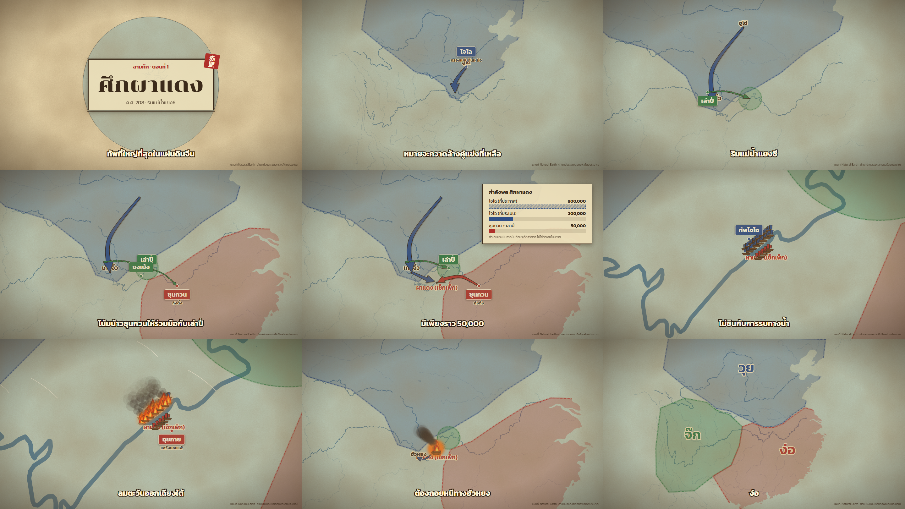

# vdomaps — ทำคลิปแผนที่เล่าเรื่องด้วยผู้ช่วย AI

Agent Skill + โปรเจกต์ Remotion สำหรับทำคลิปแผนที่เล่าเรื่อง ที่**วาดด้วยโค้ดทุกเฟรม** จากข้อมูลแผนที่เปิด
(ไม่ใช้ภาพจาก AI สร้างรูป ไม่ใช้แผนที่ที่มีลิขสิทธิ์) ทำได้ทั้งคลิปยาว 16:9 และ Shorts / Reels 9:16 จากโค้ดชุดเดียวกัน



## มีอะไรบ้าง

| โฟลเดอร์ | เนื้อหา |
|---|---|
| [`skills/map-studio/`](skills/map-studio) | ตัว skill: `SKILL.md` (กฎ + ขั้นตอน), `references/` (workflow, 32 สไตล์, แหล่งข้อมูล + สัญญาอนุญาต, เทคนิค Remotion, จังหวะเล่าเรื่อง, เสียง) และ `template/` โปรเจกต์ Remotion พร้อมคอมโพเนนต์ |
| [`episodes/redcliffs/`](episodes/redcliffs) | ตอนตัวอย่าง "สามก๊ก ตอนที่ 1: ศึกผาแดง" ยาว 1 นาที สไตล์แผนที่กระดาษโบราณ พากย์ด้วย Gemini TTS |
| [`docs/PROCESS.md`](docs/PROCESS.md) | กระบวนการทำทั้งหมด ตั้งแต่ตั้งเครื่องจนเรนเดอร์ และบทเรียนที่เจอระหว่างทำ |

## ติดตั้ง skill

- **Claude Code:** คัดลอก `skills/map-studio` ไปไว้ที่ `~/.claude/skills/map-studio` แล้วสั่งได้เลย เช่น
  "ทำคลิปแผนที่ 60 วินาที ทำไมกรุงเทพฯ น้ำท่วมง่าย"
- **Codex / Cursor:** เปิดโฟลเดอร์นี้เป็นโปรเจกต์ agent จะอ่าน `AGENTS.md`

## ลองเรนเดอร์

```bash
cp -r skills/map-studio/template my-channel && cd my-channel
npm install
npx remotion studio                         # เปิดดูและปรับแบบสด
npx remotion render MapTest out/test.mp4    # คลิปทดสอบ 9 วินาที
```

บน Windows ให้วางโปรเจกต์ไว้ใน path สั้น ๆ เช่น `C:\maps\my-channel` (path ยาวทำให้ npm และ Remotion ทำงานผิดพลาด)

## API key

ห้ามใส่ key ลงในไฟล์ใด ๆ ใน repo สคริปต์ทุกตัวอ่าน key จากตัวแปรแวดล้อม:

```bash
GEMINI_API_KEY=xxxx npm run tts -- redcliffs
```

`.gitignore` กันไฟล์ `.env*` ไว้แล้ว

## เครดิตข้อมูล

แผนที่โลกและแม่น้ำ: [Natural Earth](https://www.naturalearthdata.com/) (public domain) · ขอบเขตจังหวัด:
geoBoundaries / © OpenStreetMap contributors (ODbL) · รายละเอียดสัญญาอนุญาตของทุกแหล่งอยู่ใน
[`data-sources.md`](skills/map-studio/references/data-sources.md)
