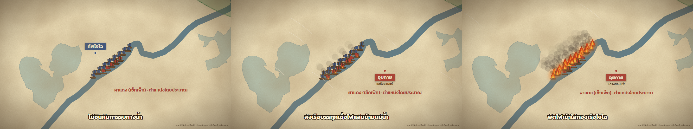

# สามก๊ก ตอนที่ 1: ศึกผาแดง (ตัวอย่าง 1 นาที)

สไตล์ S13 แผนที่กระดาษนักสำรวจ ปรับโทนให้เข้ากับสามก๊ก (วุย = น้ำเงิน, จ๊ก = เขียว, ง่อ = แดง)



| ไฟล์ | เนื้อหา |
|---|---|
| `beats.json` | บท 9 ช่วง (`text` สำหรับ TTS, `caption` สำหรับขึ้นจอ) |
| `timing.json` | ความยาวเสียงแต่ละช่วง (สร้างโดย `tts-gemini.mjs`) |
| `geo.ts` | พิกัดเมือง กรอบกล้อง และเขตอิทธิพลโดยประมาณปี 208 และราวปี 222 |
| `Parchment.tsx` | ธีมกระดาษ แผนที่ แม่น้ำ ป้ายผู้นำแต่ละฝ่าย |
| `Fleet.tsx` | กองเรือโจโฉที่ล่ามกัน เรือไฟของอุยกาย เปลวไฟ ควัน ลม |
| `RedCliffs.tsx` | ไทม์ไลน์ทั้งตอน กล้อง ชื่อเรื่อง กราฟกำลังพล คำบรรยาย |
| `china-water.json` | แม่น้ำและทะเลสาบ Natural Earth 1:10m เฉพาะกรอบประเทศจีน |

## เรนเดอร์เอง

```bash
cp -r skills/map-studio/template my-channel && cd my-channel && npm install
cp -r ../episodes/redcliffs src/episodes/redcliffs
GEMINI_API_KEY=xxxx npm run tts -- redcliffs        # สร้างเสียงพากย์ (ไม่ได้เก็บไฟล์เสียงไว้ใน repo)
```

เพิ่ม composition ใน `src/Root.tsx`:

```tsx
import { FPS, RedCliffs, TOTAL_FRAMES } from "./episodes/redcliffs/RedCliffs";
<Composition id="RedCliffs" component={RedCliffs} durationInFrames={TOTAL_FRAMES} fps={FPS} width={1920} height={1080} />
<Composition id="RedCliffsVertical" component={RedCliffs} durationInFrames={TOTAL_FRAMES} fps={FPS} width={1080} height={1920} />
```

แล้ว `npx remotion render RedCliffs out/redcliffs.mp4`

เสียงที่สร้างใหม่อาจยาวต่างจาก `timing.json` เดิมเล็กน้อย ฉากจะปรับเวลาตามเสียงใหม่เอง
