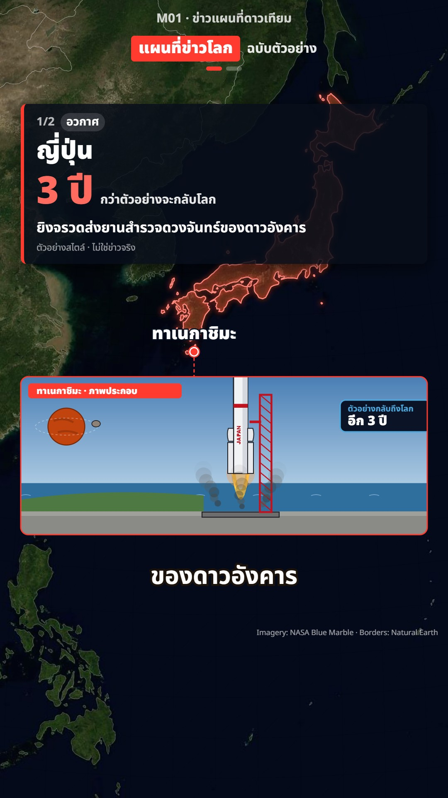

# M01 ข่าวแผนที่ดาวเทียม · Satellite News Map



**Fits:** world news round-ups, current events, "N stories in 90 seconds", any story that jumps between countries ·
**Formats:** 9:16 / 16:9 · **Code:** `Demo.tsx` + `kit/News.tsx` (plus template `InsetPanel`, `PointLabel`, `Caption`, `Props`, `Figures`)

## Look

A TV-news map on real satellite imagery. A NASA Blue Marble globe floats on a deep navy radial background with
faint white country borders; the camera flies country to country. The country in the story gets a red wash, a
blurred red glow and a crisp salmon outline. A dark translucent news card with a red left bar slides in at the top
(story n/N, category chip, country, a huge red stat, headline, sources line). A pulsing red pin names the place and
a dashed red leader line drops from it to a rounded illustration panel ("<place> · ภาพประกอบ") with a cartoon scene
in flat two-tone colours and dark outlines. Word-timed white captions with a dark outline sit low.

| Role | Hex |
|---|---|
| Background (radial, centre → edge) | `#0b1830` → `#02060d` |
| Accent red (bar, badge, wash, pins, panel frame) | `#ff3b30` |
| Big stat / glow outline | `#ff6b5f` / `#ff8a80` |
| Card | `rgba(8,14,26,0.86)` (≈ `#080e1a`) |
| Text | `#ffffff` (outline `#06101f`) |

**Type:** Noto Sans Thai (template `style.font`) 700/900 — edition badge 38 px, card country 60 px, stat 92 px, headline
34 px, sources 22 px, pin labels 46 × 0.9 px, hook title 110 px, at 1080 wide. **Line:** country borders 0.9 px
white at 30 %; highlight outline 2.5 px over a 9 px blurred glow; panel frame 3 px red; leader line 3 px dashed 8/6.

## Motion signature

- Camera per story: hold → pull back to whole-globe size at the great-circle midpoint (20 frames, ease in-out) →
  push in on the country (24 frames, ease-out cubic) → slow 6 % creep until the next story. Hook: the globe spins.
- Card slides in from the left on a spring (damping 14) 18 frames after the story starts; the stat pops 6 frames
  later with a back-ease (scale 0.6 → 1). Everything fades out in the last 8 frames of the story.
- Country wash fades in over 14 frames as the camera lands; the pin pops on the landing frame (spring) and its ring
  pulses every 36 frames; the panel pops up 30 px with the dashed line.
- Sound: `SFX.whoosh` 10 frames before each fly, `SFX.pop` on the pin, `SFX.swell` on the hook; story events use
  house-library `<Hit>` (launch rumble) and a quiet `<Bed>` (crowd).

## Scenes in the kit (`kit/News.tsx`)

| Component | Shows | Props |
|---|---|---|
| `newsCam` | Camera keys: hook spin + fly-to per story (phones lift the place above the panel) | `stories, width, height, [lon0, lat0, lon1, lat1]` |
| `Borders` | Faint white country borders (Natural Earth 50 m) | — |
| `Highlight` | Red wash + glow + outline of one country | `id` (ISO numeric), `opacity` |
| `TopBar` | Edition badge, date, one progress pill per story | `title, date, stories` |
| `StoryCard` | Dark news card with n/N, tag, country, big stat, headline, sources | `story, index, count` |
| `HookTitle` | Big hook title over the spinning globe | `title, sub, from, to` |
| `MapCredit` | Small imagery/borders credit | `text` |
| template `InsetPanel` | Illustration panel on a dashed leader line, label "… · ภาพประกอบ" | `id, anchor, label, start, end, sky, font` |
| template `PointLabel` | Pulsing pin with outlined name | `at, text, start, color, size` |

`Story` = `{ id, country, name, tag, stat, statLabel, headline, sources, focus, zoom, start, end }`. Illustration
scenes come from the template: `Props.tsx` (rockets, drones, aid trucks, ballot boxes, vote bars, city skylines,
info chips) and `Figures.tsx` (people, protesters, police, fire, smoke).

## Build notes

One `MapFrame` (orthographic globe) holds imagery, borders, highlights, pins and panels; cards, top bar and
captions are HTML on top. A story = `{start, end}`; consecutive stories share a frame (`end` of one = `start` of the
next) and illustration panels inside a story overlap by 14 frames. On 9:16 the card sits at 13 % of the height, the
panel in the 35–70 % band and captions at 70 %; on 16:9 the card is a 640 px column on the left and the panel on the
right. In an episode, cue every panel and chip on a spoken word (`wordFrame(beat, "คำ")`) and show a new picture
every 3–4 s. The Blue Marble world raster is 8192 px wide — fine for zoom ≤ ~7; closer views need a regional crop.

## Data

Not shipped — run once in the project:

```bash
npm run imagery -- bluemarble world     # public/raster/world.jpg + .json (8192 × 4096)
npm run sfx                              # template UI sounds
npm run sfx-lib                          # house library (thunder_rumble, city_crowd)
```

Country borders come with the template (`world-atlas` countries-50m).

## Don'ts

- Never the word "สด" (live) and never draw injured people or bodies — give numbers in an info chip instead.
- Every illustration panel carries "ภาพประกอบ"; approximate places say "(โดยประมาณ)".
- No more than one highlighted country at a time (two only for a joint story); no other colours for the wash.
- Do not use a flat vector map — the satellite globe is the look.
- Numbers on the card come from at least two sources; the sources line stays on the card.

## Credits

Imagery: NASA Blue Marble (NASA Earth Observatory) · Borders: Natural Earth (public domain) — in the video
description and the small on-screen credit. Illustrations are drawn in code. Sound: template UI sounds and house
library effects (Mixkit / Pixabay licences, no attribution needed). Font: Noto Sans Thai (SIL Open Font License).
