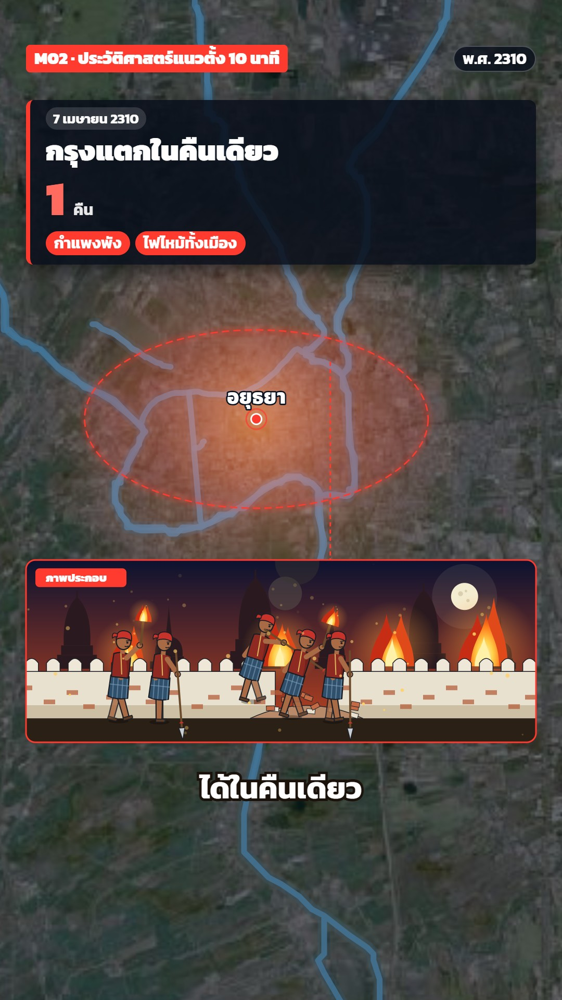

# M02 ประวัติศาสตร์แนวตั้ง 10 นาที · Long-form History, Vertical News Look



**Fits:** wars, sieges, the fall of a city, any 8–12 minute history episode told on one map ·
**Formats:** 9:16 · **Code:** `Demo.tsx` + `kit/News.tsx`, `kit/Period.tsx`, `kit/th-rivers.mjs`

## Look

A whole episode on one real map: NASA imagery (Blue Marble far out, 30 m HLS close in) with the OSM rivers drawn
as thin glowing blue lines, lit up gold when the story names them. One dark, slightly transparent head card sits
near the top for every shot — a pill tag, a heavy headline and often one huge number — and swaps its text with a
small spring. Low on the screen an illustration panel ("ภาพประกอบ") with its own sky gradient shows the moment in
flat two-tone figures and buildings, tied to its place on the map by a dashed leader line. At night the imagery is
graded dark blue and the city burns as a red-orange glow inside a dashed red ring. Captions in white with a dark
stroke sit just under the panel.

| Role | Hex |
|---|---|
| Background / night grade | `#02060d` / `#06112b` (50 %) |
| Card | `#080e1a` at 86 % (`rgba(8,14,26,0.86)`) |
| Rivers (line / glow / lit) | `#7fd4ff` / `#4fc3ff` / `#fff3a6` + `#ffd84a` shadow |
| Accent (badge, threat, fire ring) | `#ff3b30`; stat on red cards `#ff6b5f` |
| Second accents (good side, water) | `#ffc94a` gold, `#4fa3ff` blue |
| Text / caption stroke | `#ffffff` / `#1b130b` |

**Type:** Kanit 700/900 at 1080 wide — headline 54 px 900, stat 92 px 900, tag 26 px 700, top badge 32 px 900,
chapter 30 px, captions 58 px 700 with a 10 px stroke. **Line:** rivers 2.5–16 px (grow with zoom) with a 2.2×
glow at 16 %; leader line 3 px dashed 8/6; panel border 3 px in the accent; figures with a 1.5 px `#1b1d24` outline.

## Motion signature

- One continuous camera on the globe (`camAt` keys, ease in-out cubic): wide → plain → city; high-res tiles fade in
  only when they fill the screen (`tileOpacity`), so no tile edge ever shows.
- A new picture every 3–4 s on the spoken word: head-card text swaps (spring, damping 16), panels pop in with
  `usePopIn` and overlap the next panel by 14 frames, chips spring in one by one.
- Rivers light up gold for the sentence that names them, then fade back.
- Night falls over 30 frames: dark grade + flickering fire glow (`NightGrade`), then the dashed `CityRing` turns red.
- Counters run up in the head card (`stat` as a function of the frame).

## Scenes in the kit

| Component | Shows | Props |
|---|---|---|
| `TopBar` | Red badge, chapter name, year chip | `badge, chapter?, year` |
| `HeadCard` | The one card per shot, swaps on each `Head.f` | `heads: Head[], from, to` |
| `Panel` | Illustration panel + leader line ("ภาพประกอบ") | `id, anchor, start, end, sky, accent` |
| `Rivers` | OSM rivers with glow; `hi` lights named rivers | `hi: { name: 0–1 }` |
| `NightGrade`, `CityRing` | Night over the imagery + fire glow; dashed red ring | `k, fireAt` / `k, at, color` |
| `view`, `tileOpacity` | Camera on a bbox lifted above the panel; tile fade | `f, w, h, k, lift` |
| `Skyline` | Prangs + bell chedis, gold or burning | `g, color, burn, gold` |
| `Period.tsx` | `BurmeseSoldier`, `SiamSoldier`, `CityWall` (with breach), `Prang`, `BellChedi`, `SiegeCamp`, `RuinedPrang`, `Moon`, `Embers`, `Dust`, `Fire`, `Smoke` | `x, y, scale, phase, …` |

Layout on 9:16: top bar at 4.5 %, head card 10–27 %, map subject around 35–50 %, panel 56–74 % (350 px high),
captions at 76.5 %.

## Build notes

One `<MapFrame>` for the whole episode; chapters add camera keys, map overlays, panels and sounds by frame
(the episodes use `wf(beat, "word")` from Whisper timing; the demo uses fixed frames). Raster layers in order:
`world`, `sea`, `plainhls`, `isle`, each sharp tile with `opacity: tileOpacity(cam, w, h, bbox)`. Keep `<Rivers />`
above the raster and below the panels. Panels draw scenery from `g.ground` up and figures at `g.sc`. For a new
region, change `P`, `V`, the tiles and the river files; keep the card, panel and caption layout.

## Data

Not shipped — run once in the project (network):

```bash
npm run imagery -- bluemarble world
npm run imagery -- bluemarble sea 88 2 112 28 7500
TIME=2025-01-05 npm run imagery -- hls plainhls 100.0 13.6 101.4 15.3 4096
TIME=2025-01-20 npm run imagery -- hls isle 100.50 14.30 100.62 14.40 2000
npm run osm -- th-central 99.4 13.4 101.6 15.6 bigrivers
npm run osm -- th-ayut-island 100.50 14.30 100.64 14.42 rivers
node src/styles/M02/kit/th-rivers.mjs      # → public/data/th-plain.json, th-island.json
npm run sfx && npm run sfx-lib              # UI sounds + house library (cannon_far, fire_crackle)
```

HLS days: pick a cloud-free dry-season day (November–February in Thailand) — check the JPEG, re-fetch with another
`TIME=` if clouds show.

## Don'ts

- No photos or AI portraits in the head card or panels — panels are code-drawn and always labelled "ภาพประกอบ".
- No hard cuts between places; the camera always travels.
- No second card on screen at the same time; swap the text of the one card.
- Don't let a high-res tile show its edge — only fade it in with `tileOpacity`.
- Don't draw modern reservoirs or canals into an old story; label approximate places and routes "แนวโดยประมาณ".

## Credits

Imagery: NASA Blue Marble · NASA HLS (Sentinel-2) — "Contains modified Copernicus Sentinel data 2025".
Rivers: © OpenStreetMap contributors (ODbL). Figures and panels drawn in code. Sound: template UI sounds and the
house library (Mixkit / Pixabay licences, `npm run sfx-lib`). Font: Kanit (SIL OFL). Put credits in the
description (`npm run describe`).
