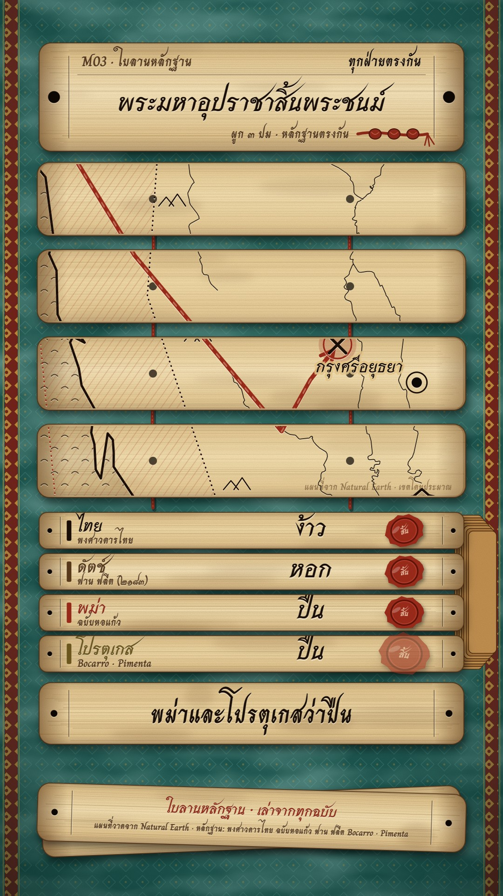

# M03 ใบลานหลักฐาน · Palm-Leaf Evidence



**Fits:** disputed events, deaths and coups, battles each side tells differently, "what really happened" long-form
Thai history (10 min) or a 60 s short · **Formats:** 9:16 · **Code:** `Demo.tsx` + `kit/Leaf.tsx`,
`kit/LeafMap.tsx`, `kit/Leaves.tsx`

## Look

A Thai palm-leaf manuscript (ใบลาน) laid out on its deep-teal silk wrapping cloth (ผ้าห่อคัมภีร์ — a woven diamond motif, a red-and-gold border band down each side) under a soft pool of light. Every card
is a pale golden palm-leaf strip — fibre striations, darker burnt edges, age stains, ruled margin lines and drilled
string holes. Text and line art are cut with a stylus and blackened with soot: dark strokes with a pale lip just
below each cut. The map is incised across a bundle of four leaves laid side by side and tied by two red cords that
show in the gaps and through the holes: the coast as a deep cut over a pale land tone, the sea as rows of small cut
waves, rivers as fine cuts, little mountain glyphs along the ranges, the Burmese extent as red-lacquer hatching
with a dotted cut edge, Siam as a dotted soot edge, the march as a red-lacquer line with a cut arrowhead, cities as
drilled holes, the battle as crossed blades cut in a ring. Each chronicle is its own thin leaf that slides out of a
pile at the right of the slot. Confidence is knots tied on a short red cord (3 = sides agree, 2 = disputed,
1 = one side only); agreement and disputes are red lacquer seals pressed onto the leaves. Captions are cut into their own long leaf, and two loose leaves at the bottom carry the credits. Years on leaves are in Thai numerals.

| Role | Hex |
|---|---|
| Silk wrapping cloth (background) · border band | `#1d5650` · `#7a1f16` + gilt `#d9a441` |
| Leaf body (pale golden straw) / light / edge | `#e0c590` / `#f6ead0` / `#c9b080` |
| Soot ink (Thai side, all cut text) | `#1a0f08` |
| Red lacquer (Burmese side, seals, cords) | `#9c2b1b` |
| Umber ink (Dutch / notes) | `#5a3a1c` |
| Caption | soot cut into its own leaf |

Other sides keep to the same earth inks: Portuguese `#6e5a1e` (olive ink); never bright UI colours.

**Type:** Srisakdi 700 (decorative Thai) for headlines (60–70 px), source names (40 px), claims (58–62 px), map
names (40–46 px) and timeline years; Charm 400/700 for kickers, tags, notes (23–32 px) and captions (54 px 700, cut into
a caption leaf) — at 1080 wide. **Line:** coast cut 5 px, rivers 1.8–6 px, march 9 px, zone edge 3 px dotted
1/9, every cut has a 1.6 px pale lip below; leaf edge 2.2 px dark brown; cords 7 px.

## Motion signature

- **Slide-stack:** cards never fade or pop — a leaf slides out of the pile at the right (16 frames, ease-out
  cubic), one leaf every 7 frames; a new head leaf slides in from the right while the old one slides out left.
- The map bundle spreads into place at the open (leaves slide together over 18 frames), then the camera eases
  between bboxes inside the bundle; one move per idea.
- A source's leaf shows "?" until the narrator names it, then the claim word is cut in with a 1.5× settle.
- Seals slam in from ×2.2 with a wood knock (`wood_hit`); knots on the confidence cord tie one by one.
- Disputed places: the accepted site is a drilled ring, the alternative a slowly turning ring of drill marks in
  red lacquer, with "(ตำแหน่งโดยประมาณ)" cut beside them; extents dim to 15 % while the close-up is on.

## Scenes in the kit

| Component | Shows | Props |
|---|---|---|
| `Table`, `Grain` (`Leaf.tsx`) | Teal silk cloth with weave motif, border bands, light pool; fine dust over all | `opacity` |
| `Leaf` | One palm-leaf strip (fibres, stains, margins, holes); children are clipped to it | `x, y, w, h, seed, holes, margins` |
| `Cut` | Incised soot text with a pale lip | `x, y, size, font, color, anchor` |
| `CordRun`, `Knots`, `Seal`, `StackEdge`, `CoverBoard` | Cord through holes; confidence knots; lacquer seal; leaf pile; optional black-lacquer cover board (ไม้ประกับ) | see code |
| `slideOut` | 0→1→0 slide factor for a leaf | `frame, start, end` |
| `fitBox`, `focusOf` (`LeafMap.tsx`) | Camera fitting a bbox into the bundle box | `f, box, k` |
| `LeafLand`, `Mountains` | Coast, sea waves, rivers; mountain glyphs | `rivers` |
| `Zones`, `March`, `Hole`, `BattleCut`, `PlaceCut` | Extents, march line, drilled city / disputed site, battle, cut name | `at, start, end, …` |
| `HeadLeaf` (`Leaves.tsx`) | Head leaf: kicker, tag, claim, knot cord (`sure`) | `heads, kicker, end` |
| `SourceLeaves` | One leaf per source: "?" → what it says; seals on agreement | `sources, checks, agree` |
| `CompareLeaves` | Two proposals on two leaves + a seal "ยังถกเถียง" | `left, right, stamp` |
| `TimelineLeaf` | When each text was written; hatched "written later" stretch | `from, to, marks, zone` |
| `Subtitle` | Captions cut into a long leaf, one phrase at a time | `lines, end` |

## Build notes

Layers, bottom to top: `Table` → cords → map leaves → `MapFrame` (clipped to the bundle) → head leaf → slot leaves →
caption leaf → credit leaves → `Grain`. Screen bands (9:16, `BAND` in `Leaves.tsx`): head leaf 4.8–16.9 %, map bundle
18.1–55.5 %, slot 57.2–75 %, caption leaf 76.5–83 %, credit leaves 88–95 %. Leaves keep a 84 px margin so the cloth shows
round them. Keep at most 4 leaves in the slot. In a full
episode alternate the slot between source leaves, compare leaves and the timeline leaf; keep one source list
(`sources.md`) and cut the source name on every claim leaf. Everything placed by hand on the map (routes, extents,
sites) is approximate — cut "(ตำแหน่งโดยประมาณ)" / "เขตโดยประมาณ" on the map. The `Grain` and `Table` filters run
every frame; for a 10-minute render still them once to a PNG and show that instead.

## Data

Land comes from `world-atlas` (in the template). Rivers are not shipped — fetch into `public/` before rendering:

```bash
npm run rivers -- nrs-rivers 94 9 106 22
npm run sfx && npm run sfx-lib        # UI sounds + war_drums, elephant, sword_clash, wind, wood_hit
```

Credits (description; small on the credit leaf): "แผนที่วาดจาก Natural Earth" (land, rivers — public domain).

## Don'ts

- No satellite imagery, no photos of real manuscripts, no AI portraits — everything is drawn leaf and cut.
- No glowing lines, rounded UI cards or bright accent colours; every colour is leaf, soot, lacquer, gilt or the teal cloth.
- Never state one chronicle's version as fact; every claim leaf names its source.
- Three knots only when independent sides agree.
- Do not draw exact borders for old kingdoms; extents stay dotted and approximate.

## Credits

Map drawn from Natural Earth land and rivers (public domain). Sound: house library `war_drums`, `elephant`,
`sword_clash`, `wind`, `wood_hit` (`npm run sfx-lib`) and template UI sounds. Fonts: Srisakdi, Charm (SIL Open Font
License). Facts in the demo follow the episode's checked list (Thai chronicles, Hmannan Yazawin, van Vliet 1640,
Bocarro/Pimenta; Don Chedi identified 1913 / Phanom Thuan proposal).
