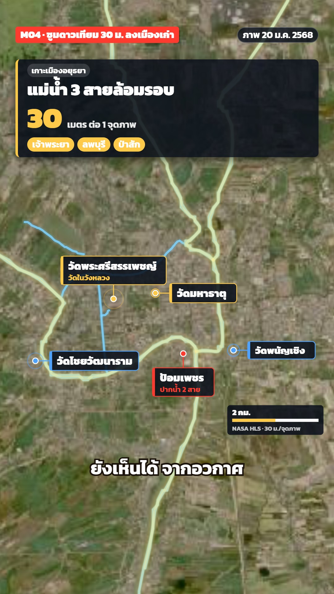

# M04 ซูมดาวเทียม 30 ม. ลงเมืองเก่า · 30 m Satellite Close-up of an Old City



**Fits:** capitals, island cities, forts, "where exactly was it" moments, the opening dive of a history video ·
**Formats:** 9:16 / 16:9 · **Code:** `Demo.tsx` + `kit/News.tsx`, `kit/Pins.tsx`, `kit/th-rivers.mjs`

## Look

One unbroken dive from space onto a real old city: Blue Marble over Southeast Asia, the 30 m NASA HLS mosaic of
the plain, then a sharp HLS tile of the city itself, where rice fields, moats and the old street grid read as
they really are. The rivers that made the city are thin glowing blue lines that light up pale gold as one set.
Temples, palaces and forts get pins: a gold dot with a pulse ring, a short stem and a dark label card with a
coloured edge and an optional sub-line. A dark head card at the top carries a live number — the width of the
screen on the ground shrinking from thousands of km to a few km — and a scale bar with the imagery source sits
bottom-right.

| Role | Hex |
|---|---|
| Background | `#02060d` |
| Card / pin labels | `#080e1a` at 86 % |
| Rivers (line / glow / lit) | `#7fd4ff` / `#4fc3ff` / `#fff3a6` |
| Pins: palace & temples / far side / forts | `#ffc94a` / `#4fa3ff` / `#ff3b30` |
| Text | `#ffffff` |

**Type:** Kanit 700/900 at 1080 — head 54 px, live stat 92 px, pin label 34 px 900 + 24 px sub, scale bar 26 /
20 px, captions 58 px. **Line:** rivers 2.5–7 px (capped so the imagery stays visible), pin stem 3 px, label edge
2.5 px + 8 px colour bar, scale bar 10 px white/gold.

## Motion signature

- Continuous zoom, scale in log space (`camAt`): ~3,300 km → ~190 km → ~9 km of screen width in about 8 s.
  Each sharper tile fades in only once it covers the whole screen.
- The live stat in the head card counts the screen width down while zooming; the scale bar picks a round length
  (50 m … 1,000 km) on every frame.
- On arrival: a dashed gold ring on the city, then the rivers light up together (16 frames) with name chips.
- Pins pop one by one, 24 frames apart, each with a pop sound; the camera keeps a slow 8 % push.

## Scenes in the kit

| Component | Shows | Props |
|---|---|---|
| `Pin` | Dot + pulse + stem + label card on a lon/lat | `at, text, sub?, start, color, side, size` |
| `ScaleBar` | Round-length scale bar + imagery note | `note, start` |
| `screenKm`, `fmtKm` | Ground width of the screen for the live stat | `scale, width` |
| `Rivers` | OSM rivers, thin glow; `hi` lights named rivers | `hi` |
| `CityRing` | Dashed glowing ring on the city | `k, at, color` |
| `HeadCard`, `TopBar` | Dark card per shot; badge + date chip | as M02 (`TopBar` takes `chip`) |
| `view`, `tileOpacity` | Camera on a bbox; tile fade | `f, w, h, k, lift` |

`P` holds approximate points on Ayutthaya island (Wat Phra Si Sanphet, Wat Mahathat, Wat Chaiwatthanaram,
Wat Phanan Choeng, Phet fortress). On 16:9 the map is shifted right (`focusX 0.63`) to clear the card.

## Build notes

Raster layers in order `world`, `sea`, `plainhls`, `isle`, the last two faded with `tileOpacity`. HLS is 30 m per
pixel: fetching a small bbox wider than its native size (e.g. 2000 px over 0.12°) only smooths it — do not zoom
past ~4 km of screen width or it turns to mush. Keep river lines thin at this range. For another city: fetch an
HLS tile of ~0.1–0.2° around it, list its places in `P`, its view in `V`.

## Data

Not shipped — run once in the project (network). The HLS layer is dated: put a cloud-free dry-season day in
`TIME=` (Thailand: November–February; look at the JPEG and re-fetch with another day if there are clouds):

```bash
# TIME=YYYY-MM-DD npm run imagery -- hls <name> <w s e n> <px>
npm run imagery -- bluemarble world
npm run imagery -- bluemarble sea 88 2 112 28 7500
TIME=2025-01-05 npm run imagery -- hls plainhls 100.0 13.6 101.4 15.3 4096
TIME=2025-01-20 npm run imagery -- hls isle 100.50 14.30 100.62 14.40 2000
npm run osm -- th-central 99.4 13.4 101.6 15.6 bigrivers
npm run osm -- th-ayut-island 100.50 14.30 100.64 14.42 rivers
node src/styles/M04/kit/th-rivers.mjs      # → public/data/th-plain.json, th-island.json
npm run sfx
```

Change the chip in `TopBar` to the day you fetched (the demo says "ภาพ 20 ม.ค. 2568").

## Don'ts

- No Google / Esri / Mapbox imagery, no screenshots of map apps — NASA GIBS layers only.
- Don't zoom past the 30 m resolution; don't sharpen or AI-upscale the tile.
- Don't cover the city with thick glowing rivers or big rings at close range — the real imagery is the star.
- Not more than ~6 pins on screen; points are approximate, say so in the description.

## Credits

Imagery: NASA Blue Marble · NASA HLS (Sentinel-2) — "Contains modified Copernicus Sentinel data 2025".
Rivers: © OpenStreetMap contributors (ODbL). Sound: template UI sounds. Font: Kanit (SIL OFL).
