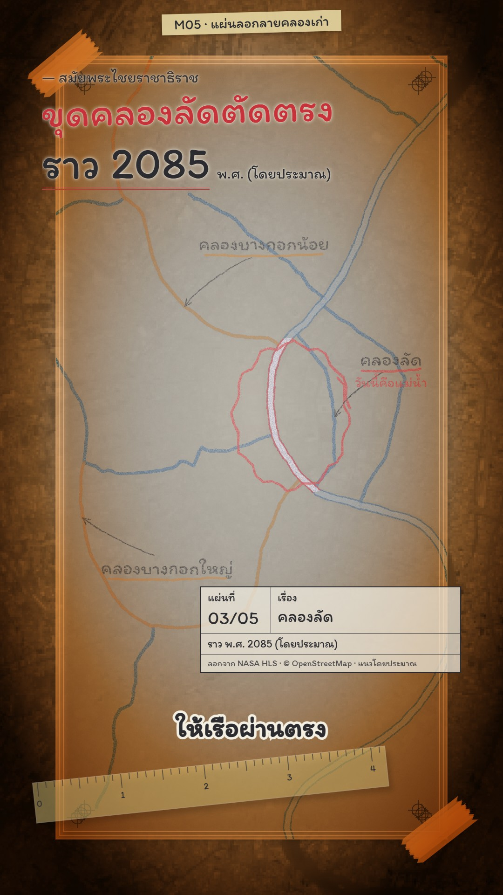

# M05 แผ่นลอกลายคลองเก่า · Light-Table Tracings



**Fits:** city history, how a river city grew, floods, trade routes by water, moats and shortcut canals, any
"layer by layer, era by era" map story · **Formats:** 9:16 / 16:9 · **Code:** `Demo.tsx` + `kit/Vellum.tsx`, `kit/canals.mjs`

## Look

An old incandescent light box in a dark room, seen from above. Today's city (NASA HLS) lies under everything as a
dim grey photo; the back-light glows warm white in the middle and burns to amber and orange towards the edges, and
the room around the box falls off to near black. Each era of the
waterways is traced in coloured pencil on its own sheet of tracing vellum: milky, cream, faintly fibrous, with a
pale edge, a soft shadow, a registration mark (circle + cross) in each corner and two strips of torn masking tape on
opposite corners. Sheets stack with a few px of offset, so their edges show and every new sheet slightly veils the
ones below (older eras fade back on their own). The pencil line wobbles and has paper grain; rivers are an outlined
channel (darker pencil edge, pale fill), canals a single line with a second lighter pass. A coloured pencil (body
in the line's colour, bare wood cone) sits on the drawing head while a line is traced. Notes are handwritten in
graphite with a hand-drawn arrow and a coloured underline; emphasis is a loose pencil ring drawn round the place.
The heading is written straight on the top sheet (small graphite tag + a big line in the era's colour, stat
double-underlined); a drafting title block (sheet n/N, subject, period, sources) sits low right. A smoky-yellow
acrylic ruler lies across the bottom. No cards, no glow, no dark UI.

| Role | Hex |
|---|---|
| Room / rim | `#2a2a2c` → black vignette |
| Back-light: centre / edge burn (multiply) | `#fff7e6` screen 30 % / `#f2902c` → `#c0560f` |
| Vellum (first sheet 60 %, each next 7 %) | `#fbf3e2` |
| Graphite (notes, title block, captions) | `#2b2b30` |
| Pencils: river / old course / shortcut / Thonburi / Rattanakosin | `#2f6fb5` / `#d9822b` / `#c8323a` / `#3c8d4a` / `#7a4fb0` |
| Masking tape / ruler | `#e6d6a2` / `#f3dd8a` at 42 % |

**Type:** Itim 400 only — head 84 px (era colour, −1.2° tilt), tag 34 px, stat 96 px with a 4 px double underline,
notes 40 px + 30 px sub, title block 24–40 px, captions 58 px graphite with a cream outline, at 1080.
**Line:** pencil — `#m05-pencil` filter (low-frequency displacement 5 px + high-frequency grain mask); canal 4.6–9 px,
river 2.2× as an edge + pale fill; arrows and rings 2.4–5 px.

## Motion signature

- Slide-stack: each sheet slides in from a different side (26 frames, ease-out cubic) with a 3–5° skew that
  settles to 0 as it lands, so the registration marks line up; the first sheet comes in at frame 8.
- Trace: after a sheet lands, its lines draw along their length (`pathLength`, 34–60 frames) with the coloured
  pencil riding the tip, then the pencil lifts away (fade 10 frames).
- Write-on: headings, notes and the title block appear by a left-to-right clip (like a hand writing), 14–22 frames;
  the pencil ring draws round with an overshoot.
- Camera nearly still: one slow push (+9 %) over the whole scene; the sheets move, the map does not.
- Sound: soft `SFX.whoosh` per sheet (paper slide), `SFX.tick` when a pencil starts, one `SFX.hit` on the shortcut
  ring, a very low `ship_sailing` bed.

## Scenes in the kit (`kit/Vellum.tsx`)

| Component | Shows | Props |
|---|---|---|
| `VellumDefs` | Pencil, vellum-grain and shadow filters (once, inside `MapFrame`) | — |
| `LightTable` | Grey sepia city photo, back-light bloom, dark rim | `layers` (default `world`, `bkkhls`) |
| `Sheet` | One vellum sheet: slide + settle, edge, shadow, reg marks, tape; children in map coords | `k, from, rot, inset, veil, tape` |
| `PencilLine` | A waterway in coloured pencil, draw-on | `f, draw, color, river, clip` |
| `Pencil`, `headOf` | Coloured pencil at the drawing head of a line | `x, y, color, s, angle, o` / `f, t, projection` |
| `Note` | Handwritten label + curved arrow + coloured underline | `text, sub, at, start, color, dx, dy` |
| `Circle` | Loose pencil ring round a place | `at, rx, ry, k, color` |
| `ClipZone` | Circular clip (radius in °) to colour one stretch of a river | `id, at, r` |
| `Glow`, `Ruler` | Back-light over the stack: warm-white centre, amber edge burn; acrylic ruler | — / `x, y, len, angle, k` |
| `HeadNote`, `TitleBlock`, `Kicker` | Written heading per shot; drafting title block; kicker on tape | `heads, to` / `n, total, subject, period, f` / `text` |
| `useCanals`, `midOf`, `PENCIL`, `view`, `V` | Load `data/old-canals.json`; tag point; pencil colours; camera on a bbox | — |
| `canals.mjs` | Builds `old-canals.json` from the OSM dump with an `era` per name | `node … [in] [out]` |

## Build notes

Inside one `MapFrame`: `VellumDefs`, `LightTable`, `ClipZone`s, then one `Sheet` per era in story order (inset grows
120 → 152 px so the edges stack and the dark room shows round the box; children are clipped to the sheet), then `Glow`, `Ruler` and the tracing pencils on top. Heading, title block and
captions are HTML. 9:16: heading at 7.5 %, title block at 65.5 % (right), captions 79 %, ruler 87.5 %. 16:9: map
pushed right (`focusX` 0.62), heading on the left, title block bottom right. Keep to about five sheets and fifteen
waterways (one filter per sheet group). For another city: fetch OSM `rivers` for a small bbox, edit `KEEP` in
`canals.mjs` (name → era), leave out canals dug after the story's period, fetch an HLS tile of the same bbox.

## Data

Not shipped — run once in the project (network). HLS: pick a cloud-free dry-season day for `TIME=`.

```bash
npm run imagery -- bluemarble world
TIME=2025-01-20 npm run imagery -- hls bkkhls 100.40 13.66 100.58 13.82 2400
npm run osm -- th-bkk 100.44 13.68 100.54 13.80 rivers
node src/styles/M05/kit/canals.mjs          # → public/data/old-canals.json (10 waterways)
npm run sfx && npm run sfx-lib               # UI sounds + house library (ship_sailing)
```

The shortcut point and the old-loop story are approximate (the canal is said to date from King Chairacha's reign,
around พ.ศ. 2085) — keep "โดยประมาณ" on screen (heading, title block) and in the description.

## Don'ts

- Don't trace every modern canal — an old-city story shows only the waterways of its period.
- One era per sheet, one colour per era; never recolour a sheet that is already down.
- No glow, neon or dark cards; no typed fonts — everything on the sheets is handwritten Itim.
- Don't let the base photo come through in colour: it stays grey, it is only the thing being traced.
- Keep the amber edge burn and the dark room: without them the sheets read as plain paper.
- Don't skew a sheet after it has landed — registered sheets are what makes the layers read as one map.

## Credits

Imagery: NASA HLS (Sentinel-2) — "Contains modified Copernicus Sentinel data 2025"; NASA Blue Marble.
Waterways: © OpenStreetMap contributors (ODbL). Everything else is drawn in code. Sound: template UI sounds and the
house library. Font: Itim (SIL OFL).
