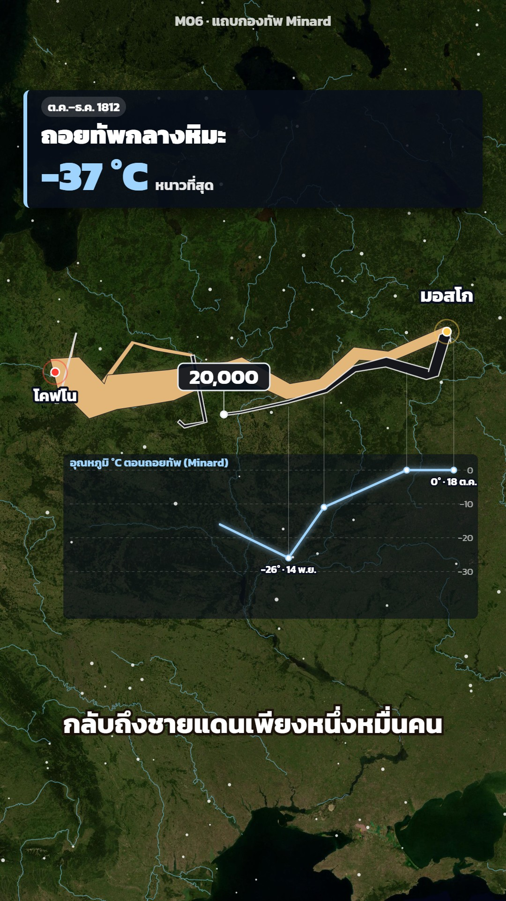

# M06 แถบกองทัพ Minard · Minard Army Band



**Fits:** campaigns, marches, retreats, migrations, any journey where the number of people changes along the way ·
**Formats:** 9:16 / 16:9 · **Code:** `Demo.tsx` + `kit/Army.tsx` + `kit/Minard.tsx` + `kit/data1812.ts`

## Look

Charles Minard's 1869 chart brought to satellite imagery. An army is a ribbon along its route whose width is the
number of men at each point: a tan band with a dark hairline edge (and a soft glow) going out, a near-black band
with a white edge coming back, side detachments as their own thinner bands. A white dot rides the head of the band
with a dark rounded counter box showing the men left right now. Under the retreat, Minard's temperature line is
drawn in ice blue on a dark translucent panel, with drop lines from the band to each reading. Cities are pulsing
pins with outlined Thai names, the target city burns with an orange glow, snow falls over the map in winter, and a
dark head card (Kanit) carries the headline and one big number. A legend chip says "ความกว้างแถบ = จำนวนทหาร".

| Role | Hex |
|---|---|
| Background · imagery | `#02060d` · NASA Blue Marble (world + Europe crop) |
| Advance band | `#e3b77a` (edge `#1b1d24`) |
| Retreat band | `#15161b` (edge `#f2f2f2`) |
| Advance counter / highlights · pins | `#ffc94a` · `#ff3b30` |
| Temperature line · retreat counter | `#9fd4ff` · `#e8edf2` |

**Type:** Kanit 700/900 — card head 54 px, number 88 px, tag 26 px, counter 44 px, pins 40 × 0.8–1 px, chart labels
20–24 px, captions 58 px, at 1080 wide. **Line:** band width = men × 1/4200 px at 1080 (422,000 men ≈ 100 px), min 1.6 px;
band edge 1.4 px (advance) / 2.6 px (retreat); temperature line 5 px with a 6 px glow; rivers 1.6–7 px cyan at 50 %.

## Motion signature

- The camera frames the whole route and barely moves (a 4 % breathe in and out); the band does the moving.
- The head of each band advances by `[frame, lon]` keys (`headAt`), so it is where the narrator is; detachments
  march at the same share of their own route. The counter rides the head and rounds to 1,000.
- Arrival: city pin pops (`SFX.pop`), the card swaps headline and number with a 14 px rise, the city burns (fire glow
  + darker grade, 70 frames).
- Retreat: black band crawls back, the temperature line draws westward with it, snow fades in, the coldest reading
  gets a red ring and chip (−37 °C), last card lands with `SFX.hit` on the final number.
- Sound beds: marching crowd on the advance, winter wind on the retreat; `<Hit id="fire_big">` on the burning city.

## Scenes in the kit

| Component | Shows | Props |
|---|---|---|
| `ArmyBand` (`kit/Army.tsx`) | Ribbon along `[lon, lat, men]` points, cut at progress `k` | `pts, k, color, edge, perMan, glow` |
| `ArmyCounter` | Counter box riding the band head | `pts, k, color, font, dy, round` |
| `headAt`, `kAt`, `lonAt` | `[frame, lon]` keys → band progress / head longitude | `keys, pts, frame` |
| `TempChart` | Minard's temperature line under the retreat, drawn to `upto` longitude | `k, upto, top, h, hot` |
| `FireGlow` | Burning-city glow + dark grade | `at, k` |
| `MapSnow` | Snow over the map | `k, n` |
| `Pin` | Pulsing city pin with Thai name | `at, text, k, color, size, dy` |
| `Rivers` | Natural Earth rivers, named ones glow gold | `hi: { Neman: 0..1 }` |
| `HeadCard` | Dark card with tag, headline, number and the width legend | `heads, from, to, legend` |
| `view` | Camera framing a bbox, subject lifted | `feature, w, h, k, lift` |
| `kit/data1812.ts` | Minard's 1812 numbers: `ADVANCE`, `RETREAT`, `NORTH_*`, `FAR_*`, `CITY`, `TEMPS` | — |

## Build notes

For a new story, write the route as `[lon, lat, men]` points (one per known count) — the band interpolates men
between points — and key the head to the narration with `[frame, lon]`. Keep `perMan` fixed for the whole video so
widths compare; pick it so the biggest force is ~100 px wide. 9:16: card at 10 %, band around 40 %, chart under the
band (`top` = the route's southern edge + 30 px), captions at 78 %. 16:9: card 560 px on the left, the map shifted
right with `MapFrame focusX={0.63}`, chart under the band, captions at the bottom. Routes are approximate — say so.

## Data

Not shipped — run once in the project (the Europe crop covers lon −12…45, lat 34…64; 4096 px is enough):

```bash
npm run imagery -- bluemarble world                         # public/raster/world.jpg
npm run imagery -- bluemarble europe -12 34 45 64 4096      # public/raster/europe.jpg
npm run rivers -- eu-rivers -12 34 45 64                    # public/data/eu-rivers.json
npm run sfx && npm run sfx-lib                              # UI sounds + house library (army_march_crowd, fire_big, wind_storm)
```

The 1812 numbers are in `kit/data1812.ts` (from Minard's chart via the HistData R package).

## Don'ts

- Don't scale the band with the zoom — width is screen-constant so it always means the same number of men.
- Don't use colours other than tan (out) and black (back) for the main army; other forces get their own colour.
- Don't show two counters at once; hide the riding counter where the card shows a different total.
- Don't present Minard's routes or counts as exact: he simplified both. Say "ตามแผนภาพของ Minard".

## Credits

Data: Charles Joseph Minard (1869), via the HistData R package (M. Friendly; Minard.troops / cities / temp).
Imagery: NASA Blue Marble · Rivers & lakes: Natural Earth — in the video description. Sound: template UI sounds and
house library (Mixkit / Pixabay licences, no attribution needed). Font: Kanit (SIL Open Font License).
