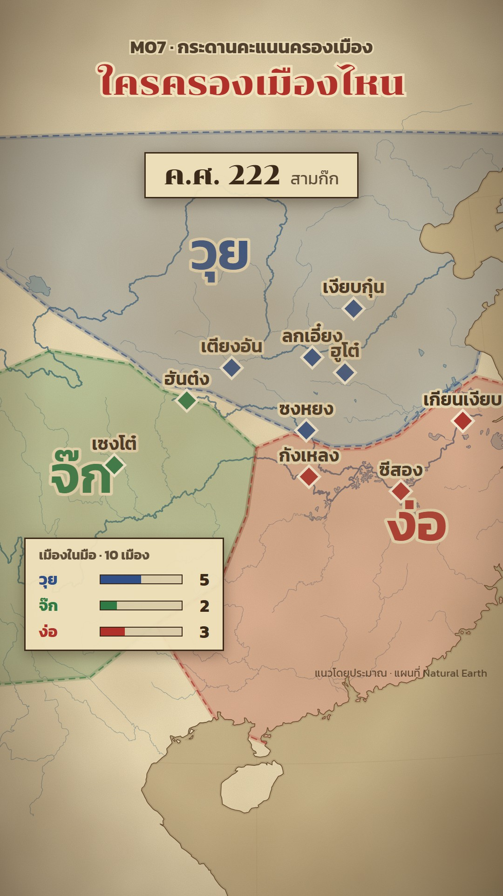

# M07 กระดานคะแนนครองเมือง · City Scoreboard



**Fits:** warring states, civil wars, any story where "who holds what" changes several times (Three Kingdoms,
Warring States, Wars of the Roses, Ayutthaya vs Burma city by city) · **Formats:** 9:16 / 16:9 ·
**Code:** `Demo.tsx` + `kit/Parchment.tsx`, `kit/Scoreboard.tsx`, `kit/eras.ts`, `kit/places.ts`

## Look

An old parchment map — paper-tan sea, cream land, a soft ink coastline, thin blue-grey rivers (the big ones as a
wider band) — under a grain-and-blotch paper texture with a brown vignette. Each side's area of control is a
translucent wash in its colour with a soft glow edge and a dashed border, clipped to the coast; its name sits on
the area in big Chonburi letters in the same colour. Cities are ink-outlined diamonds filled with the holder's
colour. The scoreboard is the point: at each new moment the areas cross-fade, captured cities flip colour with
a pop and a ring, a year chip at the top changes, and a paper tally card recounts how many cities each side holds.

| Role | Hex |
|---|---|
| Background (paper / sea) | `#e6d4aa` / `#c9b68c` |
| Land | `#efe1bb` |
| Ink (coast, text, card borders) | `#3b2a1a` (coast `#5b4026`) |
| Rivers / lakes | `#4d7488` / `#b7c4b1` |
| Sides | `#2f4f86` blue · `#2f7a45` green · `#b0302a` red · `#9a7b2f` gold · `#6b3f6e` plum · `#7a5230` brown · `#4a4a52` grey |

**Type:** Chonburi 400 for titles, area names (≈75 px on 9:16) and the year (44 px × 1.3); Kanit 600/700 for
labels (city names 26 px × 1.5 on the map), cards and kicker. All map text has a paper-coloured halo
(`stroke #efe1bb`, paint-order stroke). **Line:** coast 1.6 px with a 7 px 15 % halo; area edge 3 px dashed
14/9 + 10 px 25 % glow; card border 3 px ink (all at 1080, ×1.3 on 9:16 cards).

## Motion signature

- The camera barely moves: one framing of the whole board with a +5 % slow push over the scene. Zoom to a city
  only between scoreboard moments.
- A new moment = 25-frame cross-fade of all areas; the area names pop in 10 frames later.
- Captured cities flip 8 frames after the change: diamond springs (damping 8), a ring expands and fades in
  24 frames. Cities that did not change hands stay still — the eye goes to the flips.
- The year chip and tally card spring (damping 14–15) on each change; tally bars grow to the new count.
- Sound: a whoosh 6 frames before the change, a gong (library `gong`) on the flips, war drums at the open, a
  quiet wind bed.

## Scenes in the kit

| Component | Shows | Props |
|---|---|---|
| `PaperMap` (`Parchment.tsx`) | Paper sea, land, coast, rivers + lakes; defines `clipPath#land` | `riverBoost`, `water` (JSON path) |
| `PaperTexture` | Grain, blotches, vignette over the frame (live SVG noise) | — |
| `Badge`, `InkLabel` | Leader banner pinned to a place; ink place name with halo | `at, name/text, start, end, color` |
| `EraMap` (`Scoreboard.tsx`) | Every era's areas, cross-fading along a schedule | `steps: {year, at}[]`, `start` |
| `CityMarks` | Holder-coloured city diamonds that flip at each step | `steps, cities, start` |
| `YearBadge` | "ค.ศ. year + era title" chip, top centre | `steps, start` |
| `Tally` | Paper card: cities held per side, bars + numbers | `steps, cities, title` |
| `ERAS` (`eras.ts`), `CITIES` (`places.ts`) | The data: sides (name, colour, area ring, label point) per year; cities with holder per year | — |

For a new story, write new `ERAS` (one entry per moment, areas drawn as rough `[lon, lat]` rings) and `CITIES`
(`held: { year: sideKey }`), then pass a `steps` schedule. Keep 2–4 sides per moment and 6–12 cities.

## Build notes

One `<MapFrame>` (orthographic camera from `components/camera.ts`), layers in this order: `PaperMap` → `EraMap` →
`CityMarks` / `Badge`, then `PaperTexture` above the map and the HTML cards above that. 9:16 cards are 1.3× and
map text 1.5×. `PaperTexture` runs full-frame `feTurbulence` every frame: fine for stills and short clips; for a
long video still it once (`npx remotion still` of a composition that renders only `PaperTexture`) to
`public/paper-9x16.png` / `paper-16x9.png` and show the PNG with `` instead.

## Data

Land comes from the `world-atlas` npm package (already in the template). Rivers and lakes are not shipped — fetch
them once in the project (≈350 KB):

```bash
npm run rivers -- china-water 97 20 125 43        # → public/data/china-water.json (Natural Earth 1:10m)
```

For another region use the same command with its bbox (`<name> <west> <south> <east> <north>`) and pass
`water="data/<name>.json"` to `PaperMap`; add that region's big river names to `MAIN` in `Parchment.tsx`.

## Don'ts

- No satellite imagery or hillshade — the board must stay flat paper.
- Never show areas as exact borders: always "แนวโดยประมาณ" on screen and in the description.
- Do not change a side's colour mid-video; viewers learn them in the first 10 seconds.
- Do not flip more than ~5 cities at once — the flips stop reading.
- No camera moves during a cross-fade.

## Credits

Map: Natural Earth land (via `world-atlas`) and Natural Earth 1:10m rivers & lakes — public domain; credit line
"แผนที่ Natural Earth" (description, optionally small on screen) + "เขตแดนโดยประมาณ". Sound: template `SFX.swell`,
`SFX.whoosh`; house library `war_drums`, `gong`, `wind` (`npm run sfx-lib`). Fonts: Chonburi, Kanit (SIL Open Font
License).
