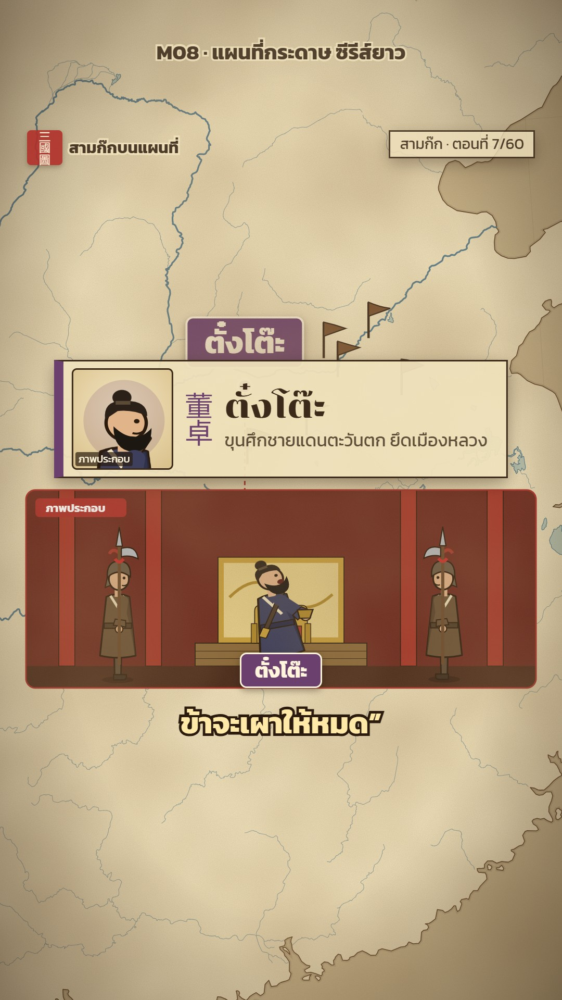

# M08 แผนที่กระดาษ ซีรีส์ยาว · Parchment Map Series Kit



**Fits:** classic epics told as a long series — 60 episodes × ~1 min on Reels, joined into 8–12 min acts on
YouTube (Sam Kok, Khun Chang Khun Phaen, Journey to the West, Phra Aphai Mani) · **Formats:** 9:16 (Reels, with
badge + next card) / 16:9 (long cut) · **Code:** `Demo.tsx` + `kit/Frame.tsx`, `Cards.tsx`, `Shots.tsx`,
`Tableau.tsx`, `Scenes.tsx`, `Marks.tsx`, `Parchment.tsx`, `cast.ts`

## Look

The same old parchment map as M07 (paper-tan sea, cream land, ink coast, blue-grey rivers, grain and brown
vignette), but dressed as one episode of a series. Every episode carries the same frame: a red square seal with
the page name top-left, a paper chip "สามก๊ก · ตอนที่ 7/60" top-right, paper cards with a 3 px ink border and soft
drop shadow, cream subtitles with a dark-brown outline, and a coloured speaker name tag above the subtitle when a
character talks (their line in quotes, in pale yellow). Faction-coloured leader banners pin to cities; small
pennants pop up at camps. Below the map sits a rounded illustration panel ("ภาพประกอบ") — flat sepia-outlined
Han figures in muted robes on simple backdrops (throne room, camp, city gate) — replaced every 3–4 s. A red
"ในนิยาย" stamp slams in for the novel-vs-record twist, and each Reels part ends on a "ตอนที่ 8/60 ▶" card that
asks the next episode's hook question.

| Role | Hex |
|---|---|
| Background (paper / sea / land) | `#e6d4aa` / `#c9b68c` / `#efe1bb` |
| Ink (text, card border) | `#3b2a1a` (figure outline `#2a1b0e`) |
| Card fill | `rgba(239,225,187,0.94)` |
| Accent (seal, stamp, hook line) | `#b0302a` |
| Subtitles | `#fff6dd` narrator · `#ffe9a8` character, outline `#2a1b0e` |
| Factions | `#2f4f86` · `#2f7a45` · `#b0302a` · `#6b3f6e` · `#7a5230` · `#9a7b2f` |

**Type:** Chonburi 400 for hook titles (60 px × 1.3 on 9:16, 80 px on 16:9), names on cards (48 px) and the next
card; Kanit 400/600/700 for everything else (badges 40 px, part chip 22 px, speaker tag 30 px; × 1.3 on 9:16,
× 1.5 for map text). **Line:** card border 3 px ink, outline offset frame 2 px on the title card; figures have a
1.2–1.6 px sepia outline; panel border 3 px in the accent colour.

## Motion signature

- Hook: the strongest picture and an `SFX.hit` + drums on frame 0, the title card (episode name small, hook
  question big, second line red) fades and rises 24 px over 20 frames.
- Camera: one slow ease-in push from the region to the episode's city (scale ×2 in 3 s), then a near-still drift.
- A new illustration panel every 3–4 s on the cue word; the outgoing panel overlaps the next by 14 frames.
- Cards spring in (damping 13–14) and fade out over 8 frames; badges and flags pop with a spring.
- Twist: the stamp hits at 2.2× scale, springs to 1×, then parks in the top corner after 34 frames; the
  novel / record rows slide in from the left with their source line.
- End (Reels only): a 35 % dark wash and the next-episode card springs in 4 frames after the last line.

## Scenes in the kit

| Component | Shows | Props |
|---|---|---|
| `SeriesFrame` (`Frame.tsx`) | Paper bg, map, texture, overlays, captions + speaker tags, brand, part badge, next card | `series, ep, lines, variant, map, overlay, sounds` |
| `SeriesMap` | `MapFrame` with the series focus (9:16 at 40 % height, 16:9 at 36 % from left) | `cam` |
| `TitleCard`, `SideCard`, `Seal` (`Cards.tsx`) | Hook title; generic paper card; red seal on a card | `kicker, lines, from, to` |
| `CharacterCard`, `Bust` | First appearance: code-drawn bust in a "ภาพประกอบ" slot, Chinese + Thai name, role | `who, from, to, role` |
| `StatCard`, `NovelStamp` | Big number; "ในนิยาย" stamp + novel/record rows with sources | `at, end, rows` |
| `Shots` (`Shots.tsx`) | A run of illustration panels, one per cue, 14-frame overlap | `items: Shot[]` |
| `Tableau`, `tab()` (`Tableau.tsx`) | A panel as data: backdrop + figures + optional caption | `bg, figs, caption` |
| `HanFigure`, `Horse`, `ThroneRoom`, `CityGate`, `DryField`, `Farmhouse`, `Bushes`, `LOOK` (`Scenes.tsx`) | Han figures (poses, hats, holds, beards), horse, sets; looks per cast key | `x, y, scale, pose, hold, flip` |
| `PaperMap`, `PaperTexture`, `Badge`, `InkLabel` (`Parchment.tsx`) | The parchment map layers and labels | — |
| `Flags`, `Tint` (`Marks.tsx`) | Pennants at places; full-frame colour wash | `items, start` |
| `CAST` (`cast.ts`) | Name, Chinese name, faction colour, role per character | — |

Backdrops: `palace`, `throne`, `night`, `field`, `camp`, `city`, `road`, `hill`, `house`, `fire`.

## Series rules the kit is built for

- Every part: hook line ≤ ~3 s → one hero with a goal → a pull-back moment at 40–50 s → novel-vs-record twist →
  end on a specific question that the next card repeats.
- 1–2 character lines per part (second TTS voice), shown with the speaker tag.
- Long cut (`variant="yt"`): no part badge, no next card, short tail, so parts join cleanly.
- A scoreboard map (style M07) opens every act.

## Build notes

Lines are scheduled by frame (`{ text, start, len, speaker }`); in a real episode take `start`/`len` from
`timing.json` and put one `<Sequence><Html5Audio/></Sequence>` per line in `sounds`. Panels: `Shots` inside
`SeriesMap`, anchored to a map point (dashed leader line). `PaperTexture` is live SVG noise (slow); for a long
render still it once to `public/paper-*.png` and use an ``. The portrait slot is a code-drawn bust — never
an AI-painted or photo portrait.

## Data

Land from `world-atlas` (already in the template). Rivers and lakes are not shipped — fetch once:

```bash
npm run rivers -- china-water 97 20 125 43        # → public/data/china-water.json (Natural Earth 1:10m)
```

Another region: same command with its bbox, then `<PaperMap water="data/<name>.json" />`.

## Don'ts

- No AI portraits, photos or painted art — figures and busts are drawn in code.
- Do not change the frame between episodes (seal, chip, card style, colours); the sameness is the series.
- No "สวัสดี" or episode-name opening and no slow map zoom as the first picture.
- Do not end on "กดติดตาม" — end on the next episode's question.
- No "โดยประมาณ" or map credits on screen in this series; they go in the description.

## Credits

Map: Natural Earth land (via `world-atlas`) and Natural Earth 1:10m rivers & lakes — public domain; description
line "แผนที่ Natural Earth · ตำแหน่งและเขตแดนโดยประมาณ". Pictures: none — everything drawn in code. Sound: template
`SFX.hit`, `SFX.pop`, `SFX.swell`; house library `war_drums`, `army_march_crowd`, `sword_draw`, `gong`,
`horse_gallop` (`npm run sfx-lib`). Fonts: Chonburi, Kanit (SIL Open Font License).
