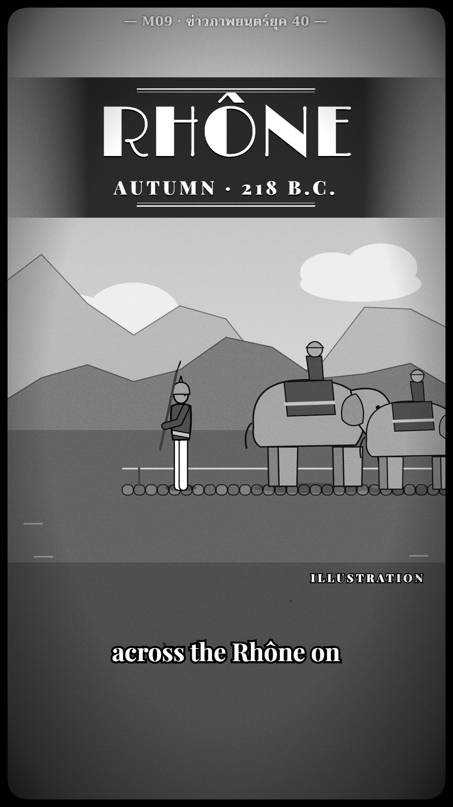

# M09 ข่าวภาพยนตร์ยุค 40 · 1940s Cinema Newsreel



**Fits:** English-language history shorts — campaigns, marches, expeditions, "how X crossed Y", anything that walks a
route through a few places and a few numbers · **Formats:** 9:16 · **Code:** `Demo.tsx` + `kit/Newsreel.tsx`, `kit/Art.tsx`
(plus template `Scene` `Ridge`/`Fighter`, `Caption`, `Raster`)

## Look

A wartime cinema newsreel. Every frame is black-and-white film: grain that changes every frame, two or three
vertical scratches that come and go, dust specks, an exposure flicker, a slight gate weave, a heavy vignette and
the rounded corners of the projector gate. The map is a b/w animated map: imagery pushed to grey with flat light-grey
land laid over it, a near-black sea, white coastlines and dashed black borders, rivers in thin white (the story's
river thickens). The route is one bold white arrow with a black outline that grows along the march. Places are white
dots in a black ring with Limelight capitals outlined in black. Numbers are "supers": a big Limelight figure and a
spaced Playfair label between double rules on a dark band. Shots are separated by full-screen art-deco title cards:
a slowly turning sunburst, stepped double-rule frame, an italic Playfair lead-in, big Limelight capitals, a spaced
sub line. Illustrations are full-frame re-enactment shots (code-drawn figures, painted clouds and ridges, graded b/w) marked
"ILLUSTRATION", with a super naming the place.
The film ends on a deco "Quiz of the week" card. English everywhere; only the kicker is Thai (Trirong).

| Role | Hex |
|---|---|
| Film black / gate / sea | `#0e0e0e` |
| Land (flat grey over imagery) | `#b9b6ae` at 62 % |
| Mid grey (shots, ridges) | `#5a5a58` |
| Arrow / coast / highlights | `#ffffff` |
| Paper white (titles, supers, captions) | `#f2efe6` |

**Type:** Limelight 400 (Latin display) — title 150 px, supers 168 px, places 46 px caps, quiz 76–82 px; Playfair
Display 700/900 — lead-ins 46 px italic, labels 44–52 px spaced 8–10 px, captions 58 px with a black outline;
kicker Trirong 700 30 px (Thai), at 1080. **Line:** bold-outline — arrow 22 px white inside 34 px black, head with
6 px outline; coast 3.2 px white; borders 1.6 px black dashed 10/7.

## Motion signature

- Gate weave + flicker on every frame (±2 px x, ±3 px y, brightness ±6 %), new grain and dust every frame,
  scratches that live 6–15 frames: the film is never still.
- Hard cuts between shots: map → deco title card (20–40 frames, sunburst turns, frame lines fade up in 14 frames)
  → shot. No wipes, no slides.
- On the map the camera reframes slowly between areas (ease in-out); the arrow grows along the route at story pace;
  supers fade in 10 frames and count up/down.
- Re-enactment shots push in 6 % over their length; figures keep their idle motion.
- Sound: `SFX.hit` on each cut (a splice thump), house beds low (`army_marching`, `wind_storm`), `elephant` hit,
  ticks + hit on the quiz reveal.

## Scenes in the kit (`kit/Newsreel.tsx`)

| Component | Shows | Props |
|---|---|---|
| `Film` | Wraps the whole frame: b/w grade, flicker, weave, grain, scratches, dust, vignette, gate | `children` |
| `BWMap` | Grey imagery + flat land, white coast, dashed borders | `layers` (default `world`, `europe`) |
| `Rivers` | Natural Earth rivers in white; `hi` thickens named rivers | `file, hi` |
| `BoldArrow` | Bold white arrow with black outline along a lon/lat route | `pts, k` |
| `Place` | White dot in a black ring + Limelight caps name | `at, text, k, size, dy` |
| `TitleCard` | Full-screen deco card: lead-in, capitals, sub | `from, to, over, title, sub` |
| `Super` | Big number + spaced label between double rules on a dark band | `from, to, value, label` |
| `Shot` | Full-frame re-enactment, marked "ILLUSTRATION" | `from, to, sky, children(g)` |
| `Quiz` | Deco quiz card with 3-2-1 and the answer boxed | `from, to, reveal, question, options, answer` |
| `Kicker`, `view` | Thai kicker; camera on a bbox | `text` / `f, width, height, k, lift` |
| `kit/Art.tsx` | Elephant, raft, water, snow, Carthaginian / Iberian costumes for `Fighter` | — |

## Build notes

Everything goes inside one `<Film>` so the grade and the damage cover maps, cards and captions alike. A story is a
row of shots `{from, to}` that never overlap; cards sit between them (hard cuts). Keep a map shot 3–4 s, a card
0.7–1.3 s, a re-enactment 2–3 s. Draw re-enactments in mid-greys with clear value contrast (the grade removes
colour, so pick fills by lightness). Captions sit at 78 %. Cue supers and places on the spoken word.

## Data

Not shipped — run once in the project (the Europe crop is ~3.6 MB at 8192 px; 4096 is enough for shorts):

```bash
npm run imagery -- bluemarble world                         # public/raster/world.jpg
npm run imagery -- bluemarble europe -12 34 45 64 4096      # public/raster/europe.jpg (lon −12…45, lat 34…64)
npm run rivers -- eu-rivers -12 34 45 64                    # public/data/eu-rivers.json
npm run sfx && npm run sfx-lib                              # UI sounds + house library (army_marching, wind_storm, elephant)
```

## Don'ts

- No colour, ever — not even an accent. No neon, no glow, no dark-UI cards.
- No Thai on screen except the kicker — titles, supers, places and captions are English.
- Numbers from ancient sources are estimates: say "approx." / "about" and name the source in the description.
- Re-enactments always say "ILLUSTRATION"; approximate routes are fine but don't draw them as surveyed lines.
- No smooth glossy moves: cuts between shots, only slow reframes inside a map shot.

## Credits

Imagery: NASA Blue Marble · Rivers & lakes: Natural Earth · Borders: Natural Earth — in the video description.
Film look and illustrations drawn in code. Sound: template UI sounds and house library (Mixkit / Pixabay licences,
no attribution needed). Fonts: Limelight, Playfair Display, Trirong (SIL Open Font License).
