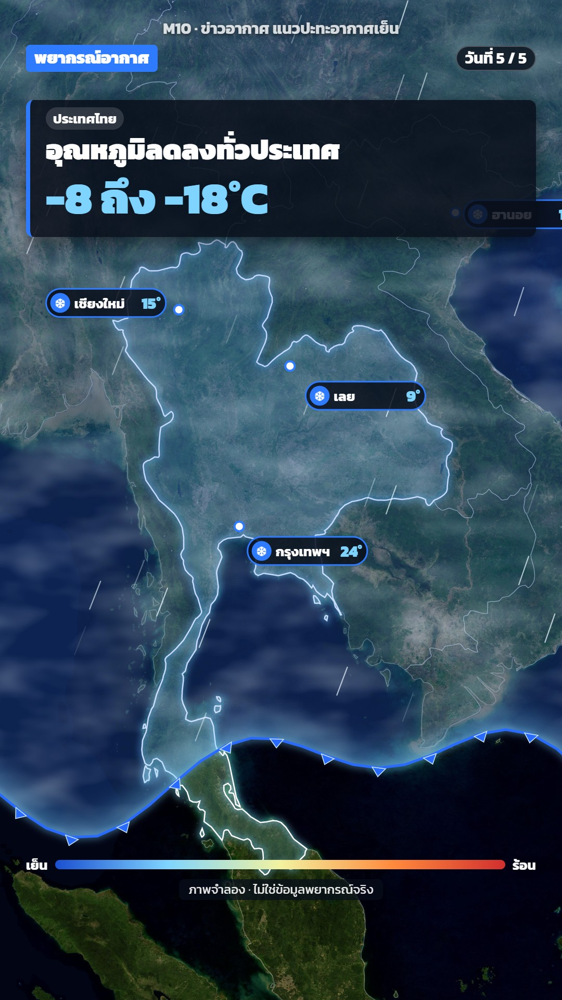

# M10 ข่าวอากาศ แนวปะทะอากาศเย็น · Weather Front News



**Fits:** weather news, cold surges, monsoon onset, heat waves, haze and storm tracks explained on a real map ·
**Formats:** 9:16 / 16:9 · **Code:** `Demo.tsx` + `kit/Weather.tsx`

## Look

A TV weather-forecast look on NASA Blue Marble imagery. A translucent blue air mass covers everything north of a
wavy cold-front line: a top-to-bottom blue gradient, drifting white cloud noise inside it, a wide soft ice-blue
glow along its edge, and a crisp blue front line with small blue triangles pointing the way it moves. Short white
wind streaks flow through the mass. A big blue "H" disc with widening dashed isobars marks the high. Cities are
white pins with dark pill chips (☀/❄ icon, name, temperature) that turn from orange to blue and count down when
the front passes. When the cold arrives the country outline glows ice blue. Dark navy news cards sit over the map:
a blue "พยากรณ์อากาศ" tab, a day counter pill, a head card with a blue left bar, a cold→hot legend bar and a
"ภาพจำลอง" tag.

| Role | Hex |
|---|---|
| Background (under imagery) | `#02060d` |
| Cold mass / front line | `#2f7bff` (fill top `#1a4fd0`, line `#2a6bff`) |
| Ice glow, cold numbers | `#7fd4ff` |
| Warm (before the front) | `#ff8a3d` (numbers `#ffb37a`) |
| Cards | `rgba(8,14,26,0.86)` (`#080e1a`) |
| Text | `#ffffff` |

**Type:** Kanit 400/700/900. Head 54 px 900, big number 84 px 900 `#7fd4ff`, tag 26 px 700, top tab 32 px 900,
chips 26/30 px, kicker 30 px — sizes at 1080 on the short side (`s = min(w,h)/1080`). **Line:** front 5 px solid
with a 14 px blurred glow and a 70 px soft inner edge; borders 1.2 px white at 35 %; isobars 2.4 px, every other
one dashed 12/8.

## Motion signature

- Slow camera: wide on the region for ~12 s, then one eased move down onto the country (`camAt`), never cuts.
- The front sweeps south with an eased curve (`Easing.bezier(0.35, 0, 0.3, 1)`), its east side leading, two slow
  sines make it ripple; cloud noise drifts SSW, wind streaks live 90 frames each.
- Pins and the "H" spring in (damping 12–14); isobars widen ×1.9 over the clip.
- Each city: the frame the front reaches it (`passAt`) starts a 45-frame count-down, chip turns orange → blue, a
  `SFX.tick` on the same frame.
- Head card swaps text with a spring slide (14 px up); the day counter steps 1 → 5.
- A big curved `Arrow` shows the flow, fades out once the mass arrives; the country glow fades in over 50 frames.

## Scenes in the kit (`kit/Weather.tsx`)

| Component | Shows | Props |
|---|---|---|
| `ColdMass` | Air mass north of the front: gradient, cloud noise, glowing edge, triangles, wind streaks | `front, lon0, lon1, wind, fadeIn` |
| `frontLat`, `passAt` | Front latitude at a lon/frame; frame the front reaches a point | `Front {from, to, lat0, lat1, tilt}` |
| `HighPressure` | "H" disc, label, widening isobars | `at, label, grow` |
| `CityTemp` | Pin + temperature chip that counts down at `pass` | `name, at, from, to, pass, show, off` |
| `Chill` | Country fill + ice glow outline | `id` (ISO numeric), `from`, `color` |
| `Borders` | Faint country borders | `ids` |
| `WeatherScreen` | Kicker, top tab, day counter, head card, legend, "ภาพจำลอง" tag | `heads, kicker, bar, days, note` |
| `view` | Camera on a bbox with the subject lifted above the cards | `f, width, height, k, lift` |

For a heat wave flip the colours (mass `#ff8a3d`/`#d12f2f`, glow `#ffd27a`), for a storm swap the mass for a
rotating spiral of the same cloud noise; keep the cards and chips.

## Build notes

`MapFrame` + `Raster layers={[{ name: "world" }, { name: "sea" }]}` (the regional `sea` raster sits on the world
one for sharper coasts). The mass is one path (front line + a line along lat 80) used as a fill and a `clipPath`;
the cloud texture is a single `feTurbulence` rect inside the clip, moved by the frame. 16:9: cards keep the left
45 %, the camera is shifted so the subject sits right (`shiftX` in `Demo.tsx`), and the mass spans a wider lon
range so its ends stay off screen. Any value that is not real data must carry "ภาพจำลอง" on screen.

## Data

Not shipped — fetch into `public/raster/` before rendering:

```bash
npm run imagery -- bluemarble world                       # whole world, 8192 px
npm run imagery -- bluemarble sea 88 2 112 28 7500         # SE Asia, sharper coasts
```

Credit (description, and small on screen): "Imagery: NASA Blue Marble" · borders "Natural Earth". For real
forecast fields use ERA5: "Contains modified Copernicus Climate Change Service information [year]".

## Don'ts

- Never present the simulated front or temperatures as a real forecast; keep the "ภาพจำลอง" tag on.
- No hard cuts or fast zooms; the weather look is slow and smooth.
- Do not cover the whole map with cards; the mass and the pins must stay readable.
- No red/orange for cold or blue for heat; the colour logic is the point of the style.

## Credits

Imagery NASA Blue Marble (not copyrighted; credit it). Borders: Natural Earth via `world-atlas` (public domain).
Sound: template UI sounds (`SFX.pop`, `SFX.tick`, `SFX.whoosh`, `SFX.riser`, `SFX.hit`, `SFX.swell`) and house
library beds `wind`, `wind_storm` (`npm run sfx-lib`). Font: Kanit (SIL Open Font License).
