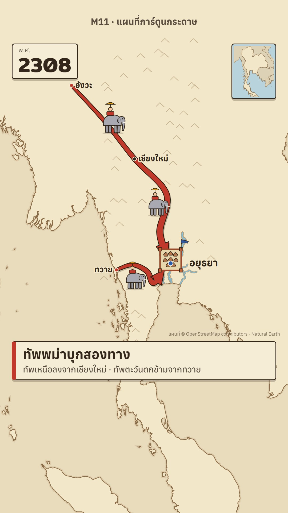

# M11 แผนที่การ์ตูนกระดาษ · Cartoon Paper Map



**Fits:** kids' history, light history shorts, school explainers, "how did they do it" stories with armies,
floods and forts · **Formats:** 9:16 · **Code:** `Demo.tsx` + `kit/` (`Map.tsx`, `Hud.tsx`, `Icons.tsx`,
`Cards.tsx`, `Diagram.tsx`, `theme.ts`, `th-rivers.mjs`)

## Look

A flat map printed on cream paper: pale land with a brown coast line, a slightly darker paper sea, little ink
chevrons for hill country, and the rivers as cartoon water — a brown bank band, a blue stream and a light centre
line, much wider than real so they read at every zoom. Everything on it is a chunky flat cartoon icon with a dark
brown 3-unit outline: forts, camps with pennants, war elephants, soldiers with spears and hoes, boats, clouds, fire.
Armies are fat tapered arrows in the side's colour. The screen furniture is paper cards with an ink border and a
hard drop shadow: a year badge top-left, a mini locator map top-right, a lower card with a coloured bar, and
centre cards for quizzes, quotes, lists and cross-section diagrams. Light, friendly, no imagery.

| Role | Hex |
|---|---|
| Paper (sea, outside) / land / hills | `#e9dcbc` / `#f2e7c9` / `#e6d6ae` (chevrons `#a48b66`) |
| Coast / river bank / water / water light | `#8a6a45` / `#b08a5c` / `#7fb0c4` / `#a9cfdc` |
| Ink (outlines, text) / card | `#33261b` / `#f6edd6` |
| Sides | Ayutthaya `#2f5aa8`, Burma `#c0392b`, Taksin `#d39a1c`, villagers `#3f8f4a`, China `#7a4b9a` |
| Fire / flood / skin | `#ff8a1f` / `#8fbfd0` / `#f1c79b` |

**Type:** Anuphan 400/500/700 for text (lower card title 50 px 700, sub 32 px, place names 30 px 700 with a land-
coloured halo), Mitr 500/600 for numbers (year 76 px). **Line:** ink outlines — cards 3 px, icons 3 units in a
100-unit box, coast 2.4 px; card shadow `0 6px 0 rgba(51,38,27,0.25)`.

## Motion signature

- Camera travels between `fitArea` views (the subject kept above the lower card), eased in-out.
- Everything pops: cards and badges spring in with a slight overshoot (`usePop`, damping 11–14), icons wobble on
  idle (`phase`), pennants wave.
- Army arrows grow along their route over ~50 frames; elephants and riders walk while they do.
- Floods spread as a wobbly translucent blob under the rivers; the year badge pulses when the year changes.
- Quiz cards: two-to-four ticked boxes, a countdown number, then a green tick.

## Scenes in the kit

| Component | Shows | Props |
|---|---|---|
| `ThMap` | Paper map: land, coast, hills, rivers (+ island waterways), night tint | `under, children, glow, island, night` |
| `Place`, `WaterLabel`, `At` | Town dot + name; river label; place any icon at lon/lat | `at, name, color, size, anchor` |
| `Flood`, `CountryTint`, `fitArea` | Flood blob; tint a country; camera fit above the card | `at, radius, k` / `id, color` |
| `YearBadge`, `Locator`, `LowerCard` | Year top-left, mini map top-right, title card low | `year, month, flash` / `cam` / `title, sub, color` |
| `QuizCard`, `QuoteCard`, `SplitCard`, `Chip`, `QuestionBadge` | Centre cards and chips | see `Hud.tsx` |
| `IconPanel`, `ListPanel`, `Stamp`, `PollCard`, `FormulaCard` | More centre cards | see `Cards.tsx` |
| `FloodDiagram`, `HighGroundDiagram`, `TunnelDiagram` | Cross-section diagrams in a centre card | `start, end, rise, y` |
| `Icons.tsx` | `Soldier`, `Elephant`, `Rider`, `Fort`, `Camp`, `Tent`, `Boat`, `Junk`, `Cannon`, `Fire`, `Smoke`, `Cloud`, `Sun`, `Stupa`, `Crown`, `RiceSack`, `RicePlant`, `Pot`, `Chain`, `Shovel`, `Firewood`, `Hourglass`, `WhiteFlag`, `scatter` | `x, y, size, phase, flip, k` |

## Build notes

One `<MapFrame>` with `<ThMap>`; put floods in `under`, icons and arrows (`Arrow` from the template) as children,
HUD outside the map. Icons are drawn in a 100-unit box with (x, y) at the ground point — size them in `s` units
(`size={80 * u}` inside `At`). Land comes from `world-atlas` land-10m (split per polygon so no ring is inverted).
For another country change the hill zones in `Map.tsx`, `NEAR` in `Hud.tsx` and the river files.

## Data

Not shipped — run once in the project (network). Land and countries come with the template (`world-atlas`).

```bash
npm run osm -- th-central 99.4 13.4 101.6 15.6 bigrivers
npm run osm -- th-ayut-island 100.50 14.30 100.64 14.42 rivers
node src/styles/M11/kit/th-rivers.mjs      # → public/data/th-plain.json, th-island.json
npm run sfx && npm run sfx-lib              # UI sounds + house library (war_drums, elephant, rain_light)
```

## Don'ts

- No satellite imagery, no gradients on icons, no realistic figures — flat cartoon only.
- Don't use it for the serious long-form channel look (it was tried and rejected there); it is for kids / light.
- No thin hairline rivers; keep the cartoon width.
- Don't crowd the map: at most ~12 icons plus one centre card at a time.

## Credits

Map: Natural Earth (via `world-atlas`, public domain) · rivers © OpenStreetMap contributors (ODbL). Icons drawn in
code. Sound: template UI sounds and the house library. Fonts: Anuphan, Mitr (SIL OFL).
