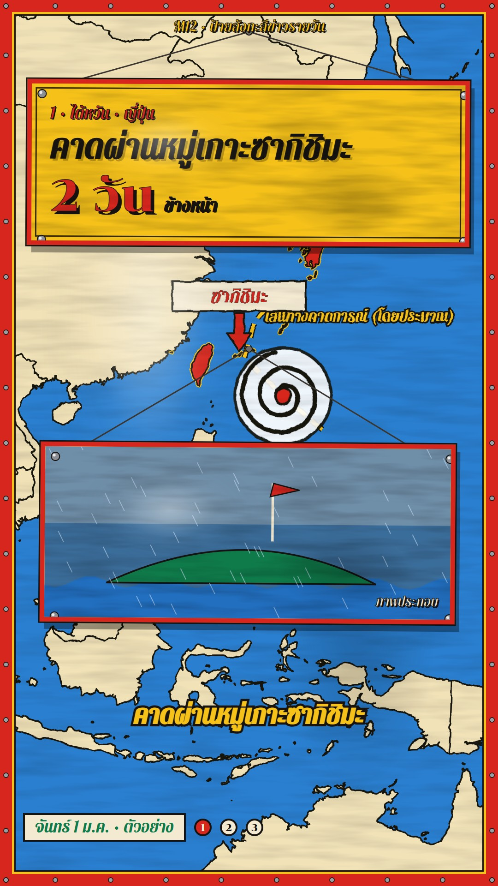

# M12 ป้ายสังกะสีข่าวรายวัน · Painted Tin-Sign Daily News



**Fits:** a daily 60–90 s world-news short (6–8 stories), weekly round-ups, any "N things today" list on a map, told
with the loud warmth of a hand-lettered Thai shop / temple-fair sign · **Formats:** 9:16 / 16:9 ·
**Code:** `Demo.tsx` + `kit/Tin.tsx` + `kit/Art.tsx`

## Look

The whole frame is one sheet of painted tin (ป้ายสังกะสีเขียนมือ): enamel paint with long horizontal brush drag, a
pale dent and a dark dent catching the light, an enamel-red border with a yellow pinstripe and a black keyline, and
rivets all the way round. The map is painted on the sheet simply: bright enamel-blue sea, cream land, a black outline
laid with a wobbly brush (displacement), a dark-green ground around the globe when the whole Earth shows, and the
story's country painted enamel red with a yellow edge. The day's stories are separate painted signs that drop in on
two wires from a nail and swing until they settle: each story its own enamel colour (yellow with red border, cream
with blue, green with yellow), a black inner keyline, four rivets, a hard drop shadow and the same enamel wear.
Lettering is sign-writer brush style (Pattaya) with a solid offset shade; the big number is Chonburi with a 7 px
shade. Under the head sign hangs a second sign with a painted illustration and "ภาพประกอบ" lettered small in its
corner. Places get a painted red arrow and a cream name plate; storm tracks are yellow brush dashes edged black and
the typhoon is a painted white disc with a black spiral. Captions are yellow brush letters with a black edge; the date
is on a cream plate with one painted disc per story. Not pop-art: no halftone, no speech bubbles, no comic outlines.

| Role | Hex |
|---|---|
| Enamel green (sheet ground) | `#0f7a4a` |
| Enamel red (border, country, pins, numbers) | `#d7261e` |
| Enamel yellow (sign, pinstripe, captions) | `#f6c21a` |
| Sea blue / land cream / plate cream | `#2a7fd0` / `#f1e2b8` / `#f4ead2` |
| Black keyline, brush outline, shade | `#161311` |

**Type:** Pattaya 400 (heads 76 px with a 5 px shade, tags 36 px, labels 40 px, plates 42 px, captions 58 px) and
Chonburi 400 for numbers (96 px, 7 px shade), at 1080. **Line:** brush — black outlines 3.4–6 px through a
displacement filter; sign keylines 3 px; wires 3 px.

## Motion signature

- Swing: every sign drops in from above in 14 frames on its wires and swings (10°, damped over ~1.5 s) until it
  hangs still; when its content is repainted (next head, next illustration) it gets a 4° jolt; it is lifted out at
  the end of the story while tilting.
- The camera flies between stories (painted globe turning in the intro and outro, push-in per story); the red country
  is painted in over 14 frames, the arrow pin pops with a back-ease and bobs.
- The typhoon spiral turns; flood paint spreads; counters count up on the sign.
- Sound: a `SFX.hit` on the frame-0 sign, `SFX.whoosh` for every sign drop (a tin swish), `SFX.tick` on repaints,
  house beds low (`wind_storm`, `rain_heavy`, `thunder_close`).

## Scenes in the kit (`kit/Tin.tsx`)

| Component | Shows | Props |
|---|---|---|
| `TinDefs` | Brush displacement filter (once, inside `MapFrame`) | — |
| `PaintedMap` | Green ground, blue globe, cream land, brushed outline, red countries | `ids, k` |
| `PaintPin` | Red painted arrow + cream name plate | `at, label, start` |
| `StormTrack`, `PaintSpiral` | Yellow/black dashed track + painted typhoon riding it | `track, from, to, trackAt, label` |
| `FloodPaint` | Painted flood blob | `at, radius, k` |
| `dailyCam` | Hook close-up → globe in the intro → per-story fly → globe at the end | `stories, width, height, hook, intro, total` |
| `Hanging`, `swingAt` | A tin sign on two wires: drop, swing, jolts, lift-out; enamel wear + rivets | `from, to, jolts, x, y, w, h, bg, edge, wire, children` |
| `SceneSign` | Painted scene inside a sign + "ภาพประกอบ" lettered | `w, h, sky, children(g)` |
| `paint` | Sign-writer lettering style (colour + offset shade + keyline) | `s, color, shade, off` |
| `Sheet`, `DatePlate`, `Kicker` | Tin sheet border, texture and rivets; date plate + story discs; kicker | — / `date, stories, from` / `text` |
| `kit/Art.tsx` | Palm, rain, waves, car, helicopter, rescue boat, hemicycle, lectern (recolour fills to enamel) | — |

## Build notes

9:16: head sign top edge at 9 % (360 px tall, 110 px wires), map centre at 42 % of the height (`focusY` 0.42) so
the place shows between the signs, illustration sign at 50 % (390 px, 210 px wires), captions at 78.5 %, date plate
5 % from the bottom. 16:9: both signs on the left (820 / 780 px wide), the place pushed right, date plate top right.
One head sign per story (heads inside the story repaint it with a jolt) and one illustration sign per story
(scenes swap on cues). Frame 0 is the "ด่วน" sign over a close-up — never open on the edition name. Paint scene fills
from the enamel palette and keep black outlines thick so they read at phone size.

## Data

Not shipped — the map is drawn from the template's Natural Earth borders (`world-atlas` countries-50m); no imagery.

```bash
npm run sfx                              # template UI sounds
npm run sfx-lib                          # house library (wind_storm, rain_heavy, thunder_close)
```

## Don'ts

- Never "สด", never injured people or bodies; casualties go on the sign with "อย่างน้อย" / "ราว" as sources say.
- Every story needs two sources; preliminary results say "ผลเบื้องต้น"; approximate places and tracks say "(โดยประมาณ)".
- No satellite imagery, no glow, no glass or dark UI cards; no halftone or comic look — it is enamel paint on tin.
- Don't move the sign slots between stories, and don't drop the date plate or story discs.
- No real shop, brand or temple names on the signs; the programme name stays generic.

## Credits

Borders: Natural Earth (public domain) — in the video description. Signs, map paint and illustrations are drawn in
code. Sound: template UI sounds and house library (Mixkit / Pixabay licences, no attribution needed). Fonts: Pattaya,
Chonburi (SIL OFL).
