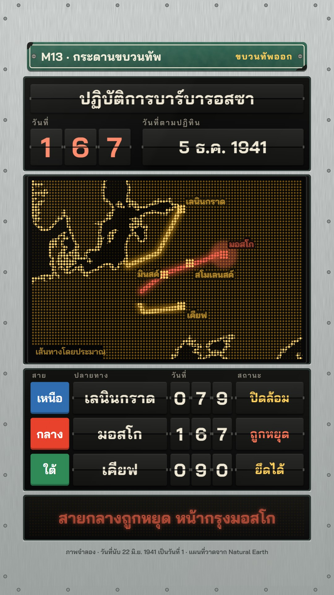

# M13 กระดานขบวนทัพ · Departure Board

**Fits:** invasions and campaigns on several routes at once, anything told with a day counter (D-day + n, a siege
that lasts n days, a race between columns) · **Formats:** 9:16 · **Code:** `Demo.tsx` + `kit/Board.tsx`

## Look

A station split-flap departure board hung in a brushed-aluminium frame. A green vitreous-enamel name plate is
bolted on top (kicker left, the board's name right in amber). Below it the board is built from separate black
modules with a bright aluminium gap and a thin highlight between them: a header module (title blade, a big day
counter of three digit blades and a calendar-date blade), the LED map module, the route rows, and an LED caption
strip. The map is an amber dot-matrix LED panel: off-dots everywhere, land lit at low power, the coast one dot
brighter, no borders (borders change; the board shows only land and routes). Each army is a route: a coloured line
badge (blue / grey / green, the halted one turns red) and three blades — destination, day count, status. Routes
light up on the LED map dot by dot with a blinking head block and a soft bloom; cities are lit 3×3 blocks with an
LED label on a black knock-out. Flap blades are charcoal with a top-to-bottom gradient, a black split, hinge pins
and a 1 px highlight; lettering on them is cream. Everything sits under a faint acrylic sheen.

| Role | Hex |
|---|---|
| Aluminium frame (background) | `#c2c7c5` (gradient `#dfe3e1` → `#a3a9a6`, brushed grain) |
| LED amber (map, LED text) | `#ffb21e` (route dots `#ffd36b`, land dots at 36 %, off-dots `#241804`) |
| Board face / blades | `#0b0b0a` / `#1b1b1a` |
| Alarm accent (halted route, its badge, its caption) | `#e8412c` (LED red `#ff6a4d`) |
| Blade lettering | `#efe8d4` |
| Enamel plate | `#2f6553` → `#1f4a3c`, cream rule `#efe8d4` |
| Route badges | north `#2f6db0`, centre `#6b7471`, south `#2e8a57` |

**Type:** Bai Jamjuree — title blade 58 px 700, day digits 98 px 700, date blade 60 px 700, destination 52 px 700,
row digits 64 px 700, status 42 px 700, column heads 24–26 px 600 letter-spaced, LED caption 54 px 700 (dot pitch
4.6 px), small LED labels 28–30 px 700 (dot pitch 3.2 px), enamel plate 40 / 30 px 700. **Line:** LED dots on a
10 px pitch (r 2.8 off, 3.3 land, 3.9 coast, 4.1 route); route mask 15 px wide; module bevels 2 px.

## Motion signature

- **Split-flap:** every change on the board is a flap: the old top half folds down over the split (rotateX with
  perspective, darkening as it turns), then the new bottom half falls into place — 5 frames per flip (3 for the
  date blade, 4 per digit). A destination first spins through 4–5 random station names before it settles; a
  status spins through "ตามกำหนด / ล่าช้า / รอสัญญาณ / ยกเลิก". Digit blades flip independently as the day count
  climbs.
- **Dot-by-dot routes:** a route's reveal is quantised to the LED pitch, so it advances one dot at a time; its head
  is a 3×3 block blinking every 6 frames. Progress is keyed to the day counter (`[lon, lat, day]` waypoints), so
  the rows, the counter and the map always agree.
- The camera never moves. The only big events are colour: a route arriving flashes its city, a halted route turns
  red on the map, on its badge and in the caption strip.
- Sound: one soft tick per flap burst, a quiet marching bed, wind and distant explosions when the board says
  "ถูกหยุด".

## Scenes in the kit

| Component | Shows | Props |
|---|---|---|
| `Casing` | Brushed aluminium frame with rivets; `bare` draws only the black modules | `modules: [y0, y1][]`, `bare` |
| `EnamelPlate` | Green enamel name plate with chips and bolts | `x, y, w, h, left, right` |
| `Blade` | One split-flap blade at flip progress `p` | `x, y, w, h, from, to, p, size, color, weight` |
| `FlapText`, `expand`, `flapAt` | A blade driven by `[frame, text, cycles]` steps (random spin-through from a pool) | `list, frame, dur` |
| `Digits` | A row of digit blades showing `value(frame)`, each flipping on change | `value, frame, n, x, y, w, h, size` |
| `useLedMap`, `landPath` | Mercator fitted to a box; land path | `box, extent` |
| `LedDefs`, `LedPanel` | Dot patterns; the LED panel (off dots, land, brighter coast) | `box, land` |
| `LedRoute` | Route lighting up dot by dot with bloom and blinking head; `red` for a halted route | `id, pts, k, frame, red` |
| `LedCity`, `LedText` | Lit 3×3 city block with label; dot-matrix text (glyphs masked over an LED field) | `at, text, flash, red` / `x, y, text, size` |
| `Sheen` | Acrylic sheen over the board | — |

## Build notes

Layout 9:16 (in board units before the 0.92 scale that shows the aluminium frame): plate 44–148, header module
168–494, LED map 512–1172 (`MAP = [64, 528, 952, 628]`), rows 1192–1616 (three rows of 112 px at 126 px pitch),
caption strip 1636–1790, credit line on the aluminium. Draw order: outer `Casing modules={[]}` → scaled container
(`bare` Casing, plate, header blades, LED map svg, rows, caption strip) → `Sheen`. Keep one LED map extent for the
whole video; drive every route from `[lon, lat, day]` waypoints and one `dayAt(frame)` table so blades and map stay
in sync. A row's day digits stop at its arrival day. Each blade is plain HTML (cheap); the LED layers are SVG
patterns + masks (no per-dot elements), so a long episode renders at normal speed. The demo is 9:16 only: the board
is a tall object; for 16:9 put the LED map left and the rows right in a new layout rather than stretching this one.

## Data

Land from `world-atlas` (Natural Earth 1:50m, in the template). No fetch needed. Sound: template `SFX.tick`,
`SFX.hit`; house library `army_marching`, `wind_storm`, `explosions_distant` (`npm run sfx && npm run sfx-lib`).

## Sources (demo)

Operation Barbarossa began on 22 June 1941 (day 1 on the board). Day numbers count 22 June as day 1: Daugavpils
26 Jun (day 5), Minsk 28 Jun (7), Lviv 30 Jun (9), Pskov and Zhytomyr 9 Jul (18), Smolensk 16 Jul (25), Leningrad
encircled when Shlisselburg fell on 8 Sep (79), Kyiv taken 19 Sep (90), Vyazma pocket 7 Oct (108), Soviet
counter-offensive before Moscow 5 Dec 1941 (167). Sources: Encyclopaedia Britannica, "Operation Barbarossa",
"Siege of Leningrad", "Battle of Moscow"; D. Glantz, *Barbarossa: Hitler's Invasion of Russia 1941* (2001).
Routes are drawn through those towns and are approximate ("เส้นทางโดยประมาณ" on screen); the day counter between
waypoints is interpolated ("ภาพจำลอง").

## Don'ts

- No real railway operator's board, typeface, logo or colours; no real station names on the plate.
- Don't add country borders to the LED map, don't colour the LED map (amber only; red only for a halted route).
- Don't animate blades with fades or slides — every change is a flap. Don't flip more than ~3 blades on one frame
  except the deliberate spin-through.
- Don't present interpolated days or routes as exact: keep "ภาพจำลอง" and "เส้นทางโดยประมาณ".

## Credits

Map drawn from Natural Earth land (public domain) via world-atlas. Sound: template UI sounds and house library
(Mixkit / Pixabay licences). Font: Bai Jamjuree (SIL Open Font License).
