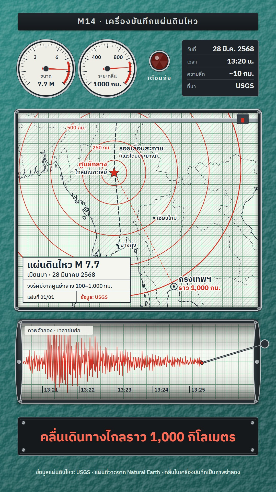

# M14 เครื่องบันทึกแผ่นดินไหว · Seismograph Recorder

**Fits:** earthquakes, floods, storms, tsunamis, heat waves — any event with a magnitude, a centre and a distance ·
**Formats:** 9:16 · **Code:** `Demo.tsx` + `kit/Recorder.tsx`

## Look

A scientific chart recorder seen face on. The casing is teal hammertone paint (hammered texture lit from the top
left) with chrome-ringed windows held by screws. Top row: a black anodised label plate (kicker), two round panel
meters (cream dials, printed scale, red zone, red needle, glass glint), a faceted red alarm jewel, and a dark data
plate with engraved rows (date, time, depth, source). The big window is a sheet of millimetre grid paper (green
1 mm / 5 mm lines) on which the map is printed in technical pen: land hatched with fine 45° lines, the coast in
1.8 px blue-black ink, borders dash-dot, upright technical lettering with a paper knock-out, an engineering title
block in an empty corner of the sea. A pen plotter works on the sheet: a grey gantry bar across the window at the
pen's height, a carriage and a red pen that draws the epicentre rings and the distance line in red. Under it, a drum
of grid paper — a horizontal cylinder with shaded top and bottom, compressed grid lines near its edges, end caps —
turns under a stylus arm that writes the seismogram in red; minute marks ride along the paper. The caption is
engraved on a black plate with screws (red when it carries the key number).

| Role | Hex |
|---|---|
| Hammertone casing (background) | `#25706b` (gradient `#2f8a84` → `#1b5552`) |
| Chart paper | `#f4f6ef` |
| Grid | major `#4f9a70`, minor `#b3d6be` |
| Plotter pen / alarm (accent) | `#d62d20` |
| Technical-pen ink (text, coast) | `#1b2735` |
| Chrome bezels | `#c9ced1` |
| Plates (kicker, data, caption) | `#15191c` → `#20262b`, lettering `#e9ecea` |

**Type:** IBM Plex Sans Thai — kicker 32 px 600 letter-spaced, data plate 20 / 27 px, dial labels 19 px 600 and
readings 26 px 700, map lettering 20–32 px 500–700, title block 38 / 24 / 19–21 px, ring labels 20 px red, caption
48–50 px 700. **Line:** coast 1.8 px, borders 1.3 px dash-dot `10 4 2 4`, fault 3 px dashed, rings 2.2 px (the
1,000 km ring 3.2 px), distance line 2.4 px dashed, grid 0.8 / 2 px, seismogram 2.4 px.

## Motion signature

- **Plotter draw:** the map prints itself top to bottom in the first 40 frames (a plotter pass); the gantry and pen
  then travel to each ring, pen down, and draw it in ~30 frames (pen up between rings, travel clamped inside the
  window). Ring labels appear when a ring closes; the distance line is drawn last and the destination is marked.
- **Drum scroll:** the drum turns continuously (2.4 px/frame), so the trace is history moving left; the stylus
  tip moves with the signal (quiet microseisms → P arrival → big S phase decaying). Minute marks scroll with it.
- **Instruments react:** the magnitude needle swings up to the value with a damped wobble on the S arrival; the
  distance meter follows the ring being drawn; the alarm jewel blinks every 8 frames until the line is drawn.
- Sound: a deep rumble on the S arrival, soft beeps with the alarm, a tick per ring, a hit when the line lands.

## Scenes in the kit

| Component | Shows | Props |
|---|---|---|
| `Casing`, `Glass`, `Plate` | Hammertone casing with chrome-ringed windows; glass reflection; engraved label plate | `windows` / `box` / `x, y, w, h` |
| `Dial` | Round panel meter with red zone and needle | `cx, cy, r, value, max, ticks, label, unit, digits` |
| `Lamp` | Faceted red alarm jewel, glows when `on` | `cx, cy, on, label` |
| `GridPaper` | Millimetre paper (optionally scrolling) | `box, minor, offsetX` |
| `usePaperMap`, `PenMap` | Mercator fitted to the window; hatched land, ink coast, dash-dot borders, top-down print | `box, extent` / `path, print` |
| `ringPath`, `pointAt`, `PenLine` | Geodesic ring of `km`; point along a path; a pen line drawn to `k` (solid or dashed) | `projection, at, km` / `pts, k` |
| `Plotter` | Gantry bar, carriage and red pen at the pen point | `box, pen, down` |
| `Lettering` | Technical lettering with a paper knock-out | `x, y, text, size, color, on` |
| `seismo`, `Drum` | Simulated seismogram; the turning drum with stylus and minute marks | `t, p, s` / `box, frame, speed, stylusX, signal, marks` |

## Build notes

9:16 boxes: plate 50–118, instruments 150–390, map window `[70, 440, 940, 760]`, drum `[84, 1262, 912, 300]`,
caption plate `[70, 1628, 940, 150]`, credit line 1850. Rings use `geoCircle` (true geodesic distance), so a
1,000 km ring really passes ~1,000 km from the centre. Keep one map extent per scene; for a flood or storm swap the
rings for a plotted track (`PenLine` along `[lon, lat]` points) and the drum signal for water level or wind speed
(pass any `signal(t)` returning −1…1). The drum draws one polyline per frame (2 px steps) — cheap. The casing's
lighting filter is static; for long episodes it can be stilled once to a PNG.

## Data

Land and borders from `world-atlas` (Natural Earth 1:50m, in the template). No fetch needed. The fault trace is
hand-placed from published maps of the Sagaing Fault and labelled "แนวโดยประมาณ". Sound: template `SFX.tick`,
`SFX.pop`, `SFX.hit`, `SFX.swell`; house library `thunder_rumble` (used as ground rumble), `wind`
(`npm run sfx && npm run sfx-lib`).

## Sources (demo)

USGS event page "M 7.7 – 2025 Mandalay, Burma (Myanmar) Earthquake": 28 March 2025, 06:20:52 UTC (13:20 Thai
time), epicentre ≈ 22.01° N, 95.92° E near Mandalay/Sagaing, depth ≈ 10 km, strike-slip rupture on the Sagaing
Fault; strong shaking was felt in Bangkok, about 1,000 km away (great-circle distance epicentre–Bangkok ≈ 1,030 km).
See also `episodes/learn/earthquake/script.md`. The seismogram, its minute marks and the needle wobble are
simulated ("ภาพจำลอง · เวลาย่นย่อ" on the drum).

## Don'ts

- No real instrument maker's casing, logo or dial face; no photo of a seismogram — the trace is drawn.
- Don't present the drum trace as a real recording; keep the "ภาพจำลอง" label on it.
- Only the plotter pen and the alarm are red. Don't colour the land; the map is ink on grid paper.
- Don't zoom or fly the camera: the instrument is fixed; the pen, drum and needles do the moving.

## Credits

Earthquake data: U.S. Geological Survey (public domain). Map drawn from Natural Earth (public domain) via
world-atlas. Sound: template UI sounds and house library (Mixkit / Pixabay licences). Font: IBM Plex Sans Thai
(SIL Open Font License).
