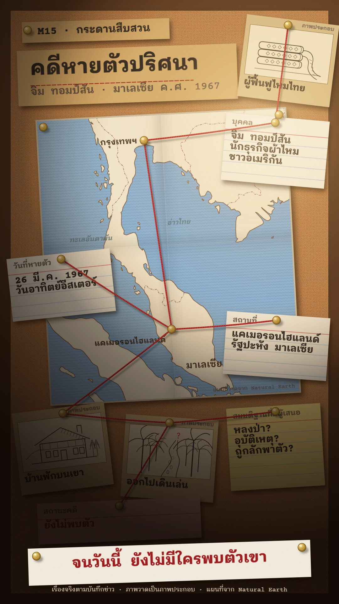

# M15 กระดานสืบสวน · Investigation Board

**Fits:** mysteries, disappearances, crimes, lost treasure, unsolved cases, "what really happened" stories ·
**Formats:** 9:16 · **Code:** `Demo.tsx` + `kit/Cork.tsx`

## Look

A cork board in a dark wooden frame, lit by a desk lamp from the upper right: a warm pool of light there, falling
off to shadow in the lower left (things pinned in the dark corner are half lost — use that for the open question).
Everything is paper, brass and wool — no photos, no sticky notes, no marker:

- a **printed folded map** pinned at two corners with brass pins, slightly rotated: blue-grey sea with offset-printed
  wave lines, cream land, brown coast, dash-dot borders, a vertical and a horizontal fold crease, typed place names;
- **typed index cards** (red head rule, blue ruling), colour-coded stock: white for facts, canary for theories,
  salmon for the case status;
- **ink-drawn evidence cards** on manila card stock: a framed pen drawing (house, path, object) with a typed title
  and a small "ภาพประกอบ";
- a **manila title card** and a manila kicker strip, a typed caption strip pinned across the bottom;
- **red wool yarn** stretched pin to pin, with a soft shadow on the cork, a dark twist pattern and a light fleck;
- **brass pins**: domed heads with a highlight and a soft shadow.

| Role | Hex |
|---|---|
| Cork (background) | `#b9773f` with dark and light granules |
| Index cards / caption paper | `#f6f1e3` (canary `#f3dc84`, salmon `#efb3a2`, manila `#d9bd88` / `#d4ac6c`) |
| Brass pins | `#c9a246` (highlight `#fbe7a1`, shade `#7a5a17`) |
| Red yarn (accent) | `#c3262b` (twist `#7d1216`) |
| Typewriter ink (text) | `#2a2420` (red ribbon `#9e1c1f`) |
| Printed map | sea `#8cb2d4`, land `#efe6cf`, coast `#6e4a2a` |

**Type:** typewriter set — Courier Prime for Latin and digits, IBM Plex Sans Thai Looped for Thai (looped monoline,
close to Thai typewriter letters); `type` in the kit is the stack. Title 68 px 700, sub 34 px, kicker 34 px 600,
card labels 24 px, card values 32 px 600, evidence titles 30 px 600, caption 48 px 700, map names 22–32 px 600.
Ink has a slight bleed (text-shadow 0.8 px) and ribbon offset. **Line:** yarn 4.6 px; map coast 1.6 px; borders
1.4 px dash-dot; evidence drawings 1–3 px pen.

## Motion signature

- **String pull:** each clue is a yarn from one pin to the next: drawn on in 22 frames with a heavy sag, then pulled
  tight over 26 frames with a little overshoot (it hums), with a tick as it snaps straight. The yarn network grows
  as the story connects things.
- **Pinning:** cards drop onto the board (40 px fall, a few degrees of rotation settling), then the pin pushes in.
- **Typing:** card values and the caption type out letter by letter (1.2–2.2 chars per frame) with soft key ticks.
- The lamp warms up with a flicker in the first second. The camera is still.
- Sound: light rain bed (a night at the office), pops for pins, ticks for yarn and keys.

## Scenes in the kit

| Component | Shows | Props |
|---|---|---|
| `CorkBoard`, `LampLight` | Cork with granules and frame; the lamp pool and shadow | — / `cx, cy, on` |
| `Pin`, `PinDefs` | Brass pin with shadow (pushes in with `k`) | `x, y, k` |
| `Yarn` | Red wool from `a` to `b`, drawn to `k`, sagging until `tight` | `a, b, k, tight, sag` |
| `Paper` | Any pinned paper: drop-in, rotation, shadow, fibre texture | `x, y, w, h, rot, k, bg` |
| `Typed` | Typewriter text, optionally typed out to `chars` | `text, size, color, chars` |
| `IndexCard` | Index card with label and typed value | `x, y, w, h, rot, k, label, value, chars, red, bg` |
| `useSheetMap`, `PrintedMap` | Mercator in the sheet's own pixels; the folded printed map | `w, h, extent` / `path` |
| `Bungalow`, `JunglePath`, `SilkBolt` | Ink drawings for evidence cards (replace per story) | `w, h` |

## Build notes

9:16: kicker 64–130, title card 150–326, map sheet `{ x: 136, y: 360, w: 800, h: 910, rot: −3 }`, cards around and
over its edges, evidence row 1290–1560, status card 1590, caption strip 1728–1846, credit 1858. Pins on the map are
placed in sheet pixels and mapped through the sheet's rotation (`onSheet`), so they sit exactly on the places. Yarn
endpoints are pins (card pins at top centre). Keep rotations within ±7° and leave cork showing between items. For a
new story, draw new evidence cards as small SVG pen drawings in the kit (objects, buildings, routes) — never photos.
The lamp is two radial gradients; the cork filters are static per frame.

## Data

Land and borders from `world-atlas` (Natural Earth 1:50m, in the template). No fetch needed. Sound: template
`SFX.pop`, `SFX.tick`; house library `rain_light` (`npm run sfx && npm run sfx-lib`).

## Sources (demo)

Jim Thompson (James H. W. Thompson, 1906–disappeared 1967), the American who revived the Thai silk industry and
founded the Thai Silk Company, went out for a walk from the cottage where he was staying in the Cameron Highlands,
Pahang, Malaysia, on 26 March 1967 (Easter Sunday) and was never found despite a large search. Sources: Encyclopaedia
Britannica, "Jim Thompson (American businessman)"; William Warren, *Jim Thompson: The Unsolved Mystery* (1998). The
theory card lists explanations that have been put forward (lost in the jungle, accident, abduction) without
endorsing any. Evidence drawings are illustrations ("ภาพประกอบ").

## Don'ts

- No photos (not even "evidence photos"), no sticky notes, no marker scribbles, no crime-scene tape, no police or
  agency insignia.
- Don't accuse real people or present a theory as fact; label theories "สมมติฐานที่มีผู้เสนอ".
- Yarn is red wool only, pin to pin; don't draw arrows. One lamp, one light direction.
- Don't make the board fully dark (it is a lamp-lit board, not a noir black frame) or fully even (no lamp).

## Credits

Map drawn from Natural Earth (public domain) via world-atlas. Sound: template UI sounds and house library
(Mixkit / Pixabay licences). Fonts: Courier Prime and IBM Plex Sans Thai Looped (SIL Open Font License).
