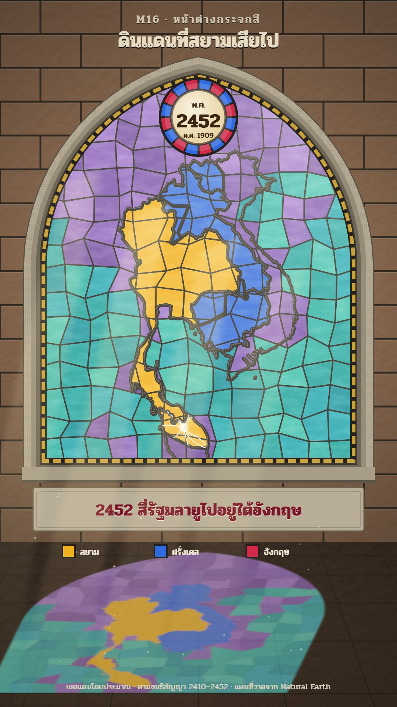

# M16 หน้าต่างกระจกสี · Stained-Glass Window

**Fits:** colonial history, lost or ceded lands, borders that change over time, empires growing and shrinking ·
**Formats:** 9:16 · **Code:** `Demo.tsx` + `kit/Glass.tsx`

## Look

The map is a lancet window (a pointed arch) set in a warm sandstone wall of ashlar blocks with deep mortar joints;
carved lettering above it (kicker and title, cut into the stone: light letters with a dark lower edge). The window
has a three-step moulded stone surround, a lead border with a band of small gold quarries, and a painted glass
roundel in the arch head holding the year (พ.ศ. large, ค.ศ. small) inside a ring of alternating ruby and cobalt
pieces. Every territory in the story is a pane of rich coloured glass — the home country amber-gold, the powers that
take land cobalt and ruby — held in dark lead came (9 px, with a thin light edge). The sea is sea-green quarry
glass and the land outside the story amethyst, both cut into a jittered grid of small panes with thinner leads. The
glass is mottled (streaks, seeds, uneven thickness) and brighter toward the upper right where the sun is. Below, a
stone sill and a carved plaque carry the caption; a legend of three glass swatches sits on the floor edge. Sunlight
streams through: faint light shafts and drifting dust, and the window's colours are thrown onto the dark flagstone
floor as a softened, skewed copy of the glass.

| Role | Hex |
|---|---|
| Sandstone wall (background) | `#9a6e4c` (floor `#3f2c1f` → `#6e4e36`) |
| Home country glass (main) | `#f2b01e` |
| First power glass (second) | `#2f6ae0` cobalt |
| Second power glass (accent) | `#d02a48` ruby |
| Lead came, text on stone | `#24211f` / `#2a241c` |
| Sea quarries | `#1fa3a0`, `#2bb3a8`, `#1993a0`, `#3cc0b0`, `#22a8b4` |
| Land outside the story | `#8a5fc0`, `#7a52b0`, `#9a70cc`, `#6f4aa4`, `#8460bc` |
| Roundel centre / grisaille paint | `#f3e6bf` / `#3a2412` |

**Type:** Pridi — carved kicker 30 px 600 letter-spaced, carved title 54 px 700, roundel 24 / 54 / 20 px, caption
46 px 700 (cobalt-dark `#1f2f5c` for France, ruby-dark `#7a1426` for Britain), legend 24 px 600, credit 22 px.
**Line:** territory leads 9 px, quarry leads 3.6 px, window border lead 34 px, cracks 2.4 px white with a 6 px glow.

## Motion signature

- **Crack and swap:** when land changes hands its pane cracks — nine jagged white rays grow from a point in 16
  frames with a white flare at the centre (masked to that pane) — then the new colour is set in over 14 frames with
  a brief white flash, and the cracks fade. The roundel's year changes on the crack frame with its own flash.
- The light breathes: the sun intensity drifts a few per cent, the shafts pulse slowly, dust drifts down through
  the light. The window never moves.
- The floor copy of the glass changes colour with the window (same panes, blurred and skewed), so the floor tells
  the story too.
- Sound: a church bell to open, a hit and a short wood-break crack per change, a tick when the new pane sets.

## Scenes in the kit

| Component | Shows | Props |
|---|---|---|
| `Wall` | Sandstone wall with ashlar joints, lighting texture, perspective flagstone floor, dim falloff | `win, floorY` |
| `Surround`, `archPath` | Moulded stone frame; pointed-arch path for any box (and inset) | `win` / `box, inset` |
| `useWindowMap` | Mercator fitted to the map box inside the window | `box, extent` |
| `useQuarries` | Jittered grid of small panes coloured sea / land | `box, projection, cell` |
| `GlassDefs` | Mottle, seed, blur filters | — |
| `PaneMasks`, `CountryClips`, `Leads` | Territory panes as masks (country ∩ `keep`, minus `drop`); clips; lead lines | `panes, path` |
| `Crack` | Spreading crack inside one pane | `at, k, size, seed, maskId` |
| `Roundel` | Painted year roundel | `cx, cy, r, top, big, bottom, flash` |
| `country`, `Pane` | Natural Earth country by ISO numeric id; pane definition | `id` |

## Build notes

9:16: carved text 30–140, window `WIN = [110, 200, 860, 1060]` (arch head 200–720), map box `[110, 412, 860, 846]`
so the roundel has the arch head to itself, sill 1268–1316, caption plaque 1324–1442, floor from 1472, legend 1480,
credit 1872. A pane is `{ country, keep?, drop? }`: a country shape, optionally cut by a hand polygon — that is how
part of a country (a province, a bank of a river) becomes its own pane. Draw the glass once for the window and once
into the floor transform (`translate skewX scale`, 3 px blur, screen blend). Colours: give the home country the
warmest glass and each other power one strong colour; keep the quarries cool so the story panes stand out. For
16:9 use a pair of lancets (two windows, before / after) rather than one stretched arch.

## Data

Country shapes from `world-atlas` (Natural Earth 1:50m countries; 1:110m land for the quarry colours), in the
template. No fetch needed. The cut lines (north-west Cambodia, Sip Song Chu Tai, Sayaboury, west-bank Champasak, the
four northern Malay states) are hand-drawn polygons in `Demo.tsx`, approximate, labelled "เขตแดนโดยประมาณ".
Sound: template `SFX.hit`, `SFX.tick`; house library `church_bell`, `wood_break`, `wind`.

## Sources (demo)

Siam's territorial concessions, as usually listed in Thai history: 1867 Franco-Siamese treaty (Siam recognised the
French protectorate over Cambodia, keeping Battambang and Siem Reap); 1888 Sip Song Chu Tai occupied by France and
joined to Tonkin; 1893 treaty after the Paknam incident (left bank of the Mekong); 1904 convention (right-bank lands:
Sayaboury and the west-bank part of Champasak, with Mlu Prey — not drawn); 1907 treaty (Battambang, Siem Reap,
Sisophon, in exchange for Trat and Dan Sai); 1909 Anglo-Siamese Treaty (Kedah, Kelantan, Terengganu, Perlis).
Sources: Encyclopaedia Britannica, "Franco-Siamese War", "Anglo-Siamese Treaty (1909)"; D. K. Wyatt, *Thailand: A
Short History* (2nd ed., 2003); Thongchai Winichakul, *Siam Mapped* (1994) — note that many of these were tributary
or overlapping-sovereignty areas, so "lost" is the Thai framing; the captions say "ไปอยู่ใต้" (came under).
Modern borders stand in for 19th-century ones, and the cut lines are approximate.

## Don'ts

- No real church's or artist's window design, no religious figures or symbols in the glass, no flags.
- Don't fill territories with flat colour without leads — every colour change needs a lead line.
- Don't show more than three story colours; outside panes stay sea-green and amethyst.
- Never present the cut lines as exact borders; keep "เขตแดนโดยประมาณ" on screen.

## Credits

Map drawn from Natural Earth (public domain) via world-atlas. Sound: template UI sounds and house library
(Mixkit / Pixabay licences). Font: Pridi (SIL Open Font License).
