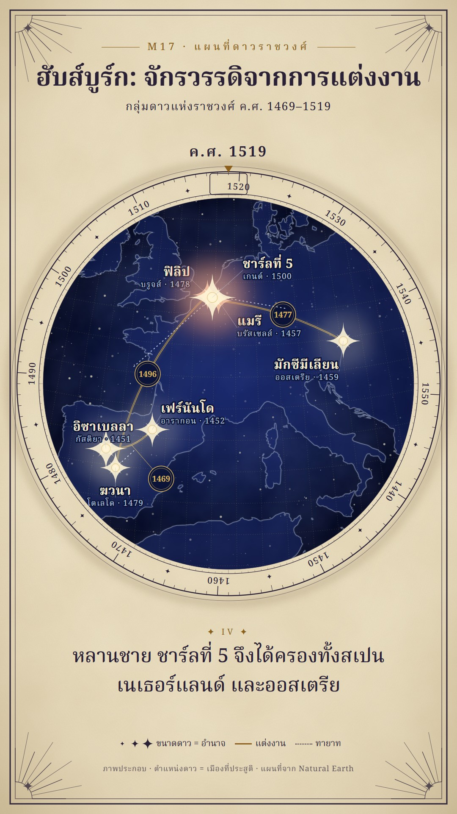

# M17 แผนที่ดาวราชวงศ์ · Dynasty Star Chart

**Fits:** royal houses, dynasties, succession, alliances by marriage, any family whose members are spread over a map ·
**Formats:** 9:16 · **Code:** `Demo.tsx` + `kit/Sky.tsx`

## Look

An antique celestial chart printed on an aged cream sheet. In the middle, a round indigo sky disc (deep at the rim,
lighter in the centre, cloudy foxing, twinkling field stars) carries the real map: land as a faint lighter indigo,
coastlines as thin silver lines with a soft halo, a fine dotted gold coordinate grid (2°). Round the disc runs a
graduated ring printed in ink on the cream paper — one tick a year, long ticks every 5 and 10, decades engraved in
the band, small four-point stars between — that is a **year dial**: it turns so the current year sits under an ochre
pointer and reading window at the top, with the year printed above it. People are **named stars** at the city they
were born in: a cream core, a gold rim, four long spikes and four short ones, a soft glow; the brighter (bigger) the
star, the more power. Marriages are double gold lines (gold with a fine indigo core) with the year in a small ringed
medallion; descent is a dotted silver line from the middle of the parents' line to the child. The brightest star
gets one warm rose halo. Outside the disc: title, catalogue-style captions (✦ I ✦ … numbering), a legend and engraved
corner spandrels of rays, inside a heavy + fine ink border.

| Role | Hex |
|---|---|
| Sky disc (background of the map) | `#0b1438` (centre `#18276a`, rim `#050920`) |
| Gold (constellation lines, grid, medallions) | `#d9b45f` |
| Silver (coast, descent, star sub-labels) | `#b9c4dc` |
| Rose accent (brightest star only) | `#e98f6f` |
| Star cores / labels in the sky | `#fff4d6` / `#f2e8cc` |
| Sheet paper / ink / ochre ink | `#ebdfc2` / `#2a2136` / `#8c5f1c` |

**Type:** Noto Serif Thai — title 60 px 700, kicker 24 px 500 letter-spaced 7 px, star names 30 px 700, star
sub-labels 19 px, dial decades 21 px, captions 46 px 500, legend 21 px, at 1080 wide. **Line:** hairlines only —
coast 1.1 px (+4 px halo at 12 %), grid 0.7 px dotted, dial ring 2.4 / 1.2 / 0.8 px, marriage 3.4 px gold with
1.1 px indigo core, descent 2 px dotted.

## Motion signature

- **Dial-turn:** the year ring rotates (eased) so each new date arrives under the pointer; the printed year above
  updates with it. Nothing else on the sheet moves.
- Stars are born faint and **brighten** (core, spikes and glow grow) as the person comes to power; all stars twinkle
  ±8 %; field stars twinkle on slow sines.
- Marriages **draw on** from one star to the other (34 frames), the year medallion appears at the end; descent lines
  run out from the parents' line to the child's star.
- The map inside the disc breathes in by ~10 % over the whole piece; the disc irises open in the first second.
- Sound: wind bed very low, soft ticks on each new star, pops on medallions, a church bell on a royal wedding, a gong
  when the brightest star peaks.

## Scenes in the kit (`kit/Sky.tsx`)

| Component | Shows | Props |
|---|---|---|
| `useChart`, `fitSquare` | Disc centre/radii for 9:16; camera fitting `[w, s, e, n]` into a square | — / `box, side, k` |
| `Sheet` | Cream sheet, foxing, indigo disc with field stars, border, spandrels | — |
| `YearDial` | Graduated year ring that turns to `year`, pointer, printed year | `year, from, to, k` |
| `ChartLand` | Land, silver coast, gold grid inside the disc (inside `<MapFrame>`) | `k` |
| `Star` | Named star at `[lon, lat]`; brightness = power | `at, b, name, sub, dx, dy, anchor, hot` |
| `Bond` | Marriage line + year medallion (optionally offset with a leader) | `a, b, k, year, bend, off` |
| `Descent` | Dotted line from parents' line to child | `from, to, k, bend` |
| `TitleBlock`, `Entry`, `Legend` | Title, catalogue caption, legend | `kicker, title, sub` / `text, start, len, no` |

## Build notes

Order: `Sheet` → `YearDial` → one `<MapFrame>` (focus = disc centre) with everything inside a circle clip of radius
`r`: `ChartLand` → `Bond`s → `Descent`s → `Star`s (stars last so lines pass under them) → HTML: title, captions,
legend, credit. Keep the dial range ~120 years (3° a year); for longer stories use `from/to` of 200–300 years.
Put labels where they do not cross lines: give each star its own `dx/dy`; cities closer than ~0.5° need leader lines.
Captions take `\n` for the line break (the font has no Thai word breaking in Remotion).

## Data

Land from `world-atlas` (`land-50m`, in the template) — no fetch. People's birthplaces are typed in `Demo.tsx`.

## Sources for the demo

Encyclopaedia Britannica biographies: Isabella I (b. 1451, Madrigal de las Altas Torres), Ferdinand II of Aragon
(b. 1452, Sos), their marriage (1469, Valladolid); Maximilian I (b. 1459, Wiener Neustadt), Mary of Burgundy
(b. 1457, Brussels), their marriage (1477, Ghent) bringing the Burgundian Netherlands to the Habsburgs; Philip I "the
Handsome" (b. 1478, Bruges), Joanna of Castile (b. 1479, Toledo), their marriage (1496); Charles V (b. 1500, Ghent;
king of Spain 1516, elected emperor 1519). Star positions are birthplaces, drawn as an illustration ("ภาพประกอบ").

## Don'ts

- No dark-navy news cards, no glass panels, no red bars — the frame is one printed sheet.
- Don't copy a real historical star atlas plate or its figures; no zodiac animals or real constellations.
- Gold for marriages only, silver for descent only; one rose halo at a time.
- Don't let the map rotate with the dial — only the ring turns.

## Credits

Map drawn from Natural Earth land (public domain, via world-atlas). Sound: template UI sounds and house library
(Mixkit / Pixabay licences). Font: Noto Serif Thai (SIL Open Font License).
