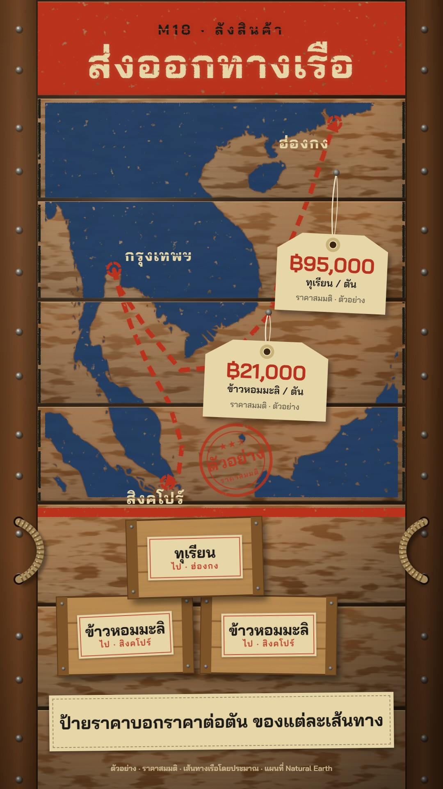

# M18 ลังสินค้า · Stencilled Cargo Crate

**Fits:** trade routes, exports and imports, goods and prices, shipping, supply chains, "where does X come from" ·
**Formats:** 9:16 · **Code:** `Demo.tsx` + `kit/Crate.tsx`

## Look

The whole frame is the face of a wooden shipping crate seen straight on: eight sawn pine planks in an oiled brown
with streaky grain, a soft warm light from the top left falling to a dark vignette, thin dark gaps between planks,
darker side battens with two nail heads per plank, and twisted rope handles through holes in the battens. The top
plank is sprayed red-oxide as a marking band with the title stencilled on it in cream; a thin red band marks the
cargo area. The **map is sprayed through a stencil** in blue paint on the middle planks — the paint stops at the gaps,
has soft overspray, worn specks and a bare-wood stencil line round the coast — inside a dashed stencil frame. Routes
are fat red stencil dashes with an arrowhead, ports are red dashed rings with cream stencilled names. Goods arrive as
**small raw-pine crates** with battens, nails and a crooked stamped kraft cargo label (red ruled border, name in
black, destination in red); they slide in and stack. **Prices hang on manila tags** with a reinforced hole, tied with
double string to a nail, swinging. A red worn rubber stamp "ตัวอย่าง / ราคาสมมติ" marks the demo as made-up.

| Role | Hex |
|---|---|
| Crate planks (background) | `#7f4e27` (gradient `#965f31` → `#5e381a`) |
| Gaps / battens | `#2e1c0e` / `#714424` |
| Blue stencil paint (land) | `#1f3a63` |
| Red stencil paint (routes, ports, band, stamps) | `#b8321f` |
| Kraft label / manila tag, string | `#e7d6a8`, `#efe4c6` |
| Black paint / text | `#1d1b18` |

**Type:** Bai Jamjuree 700 with a stencil bridge (a thin horizontal break at mid-height) — title 98 px, kicker 34 px
letter-spaced 8, ports 38 px; labels and tags in Bai Jamjuree 600–700 (price 50 px, goods 36 px), caption strip 42 px.
**Line:** stencil — paint edges with a slight displacement and wear; routes 11 px dashes (26/16), port rings 7 px.

## Motion signature

- **Slide-stack:** each small crate slides in from the right on a spring, then drops 40 px onto the stack with a
  bounce and a wooden thud (`wood_hit`).
- Everything painted **sprays on** left to right (a clip that opens over 10–40 frames): band, title, map, routes.
- Price tags drop in on their string and **swing** to rest (damped, ~1.5 s), then sway gently.
- The camera barely moves (4 % push over the whole piece).
- Sound: ship creak bed, whooshes on sprays, wood hits on crate drops, ticks on tags.

## Scenes in the kit (`kit/Crate.tsx`)

| Component | Shows | Props |
|---|---|---|
| `useCrate`, `fitBox` | Plank rows, batten width; camera fitting | — |
| `CrateDefs`, `CrateFace` | Shared filters (grain, wear, spray, plank mask); the crate face | — |
| `Rope` | Rope handle on a batten | `side, y` |
| `Paint` | Sprays children on (stencil paint with wear, overspray, gaps) | `box, k, id, planks, wear` |
| `StencilText` | Stencilled type with a bridge | `x, y, text, size, color, anchor` |
| `StencilLand`, `Port`, `StencilRoute` | Map paint, port ring + name, dashed route (inside `<MapFrame>`) | `at, name` / `pts, k` |
| `SmallCrate` | Crate with cargo label that slides in and stacks | `x, y, w, h, at, goods, sub, tilt` |
| `PriceTag` | Manila tag on string from a nail, swinging | `nail, at, price, unit, note, len, w` |
| `Stamp` | Round red rubber stamp | `x, y, text, sub, k, rot` |

## Build notes

`CrateDefs` → `CrateFace` → `Rope`s → one SVG for the title band (`Paint`) → one `<MapFrame>` with the map in a clip
box, routes and ports → HTML tags, crates, caption strip. Paint masks use page coordinates, so keep `<MapFrame>`
full-frame (do not wrap it in a positioned div). Keep `Paint` wear on large areas only; text on tags is unworn.
Several `Paint` blocks each need a unique `id`. The stack area holds 3–4 crates of 330 × 190; for more goods, stack
two rows or replace crates as the story moves.

## Data

Land from `world-atlas` (`land-50m`) — no fetch. Routes are typed waypoints at sea; label them "โดยประมาณ".

## Sources for the demo

None needed: the demo is a generic sample (ตัวอย่าง) with made-up prices (ราคาสมมติ), stamped as such on screen.
For a real story, cite the price source (e.g. Thai Rice Exporters Association, Commerce Ministry) in the description.

## Don'ts

- No glossy 3D, no flat cartoon vector look; every surface is wood, paint, paper or string.
- Don't print the map in more than two paints (blue land, red routes); black is for text only.
- Never show prices without a source or the "ราคาสมมติ" label; don't copy real shipping-line logos or brand marks.

## Credits

Map drawn from Natural Earth land (public domain, via world-atlas). Sound: template UI sounds and house library
(Mixkit / Pixabay licences). Font: Bai Jamjuree (SIL Open Font License).
