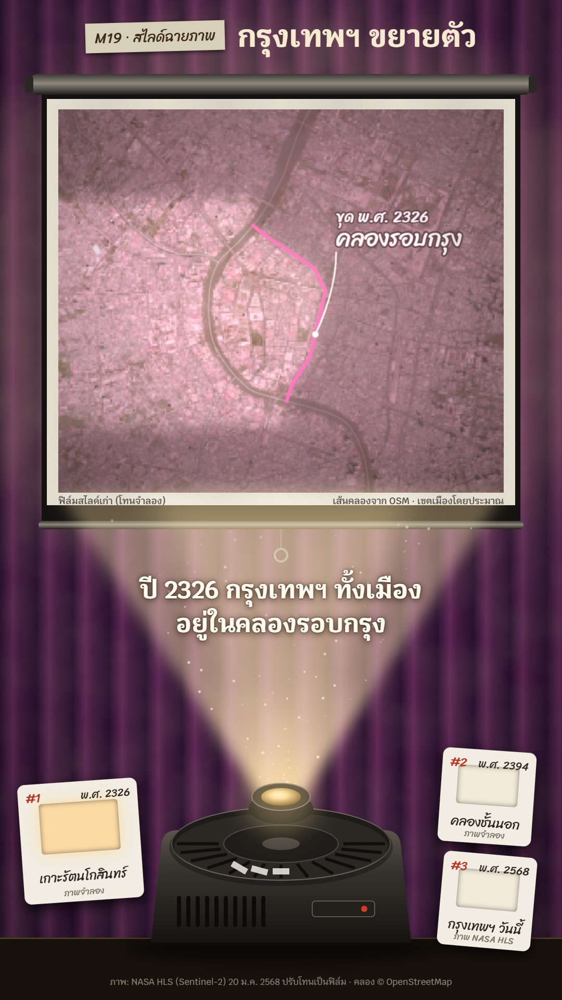

# M19 สไลด์ฉายภาพ · Slide Projector Night



**Fits:** urban change, then vs now, how a city, coast, river or forest changed over time; "before and after" ·
**Formats:** 9:16 · **Code:** `Demo.tsx` + `kit/Projector.tsx`

## Look

A slide show in a dark room. Behind, drawn plum velvet curtains with soft vertical folds, lit only by the spill of
the projector. A pull-down screen hangs in the upper half: metal roller case, black border, matte cloth with weave
grain and faint wrinkles, weighted bottom bar, cord and pull ring. The projected **slide** is the local satellite
raster graded like a film stock — faded **Ektachrome** (sepia + hue shift + a strong magenta cast) for the oldest,
warm **Kodachrome** for the middle, clean modern colour for today — slightly soft, with a lamp hot spot, dark corners,
dust specks and a hair on the slide. Grease-pencil marks are drawn on the slide: red marker lines (with a second
wobbly stroke) along a boundary, older boundaries as cream dashes, handwritten notes in Sriracha with a leader line.
From a carousel projector at the bottom (round tray with numbered slots, vents, a red pilot light, a glowing lens)
a **bright warm beam** fans up to the screen, full of drifting, twinkling dust. Cardboard slide mounts with
handwritten labels lie beside the projector; the one in the gate glows. A tape label carries the kicker.

| Role | Hex |
|---|---|
| Room / curtains (background) | `#0d0a08` / `#2a1030` → `#62285a` → `#481d44` |
| Tungsten beam | `#ffdf9e` |
| Screen cloth | `#ece6d8` |
| Grease pencil (red) | `#e2412c` |
| Slide mounts / text | `#f1ede3` / `#f6ead0` |

**Type:** Sriracha 400 for everything handwritten (slide notes 44 px with 30 px sub, mount labels 25 px, tape labels
28 px); Krub 600–700 for the title (58 px), captions (48 px) and small print (17–19 px). **Line:** grease pencil
7 px + 3 px wobble; older lines 4 px dashed cream; no outlines on objects — shapes are lit, not drawn.

## Motion signature

- **Carousel-click:** before each change the shutter closes over 5 frames, stays dark 3, the next slide drops into
  the gate with a jolt (damped bounce, ~14 px) and a light flash; the tray turns one slot; the next mount lights up;
  a click (`SFX.tick`) and a small `wood_hit`.
- The lamp strikes at the start (flicker 0 → 0.6 → 0.2 → 1) and flickers ±4 % all the time.
- Each slide slowly pushes in (5–8 %); grease-pencil marks draw on along the line, notes appear after.
- Dust motes drift up the beam and twinkle.
- Sound: quiet room tone (wind bed very low), click + thud per slide, soft pops on notes.

## Scenes in the kit (`kit/Projector.tsx`)

| Component | Shows | Props |
|---|---|---|
| `useRoom`, `fitBox`, `GRADES` | Screen / picture boxes and lens; camera fitting; film grades | — |
| `Room` | Curtains, wall spill, screen with case, bar and pull ring | `light` |
| `Projected` | The graded slide (children = `<MapFrame>` + `<Raster>` + marks), hot spot, dust, shutter, jolt | `grade, light, dark, cut, seed, box` |
| `Beam` | Warm cone with dust motes | `light, box, from` |
| `Projector` | Carousel projector (tray turns with `slot`) | `slot, light, at, scale` |
| `Mount` | Cardboard slide mount with handwritten label | `x, y, no, label, year, note, lit, rot, w` |
| `useMoat`, `Waters` | A named canal from OSM as one ordered curve; rivers faintly | `name, centre` |
| `PencilLine`, `Veil`, `Note` | Grease-pencil line, soft veil outside a boundary, handwritten note | `pts, k, color, dashed` / `ring, k` / `at, text, sub` |

## Build notes

`Room` → `Projected` (one `<MapFrame>` inside, focus = picture centre, a single `<Raster>` kept mounted while the
camera changes per slide) → `Beam` → table → `Projector` → HTML: title tape, screen footer (which film the slide
imitates), caption in the beam, mounts, credit. A slide change is just a new camera box, grade and marks on the same
raster. Keep notes inside the picture: anchor them towards the centre. For two projectors (side-by-side "then | now")
pass `box` / `from` / `at` and `scale={0.6}` — the kit supports it, but one screen reads better on a phone.

## Data

Local, not shipped (network once):

```bash
TIME=2025-01-20 npm run imagery -- hls bkkhls 100.40 13.66 100.58 13.82 2400   # public/raster/bkkhls.jpg/.json
npm run osm -- th-bkk 100.40 13.66 100.58 13.82 rivers                          # public/data/th-bkk.geojson
npm run sfx && npm run sfx-lib
```

Every slide is the same 2025 image; the older look is a grade, so the screen footer says "โทนจำลอง" and the mounts say
"ภาพจำลอง"; city edges are "เขตเมืองโดยประมาณ".

## Sources for the demo

Bangkok founded as the capital in 1782 (Britannica, "Bangkok"); Khlong Rop Krung dug in 1783 (พ.ศ. 2326) under
Rama I as the city moat; Khlong Phadung Krung Kasem dug from 1851 (พ.ศ. 2394) under Rama IV as the new outer moat
(Bangkok Metropolitan Administration canal history; Thai Wikipedia articles on both canals). Canal lines from
OpenStreetMap.

## Don'ts

- Never present the graded slides as real old photographs; keep the "โทนจำลอง / ภาพจำลอง" labels.
- No neon, no glass UI, no cartoon outlines; light comes only from the projector.
- At most one grease-pencil red per slide; older lines become cream dashes.
- Don't copy a real projector brand's look or logo.

## Credits

Imagery: NASA HLS (Sentinel-2), 20 Jan 2025. Canals and river © OpenStreetMap contributors (ODbL). Sound: template
UI sounds and house library (Mixkit / Pixabay licences). Fonts: Sriracha, Krub (SIL Open Font License).
