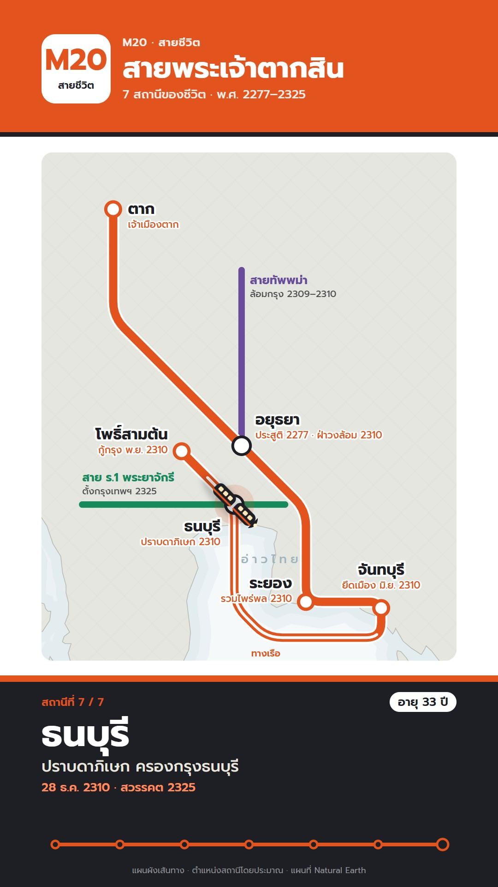

# M20 สายชีวิต · Life Metro Line

**Fits:** biographies, a person's life on the map, careers, campaigns told as stops, "the journey of …" ·
**Formats:** 9:16 · **Code:** `Demo.tsx` + `kit/Metro.tsx`

## Look

A transit diagram. A full-width header band in the line colour carries a white rounded-square line badge ("M20 /
สายชีวิต") and the title reversed out in white, closed by a thin black rule. The diagram sits on white: a faint real
map underneath (land in cool light grey with a 45° guide grid, coast in grey, a pale blue band off the coast, the sea
named in spaced pale-blue type). The **life is one thick orange-red line** (18 px with a 4 px white casing) that only
runs horizontal, vertical or at 45° (octilinear), with rounded bends; stations are white discs with a thick
line-coloured rim (grey until reached), interchanges are white pills with a black rim where another person's line
crosses (purple, green). The part of the life still to come is a faint dotted ghost; sea legs carry white dashes
inside the line and a "ทางเรือ" note. A little two-car black train with warm windows and a headlight runs the line.
At the foot, a black **platform sign** across the frame: orange top stripe, "สถานีที่ 3 / 7", an age pill, the
station name huge in white, what happened and when, and a strip of all stops with the progress filled.

| Role | Hex |
|---|---|
| Diagram paper (background) | `#ffffff` |
| The life line, header band | `#e2531d` |
| Other people's lines | `#6a4c9c`, `#178a5b` |
| Sign / text / station rims of interchanges | `#1d1f24` |
| Faint land / water | `#e6e6e1` / `#f6f9fa` |

**Type:** Prompt — title 62 px 700, station names on the map 33 px 700, station dates 21 px 500 in line colour, sign
name 80 px 700, sign event 34 px 500, kicker and small print 18–26 px 500–600. **Line:** octilinear, 18 px line +
26 px white casing, corner radius 34 px; other lines 14 px; station rim 7 px; interchange rim 6 px.

## Motion signature

- **Track-follow:** the train runs the route at eased speed between stops and **dwells** ~40 frames at each; the
  solid line is drawn exactly behind it, the future stays a dotted ghost; it can reverse out of a spur.
- On arrival the station rim fills, a soft line-coloured pulse breathes round it, the sign slides in (12 frames)
  with the new name, event, date and age, and the progress strip advances.
- Other people's lines draw on when the life meets them (interchanges).
- The map breathes in by 3 % over the whole piece.
- Sound: a tick on each arrival, a whoosh on departure, a quiet crowd bed; story hits (war drums, gong) on events.

## Scenes in the kit (`kit/Metro.tsx`)

| Component | Shows | Props |
|---|---|---|
| `useDiagram`, `fitBox` | Map box for 9:16; camera fitting | — |
| `octi`, `rounded`, `buildRoute`, `along`, `cut`, `lengthOf` | Octilinear legs, rounded paths, the route polyline with stop distances and sea spans | `pts, start, legs` |
| `Ground` | White paper, faint land, guide grid, coast band, sea name (inside `<MapFrame>`) | — |
| `LifeLine` | The life line drawn up to `t`, ghost after, sea dashes | `poly, t, sea` |
| `OtherLine` | Another person's line with a label | `pts, color, k, label, sub, at` |
| `StationMark` | Station disc / interchange pill + name + date | `p, st, reached, now` |
| `Train` | Two-car train pointing along the line | `at, ang, k` |

## Build notes

Stations come from real `[lon, lat]` projected with the camera, so the diagram sits on the true map; a station too
close to another (under ~40 px) gets a schematic offset in screen space (say so in the small print). Each leg is
`{ to, mode: "diag" | "straight", via?, sea? }`; choose the mode so lines don't cross, and route sea legs round the
coast with `via` points. Train keyframes: `[arrive, leave]` per stop → distance along the route. Put everything
inside one `<MapFrame>` component (`Diagram`) so it can use the projection; header and sign are HTML.

## Data

Land from `world-atlas` (`land-50m`) — no fetch. Stops, dates and ages are typed in `Demo.tsx`.

## Sources for the demo

King Taksin: born 17 April 1734 (พ.ศ. 2277) at Ayutthaya; governor of Tak ("Phraya Tak") before the Burmese siege
(date not recorded precisely — shown as "ก่อน พ.ศ. 2308 (โดยประมาณ)", age "ราว 30 ปี"); broke out of besieged
Ayutthaya in January 1767; gathered forces at Rayong; took Chanthaburi in June 1767; took the Burmese camp at Pho Sam
Ton in November 1767; crowned at Thonburi on 28 December 1767; died 7 April 1782 (พ.ศ. 2325), when Chao Phraya
Chakri became Rama I and founded Bangkok. Sources: Encyclopaedia Britannica, "Taksin"; David K. Wyatt, *Thailand: A
Short History* (2nd ed., 2003), ch. 6. Ages are counted from the 1734 birth date.

## Don'ts

- Don't imitate a real transit authority's map, roundel, line names or colours; the badge is this pack's own.
- No curves other than the rounded bends; no lines at other angles than 0/45/90°.
- One life line per video in the line colour; other people's lines only in other colours.
- Don't show a precise date the sources don't give — say "ราว / โดยประมาณ".

## Credits

Map drawn from Natural Earth land (public domain, via world-atlas). Sound: template UI sounds and house library
(Mixkit / Pixabay licences). Font: Prompt (SIL Open Font License).
