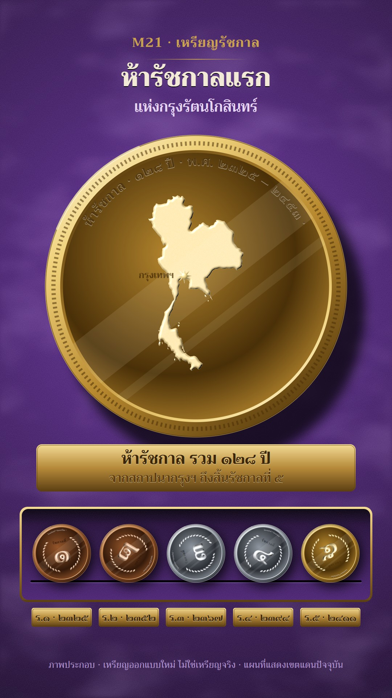

# M21 เหรียญรัชกาล · Coin Reign

**Fits:** kings, dynasties, reigns, anything told as "one ruler after another" over the same realm · **Formats:**
9:16 · **Code:** `Demo.tsx` + `kit/Coin.tsx`

## Look

Each reign is a struck metal coin lying on royal-purple velvet. One big coin fills the middle of the frame, lit by a
single raking light from the upper left: a raised rim with a bright glint on the lit side and a toothed border, the
reign years incised round the rim, a polished "proof" field that reflects a soft diagonal band of the room, and the
design in frosted relief (emboss filter: specular + diffuse lighting on the blurred shape). The obverse carries the
realm's map embossed on the field with the capital as a raised star; the reverse carries the reign numeral in big
Thai figures inside a wreath of small leaves. When a coin turns, its milled edge shows as a striped band. Below,
a brass plaque with engraved lettering names the reign; at the bottom a velvet timeline tray with a brass rim and a
groove, where a small coin for each reign rolls in and settles, with an engraved brass year plate under it.
Velvet has fibre grain, crushed-pile sheen and a spotlight pool behind the big coin.

| Role | Hex |
|---|---|
| Velvet (pool → mid → edge) | `#6e3ca6` → `#4a2372` → `#14081f` |
| Gold (dark / mid / light / glint) | `#4a3008` `#b8892f` `#f0d27c` `#fff7d8` |
| Silver | `#2c3036` `#8f969f` `#dde1e6` `#ffffff` |
| Bronze | `#33190a` `#94552a` `#d99a62` `#ffe3c4` |
| Brass (plaques, tray rim, kicker) | `#c9a24e` (gradient `#f4dc95` → `#5c3f12`) |
| Text on velvet | `#f2ead6`, secondary `#e4d6f2`, footer `#b59bd3` |

**Type:** Trirong (serif Thai, OFL) — kicker 36 px 700 brass, title 70 px 800, sub 40 px 600, plaque 44 px 700 +
34 px 600 engraved (dark cut over a light lip 1.3 px below), rim inscription 0.085 r 700. Thai numerals throughout
(`thai()`). **Line:** no outlines; every edge is light — emboss highlights and shadows, incised text, a 1.2 px rim
light. Metal is the only colour on the coins; the velvet is the only colour around them.

## Motion signature

- **Roll and flip.** The big coin flips about its vertical axis (26 frames, smoothstep), its milled edge passing
  across, and the face changes at the edge-on moment — metal can change with it (bronze → silver → gold).
- At the same time a small coin of that reign rolls into the tray from the right (36 frames, ease-out, spin =
  distance / radius) and rocks back into its groove; its brass year plate fades up.
- The light never moves: when a coin spins, the design turns but the glint and the reflection band stay put.
- A slow 4.5 % push on the big coin and a gentle 3 px bob — nothing else moves.
- Sound: whoosh on each flip, a tick when a coin lands, a soft hit when the realm face returns.

## Scenes in the kit (`kit/Coin.tsx`)

| Component | Shows | Props |
|---|---|---|
| `Velvet` | Purple velvet with grain, crushed sheen, spotlight pool | `w, h, pool` |
| `CoinDefs` | Emboss, frost and shadow filters (once per SVG) | — |
| `Coin` | One coin: rim, toothed border, mirror field, rim inscription, milled edge when turning | `id, r, metal, spin, flip, rim` |
| `Relief` | Frosted embossed relief for any filled shape | `metal, frost` |
| `RealmFace` | Realm map embossed with the capital star (modern Thailand outline) | `r, metal` |
| `ReignFace` | "รัชกาลที่" + big Thai numeral + leaf wreath | `r, metal, n` |
| `Tray`, `Plate`, `Cut` | Velvet timeline tray; brass plate; engraved brass text | box / `x, y, w, h` / `x, y, size` |
| `rollAt` | Position + spin for a coin rolling into a slot, with settle | `frame, f0, f1, from, to, r` |
| `thai` | Arabic → Thai numerals | `n` |

For another realm, replace `THAILAND` in `RealmFace` with any outline (`world-atlas` country, or a historical
polygon) — keep it one solid shape so the emboss reads. For another story, change the face children: a crown
shape, a city gate, a ship — always simple filled silhouettes inside `<Relief>`.

## Build notes

One 1080×1920 SVG. Filters are applied on wrapper groups, not on the rotating group, so the light stays fixed.
Each `Coin` needs a unique `id` (gradients and clip paths). The emboss filter is the cost: ~6 coins on screen is
fine; for a long video render the tray as a still between reign changes.

## Data

Land outline from `world-atlas` `countries-50m.json` (Natural Earth, public domain), already in the template.
Reign years and events (Rama I–V): Chakri dynasty reign dates — Rama I 2325–2352 (founding of Rattanakosin,
1782), Rama II 2352–2367, Rama III 2367–2394 (Burney Treaty 2369 / 1826), Rama IV 2394–2411 (Bowring Treaty
2398 / 1855), Rama V 2411–2453 (abolition of slavery, administrative reform). Sources: Wikipedia "Chakri dynasty",
"Burney Treaty", "Bowring Treaty", "Chulalongkorn"; Thai Wikipedia "ราชวงศ์จักรี". 2453 − 2325 = 128 years.

## Don'ts

- Never copy a real coin, medal or seal; never put a real king's portrait or royal emblem on a coin. Numerals,
  maps and simple ornaments only, and keep "เหรียญออกแบบใหม่ ไม่ใช่เหรียญจริง" on screen.
- No flat yellow circles: every coin needs the rim glint, the mirror field and embossed relief.
- One light direction for everything (upper left, azimuth 225°). No coloured lights.
- Don't put more than one big coin on screen; the others live in the tray.

## Credits

Everything drawn in code. Map: Natural Earth via world-atlas (public domain). Sound: template UI sounds
(`SFX.whoosh`, `SFX.tick`, `SFX.hit`, `SFX.swell`). Font: Trirong (SIL Open Font License).
