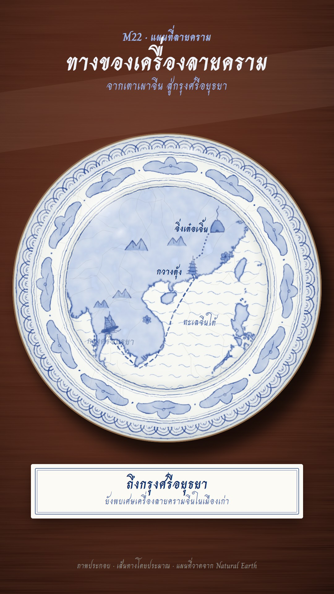

# M22 แผนที่ลายคราม · Porcelain Map

**Fits:** Thai and Asian history, trade routes, legends, journeys between ports and kingdoms · **Formats:** 9:16 ·
**Code:** `Demo.tsx` + `kit/Porcelain.tsx`

## Look

The map is painted in cobalt under a clear glaze on a white plate, seen from above on a polished rosewood stand.
The plate fills the width: a brown iron lip, a rim band of overlapping wave scallops on a pale wash, a cavetto ring
of twelve cloud-collar scrolls (dark outline, wash fill, a curl and a small ring inside), double cobalt rings, and
the well holding the map — sea in short ripple strokes, land knocked out to white then laid in a thin cobalt wash
with a dark brushed coast and a wider soft halo, painted mountain peaks, small flower sprays, and each place as a
tiny painted motif (bottle kiln with smoke, stacked pagoda, prang). The route is a dotted (river) then dashed (sea)
cobalt line, a junk under battened sails at its head. Every cobalt mark goes through one filter that wobbles the
edge and varies density, so lines look brushed and pooled. On top of the glaze, fixed to the room and not turning
with the plate: a fine crackle network, a soft window reflection and a rim gleam upper left. Captions sit on a
white museum card with a double cobalt rule.

| Role | Hex |
|---|---|
| Rosewood stand (light → mid → edge) | `#6e3524` → `#4a2216` → `#160805` |
| Glaze white | `#f6f7f3` (body gradient to `#b9bab2` at the rim) |
| Heaped cobalt (outlines, text) | `#1d3f8f` / text `#16326f` |
| Cobalt wash / thin wash | `#6f8fcb` / `#b9c9e6` |
| Iron-brown lip | `#7a4a22` |

**Type:** Charm 700 (Thai brush-script, OFL) — title 78 px in glaze white on the wood, kicker and sub 36–38 px in
`#9fb6e3`; on the plate place names 30–32 px cobalt, sea names 30 px 400; card 46 px + 30 px. **Line:** brush —
wave strokes 1.8–3.2 px, cloud outlines 2.6 px, coast 3.4 px + 9 px halo at 35 %, route 4 px dotted `2 9` / dashed
`12 8`, crackle 0.7 px at 22 %.

## Motion signature

- **Turntable:** the plate turns in from −32° on the stand (70 frames, ease-out), then drifts −3° → +3° for the rest
  of the shot. The glaze highlight and crackle stay fixed while the painting turns under them; a glint runs along
  the rim during the turn-in.
- The route is brushed on (river leg, then sea leg, smoothstep), the junk riding its head and leaning with the
  heading.
- Each place appears as its motif fades up (18 frames) and its name follows a few frames later.
- Captions change on the museum card (14-frame fade). No zooms, no camera moves — the plate is the frame.
- Sound: a soft sea bed while the junk sails, a pop when a place appears, swell at the start.

## Scenes in the kit (`kit/Porcelain.tsx`)

| Component | Shows | Props |
|---|---|---|
| `Defs` | Brush/pool filter, wood grain, soft shadow, glow | — |
| `Rosewood` | Polished wood stand with grain and a sheen band | `w, h` |
| `Plate` | White glazed body, cast shadow, iron lip; children turn with it | `r, turn` |
| `Cobalt` | Wrapper that makes everything inside brushed cobalt | `opacity` |
| `WaveBand`, `CloudBand` | Rim wave scallops; cavetto cloud-collar ring | `r0, r1, n` |
| `Ripples`, `Peaks` | Sea strokes for the well; painted mountains | `rr` / `x, y, s` |
| `Motif` | `kiln`, `pagoda`, `prang`, `flower` | `kind, x, y, s` |
| `Junk` | Junk under sail for the route head | `x, y, s, rot` |
| `Crackle`, `Glaze` | Crackle network; window reflection, rim gleam, turn glint (draw after the plate) | `rr` / `r, glint` |
| `wellProjection`, `LAND` | Mercator fitted to the well for `[w, s, e, n]`; Natural Earth 50 m land | — |

For a new story, keep the plate and swap the well: new extent, new motifs (draw them like `Motif`: one wash fill,
one dark outline, a few interior strokes), new route. Up to ~6 motifs on a plate stay readable.

## Build notes

One 1080×1920 SVG: `Rosewood` → `<g translate>` → `Plate` (children: `Cobalt` bands → well clip → `Cobalt` map →
labels) → `Crackle` + `Glaze` outside the turning group. Plate r = 500 at 9:16, well r = 0.655 r. The brush filter
is applied twice per frame (bands, map); keep it on groups, never per stroke.

## Data

Land from `world-atlas` `land-50m.json` (Natural Earth, public domain), in the template. Story facts: Jingdezhen
(Jiangxi) was the main centre of blue-and-white porcelain from the Yuan and Ming dynasties; ware went down the Gan
river and over the Meiling (Dayu) pass to Guangzhou for export by sea; Chinese blue-and-white shards are found in
excavations at Ayutthaya. Sources: Wikipedia "Jingdezhen porcelain", "Blue and white pottery", "Chinese export
porcelain", "Meiling Pass"; Fine Arts Department reports on ceramics from Ayutthaya. The route lines are
approximate (labelled "เส้นทางโดยประมาณ").

## Don'ts

- Not a Thai temple mural (that is N06): no gold leaf, no ochre wall, no figures in mural costume. Only cobalt on
  white, plus the iron lip.
- No other colours on the plate — no red, no gold, no green. One blue in three strengths.
- Don't copy a real museum plate or a known pattern sheet; compose the bands and motifs new each time.
- Keep the light fixed: never rotate the glaze highlight with the plate.

## Credits

Everything drawn in code. Map: Natural Earth via world-atlas (public domain). Sound: template UI sounds and house
library `sea_rough` (Mixkit / Pixabay licences). Font: Charm (SIL Open Font License).
