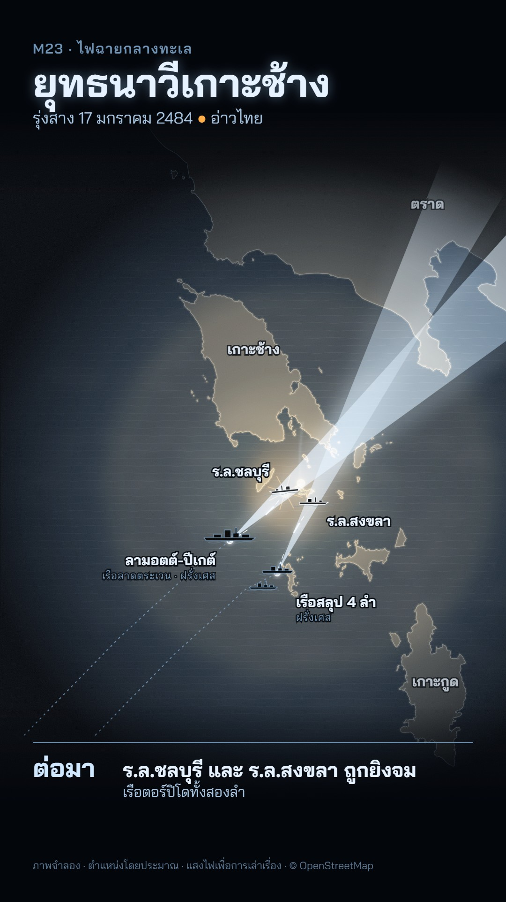

# M23 ไฟฉายกลางทะเล · Searchlight Sea



**Fits:** sea battles and night actions on a real coast; any story told as a time log of a few hours at sea ·
**Formats:** 9:16 · **Code:** `Demo.tsx` + `kit/Night.tsx`

## Look

A night naval plot. The sea is almost black, the land a shade lighter, the real coastline (OpenStreetMap) a faint
grey hairline — you only really see the map where light falls on it. Every light source writes into one mask and
the "lit" copy of the map is drawn through it: steel-blue sea with long swell strokes, pale land with a haze
texture, a white surf line with an ice-blue halo along the coast. Sources: sweeping searchlight cones from the
ships (bright ice-blue wedges with a bloom), star shells that burn, drift down on a smoke trail and light a wide
circle warm, muzzle flashes, and hits (warm flash, white core, sparks). Tracers are streams of short glowing dashes
on a slight arc. Ships are small black side-view silhouettes rimmed in ice blue (lit ones in white), with a wake
line; sunk ships tilt and fade, their names turn amber with "· จม". Labels are ice-white Thai with a dark halo;
approach tracks are dotted. As the clock runs on, first light comes up from the east edge (the battle was fought
at dawn) and turns the sea steel blue. Title top left with a cold glow; the time log bottom left under a hairline:
big time + event + detail. Fine film grain over everything.

| Role | Hex |
|---|---|
| Night sea / unlit land / unlit coast | `#03060b` / `#0b0d0f` / `#3f5a70` |
| Light: searchlight, tracer (ice) | `#cfe8ff`, dim `#6f93b4` |
| Lit sea / lit land / surf | `#4a6a90` / `#a3b4c4` / `#f2f9ff` |
| The one warm colour: flare, fire, "sunk" | `#ffae4a` |
| Text | `#e6f2ff`, secondary `#a9c6e2` |

**Type:** Bai Jamjuree (OFL) — kicker 30 px 600 letter-spaced 2, title 86 px 700 with a cold glow, date 34 px,
time 54 px 700 tabular, log 42 px 700 + 30 px, labels 30 px 700 / 22 px. **Line:** glow — coast 1.1 px unlit,
1.8 px surf + 6 px halo when lit; tracers 3.2 px dashes `22 70` with a 4 px glow and a white 1.4 px core; tracks
2 px dotted.

## Motion signature

- **Searchlight sweep:** cones sweep slowly (smoothstep across ~130 frames), then swing onto a target and hold with a
  ±1° tremble; the map appears inside the beam as it passes.
- Star shells: 6-frame ignition, slow fall (0.6 px/frame), flicker from two sines, burn out over 40 frames.
- Tracers stream continuously (dash offset 26 px/frame) for the length of an exchange, fading in/out over 10–14
  frames. Hits: 2-frame flash, 26-frame burst, 5 px shake, an explosion sound on the frame.
- Muzzle flashes light the firing ship for 5 frames on each cannon sound.
- Dawn rises over the last third; the log changes every 3–4 s (10-frame fade).
- Sound: `sea_rough` bed, `cannon_far` on muzzle frames, `explosion_mid` on hits, pop on each star shell.

## Scenes in the kit (`kit/Night.tsx`)

| Component | Shows | Props |
|---|---|---|
| `Defs` | Glow, bloom, haze, grain filters | — |
| `fit`, `landFromCoast` | Mercator fitted to a box; land fill built from OSM coastline ways (islands + mainland closed through `closeVia`) | `[w,s,e,n], box` / `coast, proj, closeVia` |
| `LightMask` | One mask from beams, flares, flashes and `dawn` | `id, beams, flares, flashes, dawn` |
| `DarkMap`, `LitMap` | The map unlit; the lit copy to draw through the mask | `path, coast, land` |
| `Beams`, `beamPath` | Visible searchlight cones | `beams: {x, y, angle, spread, len, k}` |
| `StarShell`, `Impact`, `Tracer` | Flare; hit burst; tracer stream | `x, y, k` / `t` / `a, b, frame, k, bend` |
| `Ship`, `Tag`, `Track`, `along` | Silhouette markers (`cruiser`, `sloop`, `coastal`, `torpedo`); labels; dotted tracks | — |

Build order: `LightMask`s → sea → `DarkMap` → `LitMap` in the light mask → warm multiply in a flare-only mask →
`Beams` → tracks, tracers, shells, impacts → ships → labels → grain → top/bottom shade bands → HTML title and log.

## Build notes

World-atlas land polygons are far too coarse for small islands and, unclipped, too large for Chrome at this zoom —
build the land from the OSM coastline with `landFromCoast` (screen-space path, no spherical winding). Keep the
coastline file small (one bay, ~200 KB). Masks are per frame; ~2 beams + 2 flares + 4 flashes render fast.

## Data

```bash
node scripts/fetch-osm.mjs kochang-coast 101.85 11.5 102.8 12.45 'way["natural"="coastline"]'   # public/data/kochang-coast.geojson
npm run sfx && npm run sfx-lib                                                                  # sea_rough, cannon_far, explosion_mid
```

Credit: "© OpenStreetMap contributors (ODbL)" on screen and in the description. The demo's mainland is closed via
`[[103.6, 11.6], [103.6, 13.2], [101.9, 13.2]]` (land lies north-east of that coast).

Facts (Battle of Ko Chang, 17 January 1941): the French squadron — light cruiser Lamotte-Picquet and the avisos
Dumont d'Urville, Amiral Charner, Tahure and Marne — closed on the anchorage from the south-west around 05:30; a
Loire 130 seaplane reported the torpedo boats at 06:05; HTMS Chonburi and HTMS Songkhla were sunk; HTMS Thonburi was
sighted at 06:38, fought back and was badly damaged; Thai dead 36 (Thai figures). Source: Wikipedia "Battle of Ko
Chang" (and its Thai-language sources); Royal Thai Navy history pages. Ship positions in the demo are approximate,
and the night lighting is a dramatisation — the action was fought at first light (labelled "ภาพจำลอง · แสงไฟเพื่อ
การเล่าเรื่อง").

## Don'ts

- Only white / ice-blue light plus one warm colour (`#ffae4a`). No red, no green, no neon.
- Don't light the whole map at once — the darkness is the style. At most ~40 % of the frame lit.
- Don't use it for daytime battles without a reason in the story; don't invent searchlight use as a fact — label it.
- Don't copy a film's or game's battle HUD; no crosshairs, radar sweeps or UI panels.

## Credits

Coastline © OpenStreetMap contributors (ODbL). Sound: house library (Mixkit / Pixabay licences) and template UI
sounds. Font: Bai Jamjuree (SIL Open Font License).
