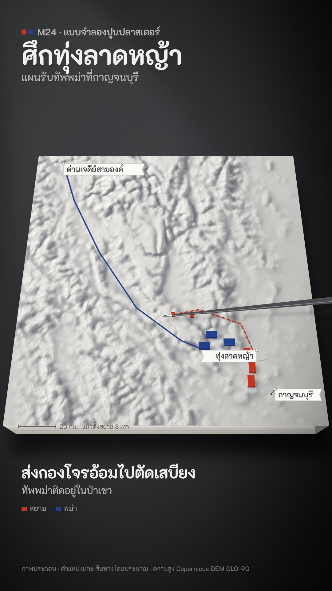

# M24 แบบจำลองปูนปลาสเตอร์ · Plaster Relief



**Fits:** strategy, battle plans, campaigns in hills and valleys — anything explained as "here is the ground, here
is the plan" · **Formats:** 9:16 · **Code:** `Demo.tsx` + `kit/Plaster.tsx`

## Look

A white plaster terrain model on a dark studio table, briefed with a pointer stick. The model is a real elevation
grid shaded at render time — one low lamp from the west-north-west, soft cast shadows in the valleys, ridges a
touch brighter, vertical scale exaggerated ×3.4 — plus the matching hillshade multiplied in lightly for fine detail
and a plaster grain. The block is tilted back 26° in perspective so you see its cut front face (casting layers) and
its shaded side; it throws a soft shadow onto the charcoal table, and a faint shaft of lamp light hangs in the air
above it. Everything on the model is white, grey or one of two unit colours: painted wooden blocks (top, front and
side faces, soft contact shadow), coloured threads pinned across the model for routes and plans (dashed for
manoeuvres), grey pins with white paper flags lettered in pencil grey, a graphite pointer with a white tip and a
shadow on the plaster. An engraved scale bar runs along the front edge. Title top left, the plan step and a two-
colour key bottom left, in white type straight on the dark studio.

| Role | Hex |
|---|---|
| Studio table (pool → edge) | `#3a3d40` → `#26282a` → `#0b0c0d` |
| Plaster lit / plaster in shade | `#f3f1ec` / `#626873` |
| Paper flags / pencil lettering | `#fbfaf6` / `#3a3c40` |
| Unit colour 1 (Siam) | `#c4361f` |
| Unit colour 2 (Burma) | `#23408f` |
| Text | `#f4f2ee`, secondary `#b9b7b1` |

**Type:** K2D (OFL) — kicker 30 px 600, title 84 px 700, step 50 px 700 + 32 px, key 24 px, flags 25 px 600.
**Line:** none on the plaster — form comes from light and shadow only. Threads 4 px, arrowheads 4.5 px, pins 2.4 px.

## Motion signature

- **Pointer trace:** the stick glides along each part of the plan (smoothstep) and taps the key points (10-frame dip,
  a wood knock on the frame).
- Blocks are set down: dropped from 40 units with an ease-in, 8–10 frames apart, a tick each.
- Threads draw on behind the pointer tip; manoeuvres are dashed; a retreat draws while the blocks slide back.
- The lamp drifts 10° across the whole shot, so the shadows on the plaster creep slowly — the model feels physical.
- No camera moves; the model stays put like a real briefing table.
- Sound: very low wind room tone, wood knocks, ticks, soft war drums under the last step.

## Scenes in the kit (`kit/Plaster.tsx`)

| Component | Shows | Props |
|---|---|---|
| `Model`, `at`, `geo` | Camera for the tilted plane; plane → screen (with height); lon/lat → plane | `m, x, y, h` |
| `Relief` | The shaded plaster (canvas from the DEM grid, cast shadows, cavity, grain, hillshade detail) | `m, dem, azimuth, elevation, exaggeration, detail` |
| `Slab` | Front face, side face and table shadow of the block (draw under `Relief`) | `m, thick` |
| `Block` | Painted wooden unit marker | `m, x, y, color, w, d, h, k, lift` |
| `Flag` | Pin with a paper flag | `m, x, y, text, k, side, tall` |
| `Thread` | Coloured thread pinned across the model, drawn on with `k`, arrowhead at the end | `m, pts, color, k, dash` |
| `Pointer` | The pointer stick with its shadow | `m, x, y, tap, from` |
| `BlurDefs`, `along`, `ease` | Shadow blur; position along a polyline; smoothstep | — |

## Build notes

Three layers: an SVG under (table, lamp shaft, `Slab`), the `Relief` div (CSS `perspective(P) rotateX(tilt)` —
`at()` uses the same maths so markers sit exactly on it), an SVG over (lamp falloff, threads, blocks, flags,
pointer, scale bar). The relief is computed per frame from a ~200×200 grid (fast); keep the model plane ≤ 1000 units
and `res` 2. Keep the tilt between 20° and 34°: flatter loses the model, steeper hides the face.

## Data

```bash
node scripts/fetch-dem.mjs kan 98.2 13.85 99.8 15.45 300 1.5   # public/raster/kan-dem.json + kan-hillshade.png (6 tiles)
npm run sfx && npm run sfx-lib                                 # wood_hit, wind, war_drums
```

Credit: "Elevation: Copernicus DEM GLO-90 © DLR e.V. 2010–2014, © Airbus 2014–2018, provided under COPERNICUS by
the EU and ESA". Facts (Nine Armies' War, 2328 BE / 1785–86): King Bodawpaya's Burmese invasion came in nine armies
by several routes; the main royal army entered by the Three Pagodas Pass; the Front Palace, Prince Surasinghanat,
held it at Thung Lat Ya (Kanchanaburi), blocking the way down to the plain, sent raiding parties to cut the Burmese
supply lines, and the Burmese withdrew. Sources: Wikipedia "Burmese–Siamese War (1785–1786)" and Thai Wikipedia
"สงครามเก้าทัพ"; Thai school history texts. Unit positions, routes and the raid line in the demo are approximate.

## Don'ts

- Not a board game (M07) and not toy soldiers (N02): no squares, dice, figures, felt or bright painted terrain. The
  model is white plaster; only the two unit colours are coloured.
- No contour lines, no hypsometric colours, no labels printed on the plaster — words go on paper flags.
- One lamp only; don't flip the light between scenes of the same model.
- Don't fake terrain with noise for a real place — fetch the DEM.

## Credits

Elevation: Copernicus DEM GLO-90 (see above). Sound: house library (Mixkit / Pixabay licences) and template UI
sounds. Font: K2D (SIL Open Font License).
