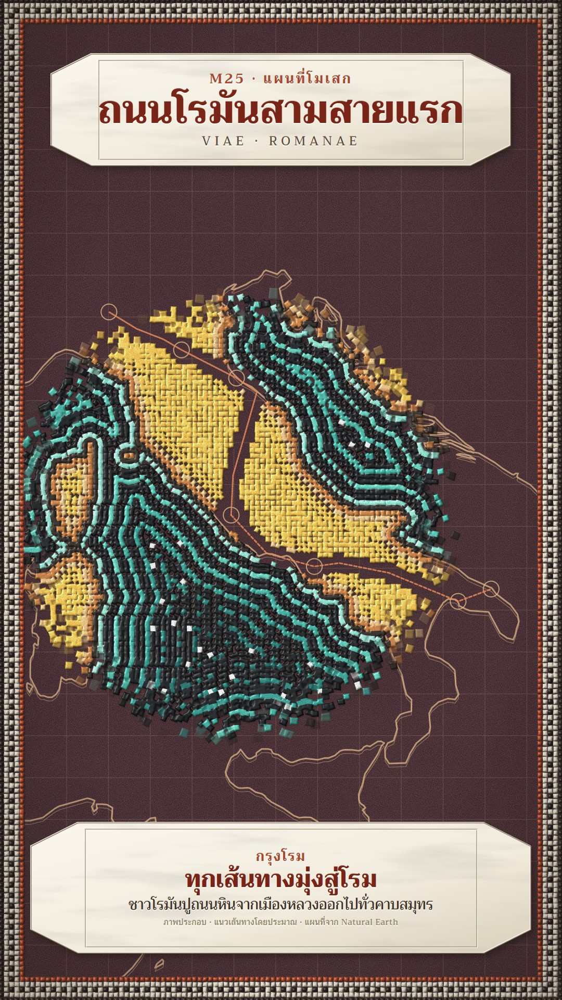

# M25 แผนที่โมเสก · Roman Mosaic Map

**Fits:** ancient empires, trade routes, roads and ports, archaeology, "how a network grew" stories ·
**Formats:** 9:16 · **Code:** `Demo.tsx` + `kit/Mosaic.tsx`, `kit/grid.ts`

## Look

The whole frame is a floor of small cut stone tesserae, seen from above under a low raking light. Before any stone
is set, the design is drawn on a dark plum setting bed in pale ochre: a squared guide grid, the coast, a ring for
every city and dashed lines for the roads. Then the stones drop in, spreading out from the capital. Every stone is an
irregular cut cube with its own bevel, grain and a soft set-in shadow; the grout between them is the dark bed.

The land is golden limestone, a few rows of stones following the coast before it turns into a plain grid (opus
tessellatum); the coast is ringed by one row of terracotta and one row of pale ochre. The sea is dark stone crossed
by blue-green crest rows that follow the coastline outwards (andamento), lighter near the shore and greener / darker
further out, with a few white flecks. Roads are three rows of red stones laid city to city; cities are rosettes (a
cream centre stone in a ring of dark stones; the capital gold in two rings). The border is five rows: dark, cream,
dark / cream dentils, cream, terracotta. Titles and captions sit on two marble tablets with dovetail handles (tabula
ansata), letters cut and filled with red; place names are on small marble name-stones with a Latin second line.

| Role | Hex |
|---|---|
| Setting bed (background, grout) | `#3a1f28` |
| Guide drawing on the bed | `#e2b98a` |
| Land stones (golden limestone) | `#e6bb4e` (`#dfb048` – `#eac158`) |
| Sea: dark stone / crest rows near → far | `#16191c` / `#7fd0bf` → `#2b8a82` → `#164f4e` |
| Coast rows (land side) | `#b8743e`, `#d9b27a` |
| Road stones (accent) | `#a3301f` (`#86251a`, `#b53a24`) |
| Marble tablets / cut letters | `#f1ebdd` / `#7a2418` |
| Border | `#2a2522`, `#eadfc6`, `#a8472d` |

**Type:** Trirong (serif Thai) — title 74 px 800, beat headline 46 px 800, kicker and tags 26 px 700 letter-spaced,
body 28 px 500, place names 30 px 800 (capital 40) with a 14 px letter-spaced Latin line, credit 15 px — at 1080.
Letters are filled red with a light lower lip (cut into marble). **Line:** no strokes on the map: edges are rows of
stones. Stone size `CELL` = 10 px (field) with a 4 % grout gap; city rosettes use `RU` = 14 px.

## Motion signature

- **Tile-lay:** the guide drawing is drawn on first (frames 2–30, spreading from the capital), then each stone drops
  in from 1.9× scale to 1× over 7 frames, in order of distance from the capital with a little jitter; the whole
  field takes ~4 s. Each road is then laid stone by stone along its route (city to city, `Road.at` / `len`), and a
  city's rosette is set when the road reaches it (8 frames, ring stones one after another).
- The camera is the floor: a slow 4.5 % push over the whole shot, and the light's azimuth swings 212° → 238° so
  the bevels shimmer. No cuts, no pans.
- Name-stones and tablets fade up 10 frames after their stones are set. Captions change on the beat with a
  12-frame fade.
- Sound: soft ticks while the field is laid, a tick every 4 frames on a road, a stone tap (`wood_hit`) on each
  city, a low wind bed, `SFX.hit` on the closing beat.

## Scenes in the kit (`kit/Mosaic.tsx`)

| Component | Shows | Props |
|---|---|---|
| `useMosaic` | Lays out every stone once (field, border, roads, rosettes, guide paths); cached per `key` | `key, proj, roads, cities, origin, start, spread, emblem?` |
| `MosaicDefs` | Stone lighting (bevel, shine, grain, set-in shadow), bed texture, vignette | `az` (light azimuth) |
| `Mortar`, `Sketch`, `Sinopia` | The bed; the ochre guide drawing; a dashed road line drawn on | `coast, cities, k, origin` / `d, k` |
| `Stones` | Stones laid by `frame`: settled ones batched by colour, falling ones one by one | `tiles, frame, drop` |
| `Tablet`, `cut` | Marble tabula ansata with cut letters; letter style helper | `box, k` / `size, weight, color` |
| `NameStone` | Small marble name plate with Thai + Latin | `x, y, th, la, k, big` |
| `OpusSectile`, `Emblem` | Optional: map set as a round or rounded-rectangle emblem in a porphyry floor | `emblem` |
| `fitProjection` | Fit `[w, s, e, n]` into a screen box | `box` |
| `kit/grid.ts` | Canvas rasteriser (paths → cell coverage), chamfer distance, hash noise | — |

For a new story: pass new `Road[]` (`pts` as `[lon, lat]` city to city, `at`, `len` in frames) and `City[]`; pick the
`origin` the floor is laid from; fit the box with `fitProjection`. Land and sea are classified from Natural Earth
land on a canvas, so any coast works.

## Build notes

One SVG at 1080×1920: `MosaicDefs` → push group (`Mortar` → `Sketch` → `Sinopia` per road → one `filter` group with
`Stones` for border, field, roads and rosettes → grime) → vignette; HTML on top for name-stones and tablets. About
20 000 stones at `CELL` 10; settled stones are one `<path>` per colour, so a still renders in a few seconds. The layout is
computed once per process (`useMosaic` cache); keep `key` unique per scene. `kit/grid.ts` needs the browser canvas
(Remotion renders in Chrome). Bigger `CELL` (14) = chunkier, faster; do not go above 14 or the coast stops reading.

## Data

Land from `world-atlas` `land-50m` (Natural Earth, in the template) — nothing to fetch. City positions are the
modern sites of the Roman towns; road lines are simplified city-to-city polylines.

Sources for the demo: Wikipedia "Appian Way" (begun 312 BC by the censor Appius Claudius Caecus, Rome → Capua, later
extended to Brundisium), "Via Flaminia" (220 BC, Gaius Flaminius, Rome → Ariminum), "Via Aemilia" (187 BC, Marcus
Aemilius Lepidus, Ariminum → Placentia), and the Italian state roads SS7 Via Appia, SS3 Via Flaminia and SS9 Via
Emilia that follow them today.

## Don'ts

- No smooth gradients or outlines on the map — every edge is a row of stones.
- Don't copy a known mosaic (no figures, inscriptions or layouts taken from real floors); keep this composition.
- Don't animate the stones after they are set (no wobble); only the light moves.
- Keep "แนวเส้นทางโดยประมาณ" on screen when routes are simplified; keep "ภาพประกอบ".
- One red accent family (roads). Don't add new hues for countries — use the stone palette.

## Credits

Map: Natural Earth land via world-atlas (public domain). Facts: Wikipedia articles above. Sound: template UI sounds
(`SFX.tick`, `SFX.swell`, `SFX.hit`) and house library (`wind`, `wood_hit`; Mixkit / Pixabay licences, `npm run
sfx-lib`). Font: Trirong (SIL Open Font License). Everything drawn in code.
