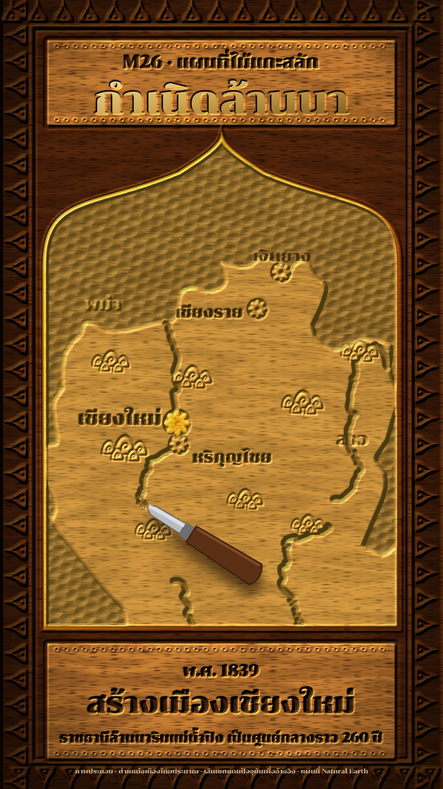

# M26 แผนที่ไม้แกะสลัก · Carved Teak Relief Map

**Fits:** local and regional history, founding of cities, temples and crafts, Lanna / northern topics, any story
told "on the temple wall" · **Formats:** 9:16 · **Code:** `Demo.tsx` + `kit/Carving.tsx`

## Look

A teak panel carved in relief, lit by one low raking light from the top left. The old surface of the panel (the
border, the board edges, the space round the arch) is dark oiled teak; everything freshly cut is light golden teak,
so the carving reads as new work. A Thai pointed arch (ซุ้ม) with a gilded bead holds the map: the ground round the
country is gouged away and covered in overlapping gouge scoops; the country stands up as a flat raised slab with a
chamfered edge; rivers are V-cut grooves (one wall lit, one in shadow); mountain ranges are carved khao-mo rock
motifs; cities are eight-petal rosettes with a sunk centre, the city in the story covered in gold leaf. The outer
border is a raised band of krajang flames between two beads; the title board and caption board are raised plates
with a bead-and-reel edge. Letters are incised (cut and darkened); the title is gilded in its cut. A real chisel
moves at the head of every cut and throws chips. Wood grain is generated and bends around the carving.

| Role | Hex |
|---|---|
| Gouged ground (in shadow) | `#4a2a14` |
| Fresh-cut teak (relief tops) | `#c8924f` |
| Old oiled surface (multiply) | `#6e4e36` |
| Gold leaf (title, arch bead, the city in the story) | `#d9a441` (`#f6e3a4` → `#6e4c18`) |
| Ink in the cuts / text | `#2b170b` |

**Type:** Chonburi 400 (a carved display serif) — title 92 px gilded, kicker 40 px, caption tag 36 px, headline
66 px, line 30 px, city names 36 px (capital 44) — at 1080. Text is drawn twice: into the height map (so the light
cuts it) and as a thin dark stain (or gold leaf) so it reads at phone size. **Line:** none — every edge is a change of
height lit by the filter. Height levels: 1 relief tops · 0.88 country slab / uncut board · 0.6 low relief ·
0.3 gouged ground · 0.42 letters and grooves.

## Motion signature

- **Chisel-cut:** the opening second gouges the ground away from the top of the arch downwards (a scalloped cut
  edge sweeps down and leaves the country standing); then each river is cut as a groove growing along its course
  with the chisel at its head, tapping (6 px) and throwing seven chips; every cut has a `wood_hit` every 7 frames.
- Cities are cut in as rosettes (scale 0.4 → 1 over 10 frames) when the story reaches them; gold leaf fades onto the
  city in the story and off the previous one. Mountain motifs come in one by one in the first seconds.
- The title is cut letter by letter (a left-to-right reveal over ~1 s). Captions change with a 10-frame fade.
- Camera: a slow 3.5 % push; the light swings 220° → 236°, so the relief shifts slightly. No cuts.

## Scenes in the kit (`kit/Carving.tsx`)

| Component | Shows | Props |
|---|---|---|
| `CarveDefs`, `Carved` | The carving filter (height → raking light, teak grain bent by the relief, depth darkening), gouge pattern, gold | `az, rake` |
| `g(level)` | Grey fill for a height level (draw shapes inside `<Carved>`) | 0–1 |
| `KanokBorder` | Raised krajang-flame border band with beads | `inset, band` |
| `archPath` | Thai pointed arch outline | `x, y, w, h` |
| `Rosette`, `GoldLeaf` | Carved city rosette; gold leaf laid over it | `x, y, r, k` |
| `riverLines`, `partial`, `Groove` | River polylines; grow to fraction k; V-groove | `proj, features` / `line, k` / `d, w` |
| `Chisel` | Chisel + chips at the head of a cut | `at, ang, frame, k` |
| `KhaoMo`, `Beads` | Thai rock-mountain motif; bead-and-reel board edge | `x, y, s, k` / `x, y, w` |
| `countryById`, `fitProjection`, `pathOf` | Countries (Natural Earth 50 m), fitting, paths | — |

For a new place: change the projection box, the country raised (`countryById`), the rivers by name, `CITY` and
`RANGES`. Keep labels inside the arch on the raised slab, not on the gouged ground.

## Build notes

One SVG at 1080×1920. Everything inside `<Carved>` is a grey height drawing — no colour there; colour, gold, chips
and the chisel go after it. The filter is full-frame (turbulence + lighting): about 2–4 s a still; for long videos
render the static panel once and animate only the cut parts if needed. The fresh / old wood split is one multiply
path (everything outside the arch and the boards).

## Data

Countries from `world-atlas` `countries-50m` (Natural Earth, in the template). Rivers (Mekong, Ping, Yom) from
Natural Earth 10 m rivers, read from `public/data/nrs-rivers.json` — recreate with
`npm run rivers -- nrs-rivers 93.5 10 107.5 32` (any name; change the path in `Demo.tsx`). The modern border is
shown for orientation and labelled; city positions are approximate.

Sources for the demo: Wikipedia "Mangrai" (ruler of Ngoen Yang; founded Chiang Rai in 1262 / พ.ศ. 1805, took
Hariphunchai, founded Chiang Mai in 1296 / พ.ศ. 1839), "Hariphunchai" (Mon kingdom centred on Lamphun), "Lan Na"
(Chiang Mai was its capital until the Burmese conquest of 1558 — about 260 years).

## Don'ts

- No paint colours on the wood — only teak, its shadows, the dark oiled surface and gold leaf.
- Don't put labels on the gouged ground; don't carve thin hairline detail (it disappears under the light).
- Don't copy a real temple panel or a known carving; draw new motifs with the kit shapes.
- Keep "ภาพประกอบ", "ตำแหน่งเมืองโดยประมาณ" and "เส้นเขตแดนปัจจุบันเพื่ออ้างอิง" when using modern borders.

## Credits

Map: Natural Earth countries (world-atlas) and rivers (public domain). Facts: Wikipedia articles above. Sound:
template `SFX.swell`, `SFX.hit` and house library `wood_hit`, `jungle_rain` (Mixkit / Pixabay licences, `npm run
sfx-lib`). Font: Chonburi (SIL Open Font License). Everything drawn in code.
