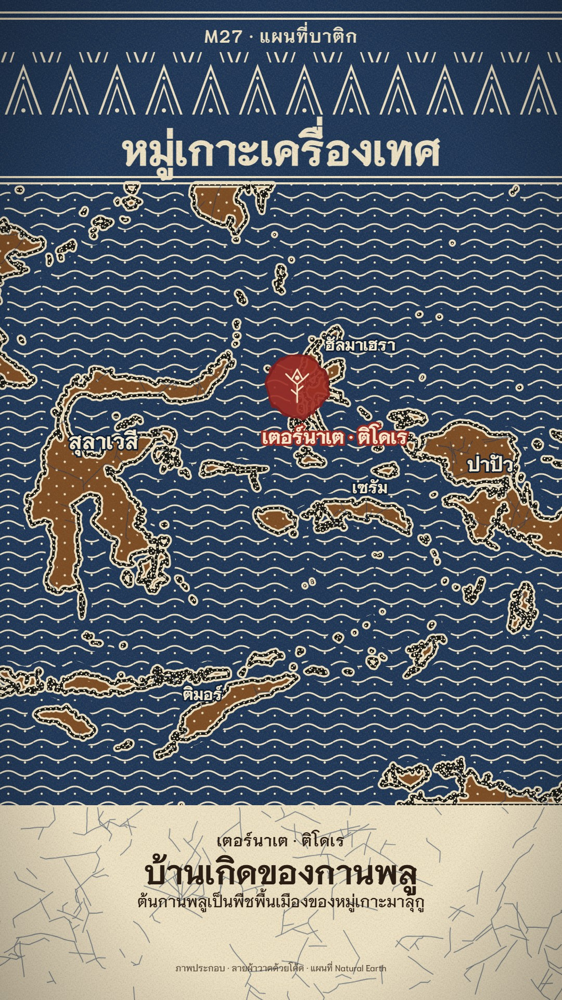

# M27 แผนที่บาติก · Wax-resist Batik Map

**Fits:** Southeast Asian history, islands and seas, maritime trade, culture and crafts of the archipelago ·
**Formats:** 9:16 · **Code:** `Demo.tsx` + `kit/Batik.tsx`

## Look

A batik cloth made in front of the viewer. Cream cotton (fine weave texture) is drawn on with a canting: the coasts
as a double wax line with a row of wax dots between, the land filled with diagonal dot isen-isen, the sea with wavy
lines and dots, a head band of tall tumpal triangles, double rules between the bands. The land and the caption band
are then waxed and the cloth goes into an indigo bath: the sea and the head band turn indigo, and fine branching
blue veins appear wherever the wax cracked (crackle). The sea is waxed, a soga-brown bath turns the land brown, the
wax is boiled off and the cream lines come back crisp. Afterwards single motifs are dipped in mengkudu red: a red
blot with a bleeding edge carrying a cream canting drawing (a clove bud, a nutmeg). Labels are cream with a
dye-dark edge; a sea lane is a row of red wax dots.

| Role | Hex |
|---|---|
| Indigo (sea, head band) | `#1c3557` |
| Soga brown (land) | `#7a4a22` (dye `#82532c` multiplied on cream) |
| Cream cotton / wax lines | `#efe3c6` |
| Mengkudu red (one accent) | `#9c2b23` |
| Wax while still on the cloth | `#e8c66a` (translucent) |
| Text on dyed areas / on cream | `#f3e8cc` / `#2a1d14` |

**Type:** Niramit — title 80 px 700 (a wax line, so it is cream on indigo), kicker 34 px 700, caption tag 30 px
600, headline 62 px 700, line 30 px 500, island names 30–40 px 700 with a 6 px indigo edge — at 1080.
**Line:** wax-resist: coast 13 px wax with a 5 px dyed gap and 3.4 px dots every 11 px; waves 3.2 px; crackle
1.1 px branching veins (plus a 3.2 px soft halo).

## Motion signature

- **Dye-bath**, in order: canting draws every wax line on a diagonal front (the canting rides the front, ~2.5 s) →
  land and caption band waxed (glossy yellow) → indigo bath rises from the bottom with a wavy surface (~1.3 s) and
  crackle veins appear in the wax → sea waxed (a sheen) → soga bath rises → wax boiled off (the yellow fades, ~1 s).
- Then story beats: a red mengkudu blot spreads on the place (22 frames, bleeding edge), its cream motif fades in;
  labels fade on; a sea lane draws as red wax dots with a clip moving west, an arrow and destination at the edge.
- Sound: a splash at each bath, a soft splash at the boil, pops on the red dips, a ship bell on the sea lane, a
  low sea bed.

## Scenes in the kit (`kit/Batik.tsx`)

| Component | Shows | Props |
|---|---|---|
| `BatikDefs` | Cotton weave, red bleed, patterns in black (`-k`, dye masks) and white (`-w`, wax view): waves, dots, tumpal | — |
| `landIn`, `fitProjection`, `pathOf` | Natural Earth 10 m land cropped to a bbox; fit with a clip band | `bbox` / `box, clip` |
| `bathPath` | The rising dye surface | `k, t` |
| `cracks` | Crackle veins (seeded random branching walks) | `seed` |
| `Canting` | The canting (copper bowl, spout, bamboo handle) at the wax front | `x, y, k` |
| `RedDrop`, `Clove`, `Nutmeg` | Mengkudu red dip with a bleeding edge; canting motifs | `x, y, k` |

The demo shows the mask recipe: `lines(v)` = everything that stays cream (wax through both baths), `head(v)` = head
band motifs; the indigo layer uses mask `dyeI` (bath ∩ not wax), the soga layer `dyeS` (bath ∩ not wax ∩ land and
caption band) multiplied on top. New motifs go into `lines` (cream) or are dipped later with `RedDrop`.

## Build notes

One SVG at 1080×1920, masks only (no raster). 10 m land is cropped with `landIn` (continent-sized rings are skipped
so clipping can never fill the frame). The map is clipped to its band with the projection's clip extent; points use
an unclipped copy. Crackle is ~520 short paths; cheap. A still renders in a few seconds.

## Data

Land from `world-atlas` `land-10m` (Natural Earth, in the template) — nothing to fetch. Island name positions are
placed by hand; the sea lane is illustrative.

Sources for the demo: Wikipedia "Banda Islands" (until the mid-19th century the only source of nutmeg and mace),
"Clove" (native to the Maluku Islands), "Malacca Sultanate" / "Spice trade" (Malacca as the great entrepôt of the
15th-century spice trade towards India and Europe).

## Don'ts

- Never fill shapes with flat colour — every colour must come from a bath or a dip, every cream from wax.
- No more than one red accent at a time; no gradients except the bath surface.
- Don't copy a traditional named batik pattern exactly (parang, kawung) or a known cloth; use these isen-isen.
- Keep "ภาพประกอบ"; mark a sea lane or a trade route as illustrative.

## Credits

Map: Natural Earth land via world-atlas (public domain). Facts: Wikipedia articles above. Sound: template `SFX.swell`,
`SFX.pop`; house library `sea_rough`, `splash`, `splash_big`, `ship_bell` (Mixkit / Pixabay licences, `npm run
sfx-lib`). Font: Niramit (SIL Open Font License). Everything drawn in code.
