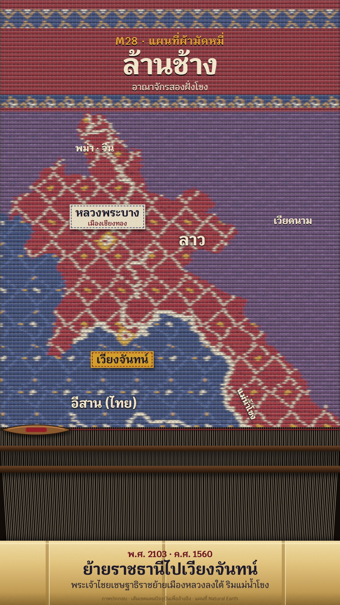

# M28 แผนที่ผ้ามัดหมี่ · Ikat Woven Map

**Fits:** regions and peoples, Isan and Lao history, kingdoms along the Mekong, textile and village stories ·
**Formats:** 9:16 · **Code:** `Demo.tsx` + `kit/Ikat.tsx`, `kit/grid.ts`

## Look

A mudmee (weft ikat) cloth being woven on a loom while we watch. The map is not drawn on the cloth, it is *in* it:
every weft pick (6 px) is one row of the thread grid, and along each pick the colour changes where the yarn was tied
and dyed before weaving. So every edge steps from row to row, the motifs wobble a cell left or right per pick
(misregistration) and colours bleed sideways along the weft. Each country is a dyed ground with its own tied motif —
Laos in lac red with a cream diamond lattice and yellow centres, Isan in indigo with diamond lines and yellow hooks
(ขอ), the neighbours in purple with small indigo dots. Rivers are pale undyed thread; cities are woven yellow / cream
/ red diamonds. A plain-weave relief (rounded picks, the warp showing over every other cell) and cotton fibre sit on
top. The head of the cloth is a lac-red band between two hook stripes (หมี่ขอ) with the title. Below the fell line
is the loom: bare warp in two sheds, the reed beating each pick in, a boat shuttle crossing with red weft trailing,
and a bamboo breast beam carrying the caption. Place names are sewn-on cloth tags with a running stitch.

This is woven, not embroidered: no hoop, no stitches on top of a ground, no padded satin — the picture is the weave.

| Role | Hex |
|---|---|
| Neighbour ground (purple) | `#5a3a6a` |
| Lac red (Laos, head band `#8e1b26`) | `#9e1f2a` |
| Indigo (Isan) | `#2b3d73` |
| Yellow (centres, hooks, city diamonds; one accent) | `#e0a72c` |
| Cream / undyed thread (lattice, rivers, text) | `#f1e6cc` |
| Loom (bare warp `#cfc4ae` on) / bamboo beam | `#120c08` / `#e2c47e` |

**Type:** Krub — title 88 px 700, kicker 34 px 600, region labels 40–52 px 700 cream with a dark drop, caption headline
50 px 700, tag 28 px 700, line 27 px 500, cloth tags 34 px 700 + 20 px — at 1080. **Line:** none; edges are stepped
thread runs blurred 3.2 px horizontally only.

## Motion signature

- **Weave-rows:** the fell line moves down the frame one pick (6 px) at a time while the shuttle crosses (one pass
  every 16 frames, alternating direction, weft trailing) and the reed beats in (a cubic beat curve, ~0.15 s); a
  `wood_hit` on every beat. The whole cloth weaves in ~11 s; labels and tags appear only after their rows are woven.
- Tags pop on (10 px rise) when the story reaches the place; the place in the story gets a yellow tag.
- The loom stays in frame after the cloth is done; the shuttle keeps crossing at the bottom. No camera moves.

## Scenes in the kit (`kit/Ikat.tsx`)

| Component | Shows | Props |
|---|---|---|
| `useWoven` | Weaves the cloth once: countries + rivers + cities + bands onto the thread grid, as runs per pick | `key, proj, y0, y1, rivers, cities, bands` |
| `IkatDefs` | Sideways bleed, plain-weave relief pattern, fibre, wood and bamboo gradients | — |
| `Cloth` | The woven runs above the fell, batched by colour, with relief | `woven, fell` |
| `Loom` | Warp sheds, reed (beating), shuttle and weft below the fell | `fell, frame, bottom` |
| `Bamboo` | Bamboo breast beam with nodes (caption board) | `y, h` |
| `Tag` | Sewn-on cloth name tag | `x, y, text, sub, k, hot` |
| `cellColour` (inside) | The tied motifs per ground: `laos`, `thai`, `other`, `band`, `stripe` | — |

For a new story: change the countries rasterised in `useWoven` (Natural Earth ids), give each a ground and motif in
`cellColour`, pass rivers by name with a thread width (px), cities as `[lon, lat]`, and the head bands.

## Build notes

One SVG at 1080×1920. The thread grid is 180 warps × 262 picks; country and river masks are rasterised on a canvas
(`kit/grid.ts`), then each pick is run-length encoded (~5 000 rects) and cached per process. Only the woven part
(`y < fell`) is drawn; the bleed filter is horizontal only (`stdDeviation="3.2 0.2"`) — keep it that way, ikat bleeds
along the weft. Pick heights are fixed: keep `fell` a multiple of `PH`.

## Data

Countries from `world-atlas` `countries-50m` (Natural Earth, in the template). Rivers (Mekong, Ou, Ngum, Mun, Chi) from
Natural Earth 10 m rivers in `public/data/nrs-rivers.json` — recreate with
`npm run rivers -- nrs-rivers 93.5 10 107.5 32`. Modern borders are shown for orientation and labelled.

Sources for the demo: Wikipedia "Lan Xang" (founded 1353 / พ.ศ. 1896 by Fa Ngum at Muang Sua – Xieng Thong, today
Luang Prabang; the name means "million elephants"; the kingdom spread on both banks of the Mekong; Setthathirath
moved the capital to Vientiane in 1560 / พ.ศ. 2103), "Pha That Luang" (built by Setthathirath in 1566 / พ.ศ. 2109,
a national symbol of Laos).

## Don'ts

- Not embroidery: no hoop, no stitches drawn on top, no satin fills, no outlines around shapes.
- Don't blur vertically or smooth the stepped edges — the steps are the ikat.
- Don't reproduce a specific traditional named pattern or a known cloth; use the diamond / hook motifs here.
- Keep "ภาพประกอบ" and "เส้นเขตแดนปัจจุบันเพื่ออ้างอิง" when modern borders are woven.

## Credits

Map: Natural Earth countries (world-atlas) and rivers (public domain). Facts: Wikipedia articles above. Sound:
template `SFX.swell`, `SFX.pop`; house library `wood_hit`, `gong`, `wind` (Mixkit / Pixabay licences, `npm run
sfx-lib`). Font: Krub (SIL Open Font License). Everything drawn in code.
