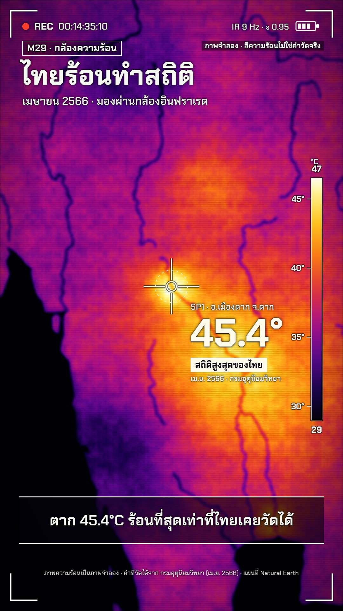

# M29 กล้องความร้อน · Thermal Camera



**Fits:** heatwaves, urban heat islands, wildfires, drought, climate records, "hottest place" stories ·
**Formats:** 9:16 · **Code:** `Demo.tsx` + `kit/Thermal.tsx`

## Look

The whole frame is the live view of an infrared camera pointed at a map. There is no "map style" under it: land,
sea and rivers exist only as temperature. Sea is cold (black-violet), land is warm (magenta-red), plains and
valleys glow orange, the hottest spot burns through yellow to near-white. The image is soft like a low-resolution
microbolometer (computed at 1/4 resolution, smoothed up), with sensor grain that changes every image, faint
fixed-pattern column noise, horizontal scan banding and a lens vignette. Rivers are cool channels through hot
land. On top, a white HUD with a dark halo: corner brackets, REC dot and timecode, "IR 9 Hz · ε 0.95", battery,
a vertical ironbow temperature scale bar with ticks, a fixed centre crosshair (the spot meter), an automatic
"MAX" box that tracks the hottest pixel in view, and the spot readout beside the crosshair. Captions sit in a
dark HUD strip between two white rules.

| Role | Hex |
|---|---|
| Coldest / background | `#07020f` |
| Violet (cool land, warm sea) | `#5f0a8c` |
| Red (warm land) | `#e1371e` |
| Yellow (hot) | `#ffd23a` |
| White (hottest, HUD text) | `#fffbea` / HUD `#f4f7f2` |

Ironbow ramp (`LUT` in the kit): black → `#16044a` → `#5c0a8c` → `#ac1284` → `#e0343a` → `#f87614` → `#ffc01e`
→ `#ffee76` → `#fffdee`.

**Type:** Chakra Petch — title 84 px 700, kicker 30 px 600 in a white-outlined box, HUD 22–30 px 500–700, big
readout 96–124 px 700, captions 46 px 600, at 1080 wide. All text white with a black halo
(`HudText`). **Line:** HUD only — 4 px brackets, 3.6 px crosshair, 2.4 px ticks, each with a 9 px dark under-stroke.
No outlines in the image itself.

## Motion signature

- **Heat bloom:** the camera's temperature span (`tMin`/`tMax`) drops over the first 5 s, so the whole scene climbs
  the palette towards white — the country "heats up" without any fake fire.
- **Frame-rate stutter:** the image (camera position, field, grain) updates every 3rd frame (~10 images/s) and
  once in a while one image is held longer; the HUD clock still runs at 30 fps.
- **Shutter (NUC):** at the start and between two targets the view goes to one flat grey for a few frames with a
  click — the camera recalibrating.
- **Spot-meter pans:** the crosshair never moves; the camera pans and zooms until the target sits under it, then
  the reticle shrinks, a dashed ring appears and the readout fades in.
- The MAX box follows the hottest pixel on its own and hides when it is under the crosshair.

## Scenes in the kit (`kit/Thermal.tsx`)

| Component | Shows | Props |
|---|---|---|
| `heatField` | Computes the false-colour image from land mask, coastal cooling, rivers, hot spots, noise | `width, height, proj, spots, tMin, tMax, seed, cell, base, sea, rivers` |
| `HeatCanvas` | Draws it smoothed; `flat` = shutter grey | `img, width, height, flat` |
| `projFor` | Mercator camera: `{lon, lat, scale}` zoom over an extent fitted to a box | `cam, extent, box` |
| `Optics`, `Brackets` | Vignette + scan banding; viewfinder corners | `width, height` |
| `ScaleBar` | Vertical ironbow bar with °C ticks and span | `x, y, h, tMin, tMax, ticks` |
| `Crosshair`, `HotBox` | Spot meter (`lock` 0–1); auto MAX marker | `x, y, lock` / `x, y, on, label` |
| `HudText`, `Battery` | Haloed HUD text; battery glyph | — |
| `ironbow`, `LUT`, `fbm` | Palette and noise helpers | — |

A `Spot` is `{ at: [lon, lat], t: +°C, r: degrees }`: positive for hot plains, valleys and cities, negative for
hills and forest. Tune them so the spot under the crosshair shows the colour of the real reading.

## Build notes

Each frame: `projFor(cam)` → `heatField(...)` in `useMemo` (≈130 k sensor pixels at `cell` 4) → `HeatCanvas`, then
HTML/SVG HUD on top. Quantise the frame (`fq = frame - frame % 3`) before the camera and the field so the stutter
is real. The crosshair is fixed at the centre of the fit box; frame targets by putting their lon/lat in the
camera key. The field is the slow part — keep `cell` at 4 for 1080 × 1920. Readouts are HTML so Thai shapes well.

## Data

Land: `world-atlas` land-50m (Natural Earth, in the template). Rivers (cool channels) from Natural Earth 1:10m:

```bash
npm run rivers -- th-rivers 96 5 106 21        # public/data/th-rivers.json
npm run sfx && npm run sfx-lib                 # wind, fire_crackle
```

Facts in the demo: Thailand's highest recorded temperature, 45.4 °C at Tak (Mueang Tak), April 2023, Thai
Meteorological Department (reported 15 April 2023; see Wikipedia "List of records of Thailand"); heat index 54 °C
in Bang Na, Bangkok, April 2023, Thai Meteorological Department via Reuters. The heat field itself is simulated
and labelled "ภาพจำลอง" on screen; only the two readouts are real.

## Don'ts

- Never present the false-colour field as measured data: keep the "ภาพจำลอง" tag and the credit line.
- No map labels drawn into the image, no borders, no flat colour fills — temperature only; names go in HUD tags.
- Don't use a rainbow or jet palette — ironbow only. Don't move the crosshair; move the camera.
- Don't fake numbers on the spot meter: show a reading only when it is a real, sourced value.

## Credits

Map: Natural Earth land and rivers (public domain) via world-atlas and `npm run rivers`. Readings: Thai
Meteorological Department. Sound: template UI sounds (`SFX.tick`, `whoosh`, `pop`, `hit`) and house library
`wind`, `fire_crackle` (Mixkit / Pixabay licences). Font: Chakra Petch (SIL Open Font License).
