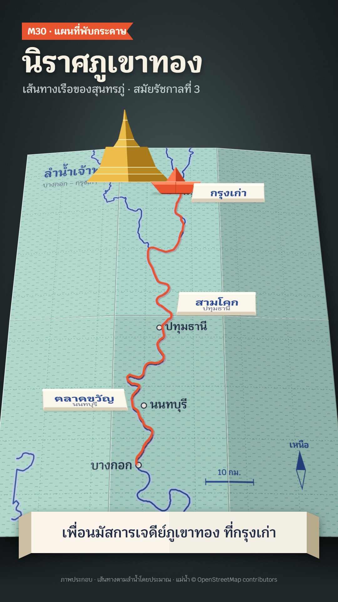

# M30 แผนที่พับกระดาษ · Origami Folded Map



**Fits:** journeys, travel routes, river and road trips, literature and pilgrim routes, geography basics ·
**Formats:** 9:16 · **Code:** `Demo.tsx` + `kit/Origami.tsx`, `kit/route.ts`, `kit/water.ts`

## Look

A real folded paper map lying on a dark slate table under one warm lamp. The sheet is two-sided origami paper:
aqua kami on the printed side (with long horizontal fibres), plain warm white on the back. It is printed in two
inks: indigo for rivers (a pale blue halo under a fine indigo line), lettering and the compass, deep teal for the
dashed graticule and a light paddy-dash texture. It is folded 3 × 2: the
bottom half folds up in front, the side panels fold in, and the plain back of the bottom-centre panel is the
cover of the folded map. When open, the creases stay — every panel sits a few degrees off flat, so each facet
catches the lamp differently (left panels lit, right panels in shade, bottom row a little darker), with a light lip
and a shadowed lip along each crease and a soft cast shadow on the slate. Paper pieces stand up out of the sheet
by folding: tent-folded place cards with printed names, a vermilion paper boat with three facets on its hull and
two on its sail, a gold paper chedi whose tiers fold up one after another, each split into a lit and a shaded half
on its centre crease. The route sailed so far is a vermilion paper ribbon. Captions are printed on a paper band
with folded ends; the kicker is a vermilion paper tag with a notched end.

| Role | Hex |
|---|---|
| Slate table (background) | `#1d2629` |
| Aqua kami (printed side) | `#a9d6cc` |
| Washi white (back, cards, caption band) | `#f4efe4` / back `#e6dfcf` |
| Indigo print (rivers, lettering) | `#28488f` |
| Vermilion paper (boat, route, tag) | `#e8542f` |
| Ink (town names, captions) | `#1f2a44` |

Also: teal print `#3f8a7e`, gold paper `#d9a533` / `#ecbd4a` / `#a87a1a`.

**Type:** Krub — title 92 px 700 (paper white on the slate), sub 34 px 500, kicker 30 px 700 on the tag, map
lettering 30–40 px 600–700, place cards 34 px 700 + 20 px 500, captions 44 px 600, at 1080 wide.
**Line:** creases (light lip 2 px `rgba(255,255,255,.55)`, shadow lip 2 px); rivers 3.4 px on an 11 px halo, canals
1.6 px on 5 px; graticule 1.2 px dashed; route ribbon 6 px with a 9 px shadow.

## Motion signature

- **Unfold:** the folded map opens in two moves — bottom half swings down on the middle crease (~40 frames), then
  both side panels swing out (~40 frames), each with a paper whoosh and a soft tap when it lands. Facet shading
  follows the fold angle.
- The table tilts from almost face-on (8°) to a tabletop view (30°) as the sheet opens; then the camera eases up
  the route with the traveller.
- **Fold-up pieces:** place cards, landmarks and the boat rise from flat to standing (`StandUp`, 16–46 frames);
  the chedi builds tier by tier from the base.
- The boat sails at an even pace along the real river line and bobs ±2 px; the ribbon draws behind it.

## Scenes in the kit (`kit/Origami.tsx`)

| Component | Shows | Props |
|---|---|---|
| `Table` | Slate with lamp pool and grain | `width, height` |
| `Sheet` | 3 × 2 folding map (CSS 3D), facet shading, cast shadow; children stand on it | `row, col` 0→1, `tilt, print, cover, rest` |
| `printProj` | Projection of an extent onto the 900 × 1140 sheet | `extent` |
| `StandUp` | Folds any piece up from the sheet | `x, y, w, h, k, stand, turn` |
| `PlaceCard`, `PaperBoat`, `PaperChedi` | Tent card; paper boat; tiered chedi | `text, sub` / `w` / `w, k` |
| `PaperBand` | Caption band with folded ends | `style` |
| `route.ts`, `water.ts` | Chao Phraya Bangkok → Ayutthaya; river and canal lines printed on the demo sheet | — |

New landmarks: draw them as facet pairs (left half lit, right half shaded) and put them in `StandUp`. A crane, a
train, a temple roof — same rule: flat paper colours, one crease shadow, no gradients inside a facet.

## Build notes

The print is one SVG (`print`) shown six times, offset per panel. The side that faces the camera is chosen in code
(`flipped`): headless Chrome does not honour `backface-visibility` reliably, and while the bottom half is folded up
its side panels are not drawn (they are hidden behind it). Objects sit on a plane 3 px above the sheet; the bottom
row rests slightly *below* the plane (valley fold) so it never covers them. Keep the cast shadow at
`translateZ(-90px)` or deeper, or it cuts across tilted panels. Fit the extent so the route is in the centre
column.

## Data

River lines from OpenStreetMap, already embedded (thinned) in `kit/water.ts` and `kit/route.ts` (chained Chao
Phraya, ~94 km from near the Grand Palace to the south tip of Ayutthaya island). For another region:

```bash
npm run osm -- my-rivers <w> <s> <e> <n> bigrivers     # public/data/my-rivers.geojson (ODbL)
```

then load it with `useJson` and pass lines to the print. `npm run sfx && npm run sfx-lib` for `ship_sailing`,
`wood_hit`, `church_bell`.

Facts in the demo: Nirat Phu Khao Thong is Sunthorn Phu's travel poem of his boat journey from Bangkok up the
Chao Phraya to the old capital (Ayutthaya) to pay homage at the Phu Khao Thong chedi, written in the reign of
Rama III (dated 1828 by some sources, c. 1830 by others — the demo says only "สมัยรัชกาลที่ 3"); places on the way
include Talat Khwan (Nonthaburi) and Sam Khok (Pathum Thani) (Thai school curriculum texts, e.g. TruePlookpanya
"นิราศภูเขาทอง"). Wat Phu Khao Thong ≈ 100.548 E, 14.373 N. The river distance is measured on the OSM line.

## Don'ts

- Not a paper-cut diorama or N04 papercut: no layered cut-out scenes, no lace edges, no red-and-cream.
- No low-poly terrain: facets come only from real folds and folded pieces.
- No gradients inside a facet, no outlines on paper pieces, no glossy highlights.
- Don't unfold more than once per scene; don't fold the sheet in odd ways it could not physically fold.

## Credits

Rivers: © OpenStreetMap contributors (ODbL) — credit on screen and in the description. Sound: template UI sounds
and house library `ship_sailing`, `wood_hit`, `church_bell` (Mixkit / Pixabay licences). Font: Krub (SIL Open Font
License).
