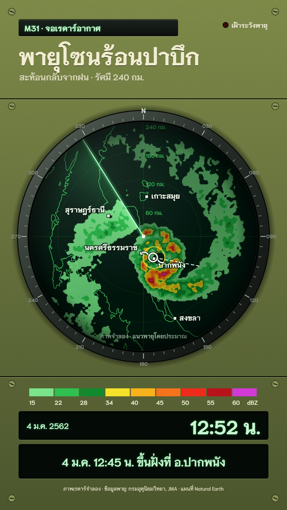

# M31 จอเรดาร์อากาศ · Weather Radar Scope

**Fits:** storms, monsoon rain, typhoon landfalls, floods, "what the radar saw" explainers ·
**Formats:** 9:16 · **Code:** `Demo.tsx` + `kit/Radar.tsx`

## Look

A round radar scope set into an olive-drab enamel steel console — an instrument, not a TV weather board and not
a glass dashboard. The console is olive steel with fine speckle, panel seams and slotted screws, lettering
painted on in cream; a bevelled
metal bezel carries azimuth ticks every 5° and figures every 30° (000 at North). The scope glass is near-black
phosphor green: the coastline glows faint green, range rings are dotted with distance labels, a faint cross
marks the centre. A bright beam turns clockwise once every 3 s with a fading green wedge behind it. Rain echoes
appear only where the beam has passed, in conventional reflectivity steps (light green → green → yellow → orange
→ red → crimson → magenta), as blocky range bins, dimming slightly as they age until the beam comes round again.
The storm's spiral bands and its eye rotate between passes, so every pass repaints a slightly different storm; a
seam shows where old and new echoes meet at the beam. Towns are small white squares with haloed names; the track
is a white dashed line; landfall gets an amber ring. Below the scope: the dBZ legend strip with cream figures, then
two dark inset glass windows — the date and a large phosphor clock, and the caption.

| Role | Hex |
|---|---|
| Olive-drab console (background) | `#5f6a35` (gradient `#7a8642` → `#465026`) |
| Phosphor green (beam, rings, coast, text glow) | `#2fd35a` |
| Echo yellow (34–40 dBZ) | `#f5e12a` |
| Echo red (50 dBZ) / alarm | `#ef2b1b` |
| Phosphor text / painted lettering | `#c9f5d2` / `#f1ecd2` |

Echo scale (`DBZ`): 15 `#7be38a`, 22 `#2fc04f`, 28 `#13892f`, 34 `#f5e12a`, 40 `#f8b21c`, 45 `#f5731a`, 50 `#ef2b1b`,
55 `#b8121a`, 60 `#d23ad8`.

**Type:** Niramit — title 84 px 700 (painted cream on the console), clock 72 px 700 (phosphor, in a window), caption 42 px 600, kicker 30 px 700 on an engraved plate,
town names 27 px 700, ring labels 21 px 600, at 1080 wide; green text carries a soft phosphor glow.
**Line:** coastline 2.2 px glowing; range rings 1.6 px dotted; beam 3 px core + 12 px blur; track 3 px dashed.

## Motion signature

- **Radar sweep:** the beam turns at a fixed rate (`period` 90 frames). Echoes at a bearing update only when the
  beam crosses it — the storm is sampled, never animated smoothly.
- The storm moves along its track between passes; bands spin slowly (`spin`).
- Afterglow: each echo fades to ~58 % over one turn.
- The clock runs in story time (1 hour = 2 s in the demo); landfall = amber ring + thunder on the same frame.
- The camera never moves: the scope is fixed hardware. Change the range (`rangeKm`) between scenes instead.

## Scenes in the kit (`kit/Radar.tsx`)

| Component | Shows | Props |
|---|---|---|
| `Console` | Steel panel, seams, screws, bezel, scope glass | `width, height, scope` |
| `scopeProj` | Mercator with `rangeKm` at the scope radius | `scope` |
| `Graticule` | Coastline, range rings, cross, azimuth bezel | `scope, proj, rings` |
| `echoField`, `EchoCanvas` | Swept rain echoes from a `Storm`; returns `beam` angle | `scope, frame, period, storm, proj, cell` |
| `Sweep`, `Glass` | Beam + wedge; glass highlight and edge shadow | `scope, beam` |
| `Legend`, `StormMark` | dBZ strip; tropical-storm symbol | `x, y, w` / `x, y, rot` |
| `Glow`, `Plate` | Phosphor text; engraved console plate | — |

A `Storm` is `{ at(t) → [lon, lat], spin, size }`; `stormDbz` builds an eye, a dense core ring and log-spiral
bands broken into cells by noise. For a squall line or monsoon rain, write another field function with the same
signature (dx, dy in km from a centre, t) and keep the sweep.

## Build notes

Phosphor-green text only inside dark glass (scope, windows, kicker plate); everything painted on the console is
cream `C.stencil`. Order: `Console` → `Graticule` → `EchoCanvas` → track / towns SVG → `StormMark` → `Sweep` → `Glass` → panels.
`echoField` runs every frame (≈80 k bins at `cell` 3). Keep the scope centre fixed for a whole scene. Put
"ภาพจำลอง" on the scope face whenever the echoes are not real radar data.

## Data

Land: `world-atlas` land-10m (Natural Earth, in the template). No fetch needed.
`npm run sfx && npm run sfx-lib` for `rain_heavy`, `wind_storm`, `thunder_rumble`.

Facts in the demo (Wikipedia "Tropical Storm Pabuk (2019)", citing TMD and JMA): Pabuk was named on 1 January
2019, made landfall at Pak Phanang, Nakhon Si Thammarat at 12:45 local time on 4 January 2019 (TMD), and was the
first tropical storm to make landfall in southern Thailand since Tropical Storm Linda in 1997. Max 10-min winds
85 km/h (JMA). The echoes and the track line are simulated / approximate (labelled on screen).

## Don'ts

- Not M10: no blue TV map, no sticker icons, no presenter graphics. Not M23: no searchlight cones, no navy sea.
- Don't move or zoom the camera inside a scope scene; don't animate echoes between sweeps.
- Don't show a real radar station's name or logo as the source of simulated echoes.
- Keep magenta for the very strongest cells only.

## Credits

Map: Natural Earth land (public domain) via world-atlas. Storm facts: Thai Meteorological Department, Japan
Meteorological Agency (via Wikipedia). Sound: template UI sounds and house library `rain_heavy`, `wind_storm`,
`thunder_rumble` (Mixkit / Pixabay licences). Font: Niramit (SIL Open Font License).
