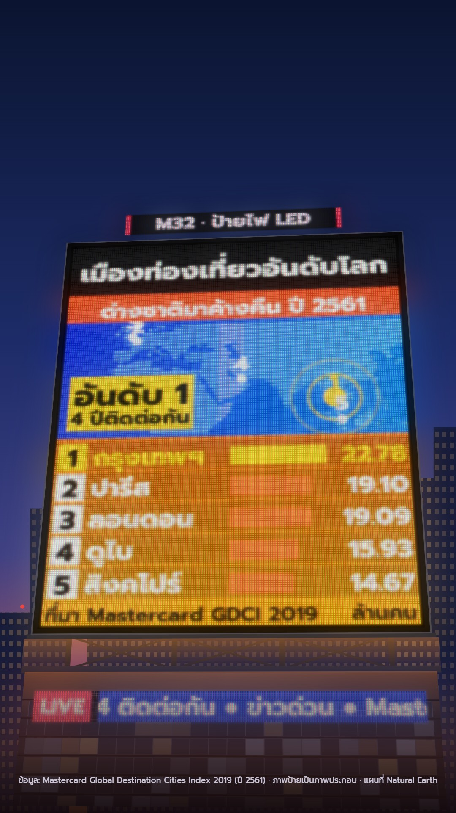

# M32 ป้ายไฟ LED · LED Billboard

**Fits:** breaking news, rankings and top-5s, city stories, records, results nights, countdowns ·
**Formats:** 9:16 · **Code:** `Demo.tsx` + `kit/Led.tsx`

## Look

A giant rooftop LED screen on a steel truss above a tower at blue hour, filmed from the street looking up
(strong perspective: the screen leans back and to one side). Everything the story shows is
on the screen, and the screen is made of coarse LEDs: each pixel is three RGB sub-pixel bars behind a black mask,
with slight LED-to-LED brightness spread, and unlit LEDs show as dark grey dots, so the grid is visible even on
black. Light blooms off the panel twice — a tight glow over the mask and a wide spill into the night air. The
camera drifts and slowly swings round the building; when it moves, a moiré beat (the camera grid against the LED
grid) crawls across the screen. Around it: a steel screen frame on a truss with cross braces and an orange light
spill, the tower's roof edge and curtain-wall floors with a few lit panes, a small LED sign above the screen (the
kicker), a blue news ticker band on the facade with a red LIVE tag, far towers with lit windows and red aircraft
lights against a deep blue sky that warms to orange at the horizon, and street haze at the bottom.
On the screen: a full-panel red-orange → amber LED gradient, a black header bar, a deep LED-blue map band with the
land as a cyan dot screen and a scan line, white city dots with rank numbers, and ranked rows (white rank chip,
name, bar, value) that build from fifth to first; #1 in yellow with a yellow "อันดับ 1" badge.

| Role | Hex |
|---|---|
| Blue-hour sky | `#1d2c68` (`#0b1430` → `#3e4083` → `#d0743f`) |
| LED orange (screen ground) | `#ff6a00` (`#ff2d1a` → `#ffa000`) |
| LED blue (map band, ticker) | `#0a1fd8` → `#0a78ff`, land dots `#8fe6ff` |
| Yellow (#1 highlight) | `#ffd21f` |
| White (LED text) | `#f4f6ff` |

Also: LIVE red `#ff2a4a`, bars `#ff6a2a`, tower `#141a3a`, facade `#2b2a38`.

**Type:** Prompt 700–800 rendered *as LEDs* (drawn at 4× in canvas, averaged to the LED grid). Main screen 160 ×
200 LEDs at 6 px pitch: header 10.6 LED rows, names 9, values 8.6, small print 6.8; ticker 160 × 13 at 6 px,
text 10; rooftop sign 130 × 15 at 5 px. Credit line under the scene in Prompt 500, 19 px.
**Line:** none in the vector sense — every edge is the LED grid (`dot-matrix`).

## Motion signature

- **Ticker crawl:** the caption/news line crawls right-to-left continuously on the ticker band (1.9 LEDs per
  frame), with the LIVE tag pinned on the left.
- Ranks build up from the bottom of the list: each row's bar grows and its value counts up over 20 frames,
  a pop on each; #1 arrives last, flashes, and the map shows rings round its city and a big "อันดับ 1" overlay.
- Camera: looking up (`rotateX` 16° → 13°, perspective 1500) with a slow push and a swing round the building
  (`rotateY` −16° → −2°); moiré strength follows camera speed.
- A brighter scan line sweeps the map's dot screen.

## Scenes in the kit (`kit/Led.tsx`)

| Component | Shows | Props |
|---|---|---|
| `LedPanel` | Any canvas drawing rendered as an LED panel with bloom | `x, y, cols, rows, pitch, draw, deps, bloom, ready` |
| `ledImage` | The rasteriser behind it (supersample → LED grid → RGB sub-pixels) | `cols, rows, pitch, draw, ss` |
| `useFontReady` | Holds the render until the font is loaded for canvas text | — |
| `Moire` | Beat pattern over a panel | `x, y, w, h, pitch, k, phase` |
| `Night`, `Building` | Blue-hour sky and far towers; rooftop truss, screen frame, roof, lit floors, light spill | `width, height` / `x, w, top` (roof y), `screen` |
| `Small` | Plain small text off-screen (credits) | — |

`draw(ctx, w, h)` gets a 4× canvas; lay content out in panel units (`u = w / 120` in the demo). Keep text ≥ 9 LED
rows, heavy weights (700–800), and few words per line — it is a billboard.

## Build notes

Building, panels and moiré sit inside one `perspective` wrapper (the camera); haze and credits stay outside it.
Each `LedPanel` recomputes on its `deps` (the frame for animated content, `[]` for the static sign). The main panel
is ~600 k output pixels per frame; keep at most two animated panels. Don't scale a panel with CSS — change `pitch`.

## Data

Land: `world-atlas` land-110m (Natural Earth, in the template). No fetch needed.
`npm run sfx && npm run sfx-lib` for `city_crowd`, `crowd_cheer`.

Facts in the demo: Mastercard Global Destination Cities Index 2019 (international overnight visitors in 2018):
Bangkok 22.78 million, Paris 19.10 m, London 19.09 m, Dubai 15.93 m, Singapore 14.67 m; Bangkok first for the
fourth consecutive year (Mastercard press release, September 2019; Tourism Authority of Thailand, TAT News,
10 September 2019). The building and screen are illustration (labelled "ภาพประกอบ" in the credit line).

## Don'ts

- Not 8-bit pixel art: no sprites, no chunky game palette, no hard-pixel characters — it is a photographed LED panel
  with sub-pixels, bloom and moiré.
- Not M13: no split-flap, no amber monochrome. Use saturated full-colour LED grounds (orange, blue).
- Don't put real brands' logos or ads on the screen or building; the data source is named in text only.
- Don't push moiré past ~0.4 on a frame that has to be read.

## Credits

Data: Mastercard Global Destination Cities Index 2019. Map: Natural Earth (public domain) via world-atlas. Sound:
template UI sounds and house library `city_crowd`, `crowd_cheer` (Mixkit / Pixabay licences). Font: Prompt (SIL
Open Font License).
