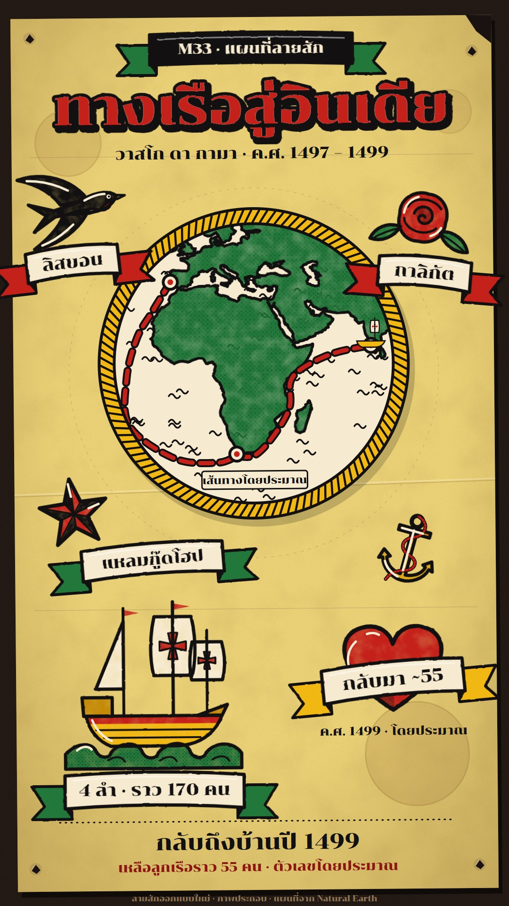

# M33 แผนที่ลายสัก · Tattoo Flash Sheet Map

**Fits:** sailors, pirates, sea routes, legends, bold short stories with a few strong symbols ·
**Formats:** 9:16 · **Code:** `Demo.tsx` + `kit/Flash.tsx`

## Look

The whole frame is one sheet of traditional tattoo flash pinned to a dark shop wall: aged manila-yellow paper with tea
stains, foxing grain, a fold crease, a torn corner, four pin holes and faint pencil layout lines left from drawing
the sheet. Every element is a flash design: a heavy black outline (7 px, slightly wobbly, a touch of ink bleed)
filled with hand-painted flat colour from a limited palette — red, green, yellow, black and cream — that sits a
hair off the line (2 px) and is a little uneven, with black dot stipple for shading and short cream highlight
flicks. The map is itself a design: a medallion in a twisted yellow rope ring, land in green with dot shading, sea
in cream with black wave flicks, the route in bold red dashes on a black keyline, ports as red-centred rings. Round
it sit the story's symbols (swallow, nautical star, rose, anchor, caravel, heart), each with a ribbon banner
carrying a place name or number. Lettering is hand-painted: red display letters with a cream inline, a heavy black
keyline and an offset black drop.

| Role | Hex |
|---|---|
| Aged manila flash paper (background) | `#f6dc7c` (stains `#a57c3c`, wall `#1a1210`) |
| Red (route, roses, hearts, title) | `#c4211b` (shade `#8e1512`) |
| Green (land, leaves, waves, banner tails) | `#22783b` |
| Yellow (rope ring, hulls, anchors) | `#f1b712` |
| Outline black / text | `#121010` |
| Cream (sea, banners, highlights) | `#f6ead0` |

**Type:** Chonburi 400 (Thai display serif with heavy contrast, reads as sign-painted). Title 108 px, kicker 32 px
cream on a black banner, banner text 34–38 px, caption 46 px + 28 px red-brown line, honest labels 22 px — at
1080 wide. **Line:** bold-outline: 7 px designs, 6 px coast, 9 px hearts and rings, 17 px route keyline under 9 px red
dashes (26/16).

## Motion signature

- **Ink-in:** every design appears the way a tattoo is made. 0–55 %: the black outline is pulled along each path
  (`pathLength` dash). 45–90 %: colour is packed in from the design's centre (a growing circular clip). 85–100 %:
  the cream highlight flicks appear. One design every 2–4 s, cued on the word.
- Banners unroll from the centre, then the tails fold out, then the lettering appears.
- Title and display lettering: the outline wipes in left to right, then the red fill floods in.
- The route draws in bold dashes leg by leg; a small caravel rides its head with a slight bob.
- The camera does not move. The sheet is still; the ink is the motion.
- Sound: a soft tick on each ink-in (the needle), a pop on each banner, sea and creaking-ship beds, a ship's bell
  on arrival.

## Scenes in the kit (`kit/Flash.tsx`)

| Component | Shows | Props |
|---|---|---|
| `SheetDefs`, `Sheet` | Filters (paper, grain, paint, ink wobble), dot pattern; the pinned sheet | `children, tilt` |
| `Flash` | Generic ink-in design from `fills` (colour) + `lines` (outline) + `hi` (highlights) | `id, k, x, y, s, rot` |
| `Swallow`, `Anchor`, `Rose`, `NauticalStar`, `Heart`, `Caravel` | Original flash designs | `id, k, x, y, s, rot` |
| `Banner` | Ribbon with folded tails and lettering | `x, y, w, text, size, k, fill, tail, rot` |
| `Medallion`, `medallionProj` | Map in a rope ring (world-atlas land), wave flicks | `cx, cy, r, proj, k` |
| `Route`, `Port`, `ShipMark`, `smooth`, `along` | Dashed route, ports, the riding caravel | `id, pts, k` |
| `Lettering` | Hand-painted display title | `id, x, y, text, size, k` |
| `inkK` | `frame, start, len` → 0..1 ink-in progress | — |

New symbols: draw them as a `Flash` with 2–6 fill paths in the palette and the same paths as `lines`; add one or
two `hi` flicks. Keep each design readable as a silhouette at phone size.

## Build notes

One SVG at 1080×1920; the HTML layer is only the credit line. 9:16 layout: kicker banner 6 %, title 14 %, sub-title
17.5 %, medallion centre 40 % (r 306), designs round it, lower third for the big designs (ship, heart), caption
below a dotted rule at 90 %. Each `Flash` needs a unique `id` (its clip). The paint and ink filters are per design;
keep to about 10 designs on screen. For long videos, change the sheet (a new sheet per chapter) rather than
crowding one.

## Data

Land: `world-atlas/land-110m.json` (in the template; the coarse coast suits flash). No fetch needed.
Demo facts (Vasco da Gama's first voyage): left Lisbon 8 July 1497 with four ships; rounded the Cape of Good Hope
22 November 1497; reached Calicut 20 May 1498; back in Portugal in 1499. About 170 men sailed and about 55
returned — numbers differ between sources, so the demo says "ราว" and "โดยประมาณ". Source: Encyclopaedia
Britannica, "Vasco da Gama" and "European exploration — the voyage of Vasco da Gama". The route is drawn
through approximate waypoints (Cape Verde, the South Atlantic swing, Mossel Bay, Mozambique, Malindi) and is
labelled "เส้นทางโดยประมาณ". The red cross on the sails is the Order of Christ cross used on Portuguese ships.

## Don'ts

- No gradients, glow, photos or soft shading — flat colour, black line, dot stipple only.
- No colours outside the five (plus cream); no blue sea fill.
- Don't copy real flash sheets or a tattoo artist's designs; draw new ones in this kit's manner.
- No skulls, weapons on people or gore for history topics; keep the symbols nautical and decorative.
- Don't move the camera or let designs slide around; they ink in where they sit.

## Credits

Map drawn from Natural Earth land via `world-atlas` (public domain). Sound: template UI sounds and house library
(`sea_rough`, `ship_creak`, `ship_bell`; Mixkit / Pixabay licences). Font: Chonburi (SIL Open Font License).
All flash designs are original, drawn in code.
