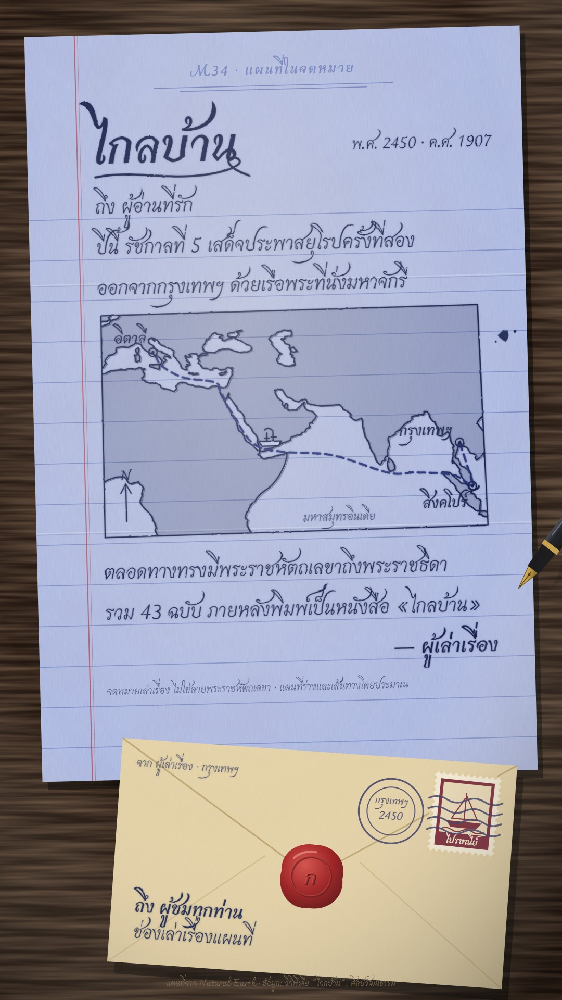

# M34 แผนที่ในจดหมาย · Fountain-Pen Letter Map

**Fits:** letters, travellers' journeys, diaries, war mail, "a message from far away" stories ·
**Formats:** 9:16 · **Code:** `Demo.tsx` + `kit/Letter.tsx`

## Look

A letter lying on a dark walnut desk under a warm lamp. The sheet is tinted periwinkle-blue writing paper with
printed blue ruling, a red double margin line, fine paper fibre and mottling, two fold creases (it was folded in
three) and a soft shadow on the desk. Everything on it is blue-black fountain-pen ink in a calligraphic Thai hand:
a small printed letterhead (the kicker), the date at the right, a big handwritten title with a looped flourish,
the greeting, the body lines sitting on the ruling. In the middle of the letter the writer has sketched a map in
the same ink: a hand-ruled, slightly crooked frame, a coast drawn twice (a quick second pass a hair off), a pale
ink wash on the land, a north arrow, the route as pen dashes with a tiny boat doodle, places as circled dots with
handwritten names. Ink feathers a little into the paper; there is one blot. At the foot, a cream envelope slides
in: handwritten address, an original stamp, a postal cancel (rings with town and year + wavy lines) and a red wax
seal pressed on the flap. A real fountain pen (black barrel, gold bands, gold nib) writes every line.

| Role | Hex |
|---|---|
| Tinted writing paper (main ground) | `#a9b5df` (ruling `#6f80bf`, margin `#b0475a`) |
| Blue-black ink (all writing and drawing) | `#16204d` |
| Envelope | `#e2cfa3` (fold shadows `#bfa774`) |
| Wax seal (accent) | `#9c1c1f` → `#d4504a` highlight |
| Walnut desk | `#21150f` |

Must not look like M05 (map on vellum over a light box), N09 (newsprint) or N12 (stamp album): here the paper is
blue, ruled and handwritten on, the map is a pen sketch inside the text, and the only "stamp" is on the envelope.

**Type:** Charmonman (Thai calligraphic pen script) — title 104 px 700, body 44 px 400 on 78 px ruling, date 34 px,
place names 32 px 700, honest label 23 px, letterhead 30 px 700 in the ruling blue (printed, letter-spaced) — at
1080 wide. **Line:** nib-ink: coast 2.6 px + 1.1 px second pass, frame 2.4 px, route 4.2 px dashes 14/9, all through
the `m34-ink` filter (2 px wobble + a 1.8 px darker bleed halo).

## Motion signature

- **Handwrite:** every text line writes itself left to right (a clip that grows at 1.5 characters per frame) and
  the pen's nib rides the writing head with a small up-down scribble; between lines the pen lifts (its shadow moves
  away) and travels to the next line's start.
- The map is sketched with the same pen: frame and coast draw on, the second pass follows, the wash and north arrow
  appear; then the route is dashed out with the nib on its head and a boat doodle riding it.
- The envelope slides up into frame; the stamp drops on (rotates into place), the cancel thumps on in 4 frames, the
  wax seal presses down (scale 1.6 → 0.94 → 1).
- No camera moves; the light and the desk are still. One idea per line, one line every 1.5–3 s.
- Sound: light rain bed, a soft tick as each line starts, a ship's bell on arrival, a wooden thump on the cancel.

## Scenes in the kit (`kit/Letter.tsx`)

| Component | Shows | Props |
|---|---|---|
| `Defs`, `Desk`, `Lamp` | Filters and gradients; walnut desk; lamp light and dark corners | — |
| `Sheet` | Tinted ruled paper with margin and folds; children in sheet coords | `children` |
| `Hand`, `handHead`, `estWidth` | A line that writes itself; the nib position for it | `id, x, y, text, size, k, weight, anchor` |
| `Flourish` | Looped underline drawn on | `x, y, w, k` |
| `SketchMap`, `sketchProj` | Pen-sketched map in a hand-ruled frame (world-atlas land) | `id, proj, box, k` |
| `InkRoute`, `Boat`, `Place`, `Blot` | Dashed route, boat doodle, circled place + name, ink blot | `id, pts, k` / `x, y, name, k` |
| `Pen` | Fountain pen with its nib at `x, y` | `x, y, angle, lift` |
| `Envelope` | Envelope with address, stamp, cancel and wax seal | `k, stampK, cancelK, sealK, to, from` |
| `toScreen`, `along`, `smooth` | Sheet → screen point (for the pen); polyline helpers | — |

## Build notes

One SVG at 1080×1920. The sheet is at (64, 60), 952 × 1430, rotated −1.4°; text and map are in sheet coordinates
(ruled lines from y 352 every 78 px; write body lines at `RULE0 + n·RULE − 10`). The pen is drawn in screen space
via `toScreen`, after the envelope and before the lamp. Keep each body line under ~44 characters at 44 px (one
line per sentence). For long videos turn the page: a new `Sheet` per chapter, the previous one sliding off.

## Data

Land: `world-atlas/land-110m.json` (in the template). No fetch needed.
Demo facts: in 1907 (พ.ศ. 2450) King Chulalongkorn (Rama V) made his second journey to Europe, leaving Bangkok on
the royal yacht Maha Chakri; the trip lasted about 225 days and he was back in Bangkok in November 1907; the first
stops were Singapore and then Italy. On the way he wrote letters to his daughter, Princess Nibha Nobhadol —
43 letters, later published as the book *Klai Ban* (ไกลบ้าน). Sources: Thai Wikipedia "ไกลบ้าน"; Silpa
Wattanatham (silpa-mag.com) articles on the second European trip. The sea route via the Strait of Malacca,
Ceylon, the Red Sea and Suez is drawn through approximate waypoints and labelled as approximate. The letter on
screen is the narrator's own text, not a royal letter, and says so on the sheet; no words are put in the king's mouth.

## Don'ts

- Never present the on-screen letter as a real letter or quote a real person in it unless the words are a sourced
  quotation (then cite it in the video description).
- No typewriter type, no printed body text, no colour except the ink, the envelope and the red seal.
- Don't fill the map with colour or labels; it is a quick pen sketch, five or six names at most.
- Don't make the pen fly about fast; it lifts and travels between lines at writing pace.
- Don't imitate real stamps or postmarks; draw generic ones.

## Credits

Map drawn from Natural Earth land via `world-atlas` (public domain). Sound: template UI sounds and house library
(`rain_light`, `ship_bell`, `wood_hit`; Mixkit / Pixabay licences). Font: Charmonman (SIL Open Font License).
