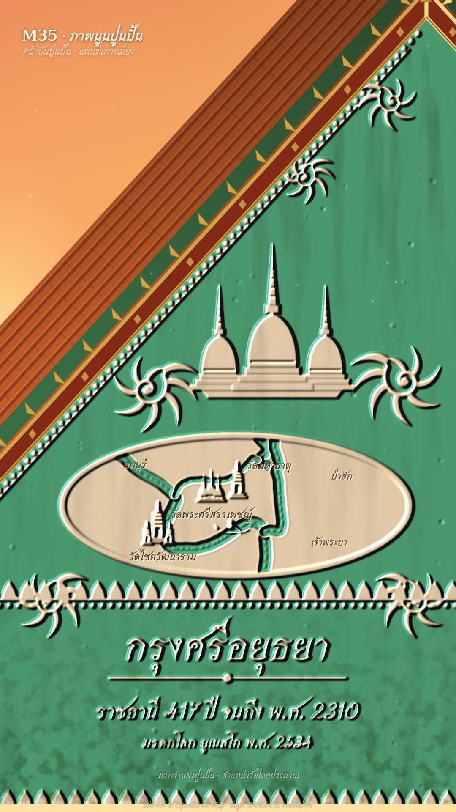

# M35 ภาพนูนปูนปั้น · Temple Stucco Relief Map



**Fits:** Thai temples, kingdoms and old capitals, sacred sites, a city's founding story ·
**Formats:** 9:16 · **Code:** `Demo.tsx` + `kit/Stucco.tsx`, `kit/ayutthaya.ts`

## Look

A Thai temple gable (หน้าบัน) seen close up from below, so one bargeboard runs diagonally across the frame against
a warm evening sky. Above the diagonal: amber-to-rose sky with the low sun's glow at the left, a band of orange
roof tiles with a green-glazed edge course, and the bargeboard (ลำยอง) in red lacquer with gilt rules, gilt
lozenges and a row of gilt bai raka fins; the chofa hook just shows at the top corner. Below it, the whole frame is
the gable's painted jade-green field with **white lime stucco (ปูนปั้น) modelled in raised relief**: a beaded
border following the slope, kanok flame scrolls, the story's emblem (here the three bell chedis of Wat Phra Si
Sanphet), a raised oval cartouche holding the map — the rivers carved into it as channels with raised banks and
ripple ridges, the temples standing on it as small chedis and prangs, a boat on the river — lotus-petal bands,
and the title and captions themselves as raised stucco letters. Everything in the panel is lit by one low warm
sun through an SVG lighting filter, so every edge has a lit lip and a cool cast-side shadow. Weathering: faint
black mould streaks running down from the top, moss gathering in the lower part, lime pits and grit.

| Role | Hex |
|---|---|
| Painted field (background of the relief) | `#3db394` |
| Lime stucco (all relief) | `#fbf5ea` lit by `#ffe6c4` sun, shadows bounced cool `#4a5a78` |
| Roof tiles | `#c45a2c` (courses `#7d3218`, edge course `#2f6e4a`) |
| Gilt (bargeboard rules, fins, chofa) | `#caa04c` (lacquer `#7a2618`) |
| Incised text / small labels | `#43372a` |
| Evening sky | `#e7845e` → `#f3a565` → `#f8cf86` → `#fbe3a8` |

Must not look like M24 (a white plaster terrain model on black) or N06 (a painted mural): here the relief is
ornament on a temple gable, white on a painted field, framed by roof and bargeboard, with the map as one cartouche.

**Type:** Srisakdi 700 (traditional Thai display) — raised title 104 px, raised caption 54 px + 38 px, incised map
labels 26–28 px, kicker 38 px (the pack ID set in Trirong 700, because Srisakdi's Latin capitals are ornamental) —
at 1080 wide. **Line:** embossed: no drawn lines at all; every edge comes from the height map under the light
(relief depth `scale` 13 px, blur 2.2 px).

## Motion signature

- **Light rake:** the sun moves through the clip — azimuth 236° → 200°, elevation 38° → 28° — so shadows lengthen
  and swing across the relief; the soft-light warm wash deepens with it.
- **Rise from the plaster:** every element starts at the field's height and rises to its own height
  (`rise(k, top)`), so it appears as shadows growing round it, not as a fade: kanok scrolls first, then the emblem,
  then the rivers are carved along their length (`Carved k`), then each temple rises on the map as it is named.
- Captions are raised letters too: at each beat change the old line sinks back into the field and the new one rises.
- No camera move. Dust motes drift in the sunlight.
- Sound: soft wind bed, a tick per rising element, a whoosh as the rivers are carved, a gong when the main temple
  rises, a faint bell on the last beat.

## Scenes in the kit (`kit/Stucco.tsx`)

| Component | Shows | Props |
|---|---|---|
| `ReliefDefs` | The lighting filter (height → diffuse + specular, field paint mask), weathering filters, gradients | `az, el, scale` |
| `Relief` | A height-map group lit by the sun (draw children with `hgt(h)` / `rise(k, h)` greys) | `x, y, w, h` |
| `Kanok`, `Chedi`, `Prang`, `Boat` | Kanok flame scroll; bell chedi; prang; boat with oarsman — all as height | `x, y, s/ht, h, k` |
| `Beads`, `Lotus`, `Carved`, `Column` | Bead moulding; lotus-petal band; carved river with banks; porch column | — |
| `Weather` | Mould streaks, moss, grit (multiply) over a region | `x, y, w, h, mould, moss` |
| `Sky`, `Roof`, `Bargeboards` | Evening sky; tile band; lacquer-and-gilt bargeboards with bai raka and chofa | `warm` / `band` |
| `Dapple` | Optional dappled tree shade with drifting sun-flecks | `id, region, sway, k` |
| `Incised`, `Motes` | Lettering cut into plaster; dust in the sun | — |
| `fitProj`, `linePath` | Map projection into a box; MultiLineString → path | — |
| `kit/ayutthaya.ts` | Chao Phraya, Lopburi, Pa Sak and Khlong Mueang round Ayutthaya island | — |

Height levels used: field 0.34 (painted), map ground 0.5, river banks 0.52, channels 0.08, mouldings 0.6–0.75,
kanok 0.78, chedis 0.92–0.98, raised letters 0.72–0.8. Anything below ~0.45 takes the field colour.

## Build notes

One SVG at 1080×1920. The gable is the triangle `APEX` (1010, 40) → `BL` / `BR` (far off-frame), so its left slope
crosses the frame diagonally; the panel is clipped to it (`#m35-tri`). Order: `Sky` → `Roof` → clipped panel
(`Relief` → `Weather` → incised labels) → `Bargeboards` → warm wash → motes; HTML on top only for the kicker and
the credit line. The lighting filter is heavy (≈ 90 s a 1080×1920 still): for a long video keep the sun still
through a scene so frames can be cached, and keep each relief group to the area it needs.

## Data

Waterways round Ayutthaya island from OpenStreetMap (© OpenStreetMap contributors, ODbL), simplified into
`kit/ayutthaya.ts`. To make the same for another place:

```bash
node scripts/fetch-osm.mjs th-ayut-island 100.50 14.30 100.64 14.42 rivers   # public/data/th-ayut-island.geojson
# keep the named rivers/canals, round to 4 decimals, write them as [lon, lat][][] (see kit/ayutthaya.ts)
```

Temple positions (approximate, labelled on screen): Wat Phra Si Sanphet 14.3558 N 100.5589 E, Wat Mahathat
14.3569 N 100.5675 E, Wat Chaiwatthanaram 14.3428 N 100.5417 E.
Demo facts: Ayutthaya founded in B.E. 1893 (1350/51) by King U Thong; the city is an island where the Chao Phraya,
Lopburi and Pa Sak rivers meet; Wat Phra Si Sanphet was the royal temple inside the Grand Palace, with three bell
chedis; capital for 417 years until B.E. 2310 (1767); "Historic City of Ayutthaya" on the UNESCO World Heritage
List in 1991 (B.E. 2534). Sources: UNESCO World Heritage Centre, whc.unesco.org/en/list/576; Fine Arts Department
(กรมศิลปากร), Ayutthaya Historical Park.

## Don'ts

- Don't colour the relief: stucco is white; colour lives only in the painted field, roof, bargeboard and sky.
- Don't draw outlines or flat icons in the panel — everything must be height under the light.
- Don't copy a real temple's gable composition or a real stucco master's figures; draw new ornament.
- Avoid figures of the Buddha or royalty as decoration; use architecture, kanok, animals, boats.
- Keep the field one painted colour per video.

## Credits

Waterways © OpenStreetMap contributors (ODbL). Sound: template UI sounds and house library (`wind`, `gong`,
`church_bell`; Mixkit / Pixabay licences). Fonts: Srisakdi and Trirong (SIL Open Font License).
