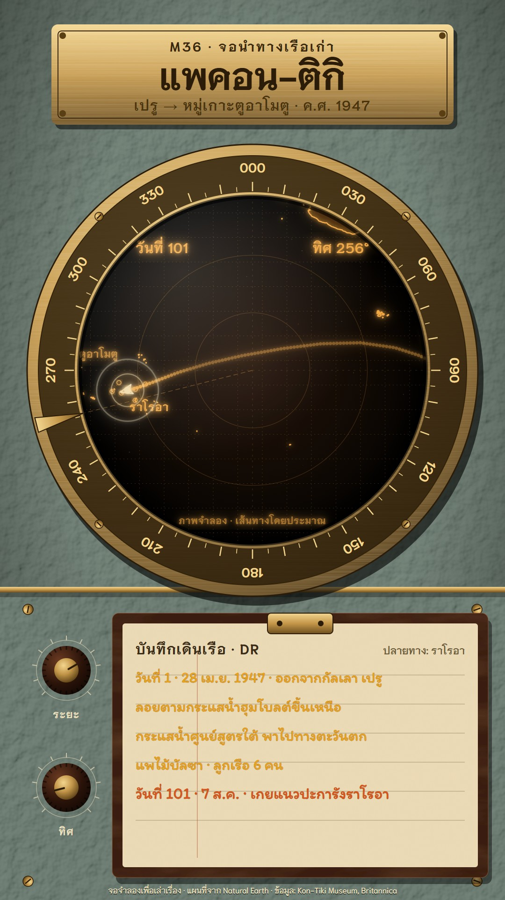

# M36 จอนำทางเรือเก่า · Old Ship's Navigation Scope

**Fits:** voyages, sea lanes, expeditions, naval history, any journey told day by day ·
**Formats:** 9:16 · **Code:** `Demo.tsx` + `kit/Scope.tsx`

## Look

An old ship's plotting scope on a bridge console. The console is grey-green hammertone enamel (dimpled, lit from
the upper left, darker at the corners). At the top a brushed-brass name plate with four screws carries the kicker,
the title and the route, engraved in dark. The centre is a round cathode-ray tube in a heavy brass bezel: a dark
engraved bearing band (000–330 figures, 5° ticks) on polished, brushed brass, four bezel screws and a brass bearing
cursor that rides the ring. The tube face is near-black glass with a faint warm glow in the centre, a dotted 5°
graticule and two range rings, all in dim amber phosphor; the coast is drawn by the beam in bright amber with a
soft bloom and a faint fill; atolls are tiny rings; the ship's track is a line of fix dots, the newest hot white,
older ones fading (phosphor persistence); the ship is a chevron with a pulsing ring; readouts (day, heading) sit in
the tube's upper corners in the plotter's own lettering. A soft glare lies across the glass. Below a brass strip,
the lower plate holds two bakelite knobs with brass caps and engraved scales, and a celluloid dead-reckoning card
in a bakelite frame under a brass clip, ruled, with entries in yellow-orange grease pencil.

| Role | Hex |
|---|---|
| Grey-green enamel console (background) | `#5a6e62` |
| Brass (bezel, plate, cursor, clip) | `#c4974a` (highlight `#f3d58e`, shade `#6e4f1f`) |
| Tube glass | `#0c0703` |
| Amber phosphor (coast, track, readouts) | `#ffb24a` (hot `#fff0c8`, dim `#8a4f14`) |
| DR card / grease pencil | `#ead9b4` / `#e8a21c` (last entry `#d8541c`) |
| Bakelite (knobs, card frame) | `#3a1d10` |

Must not look like M23 (searchlight on a night sea), M14 (seismograph on chart paper) or M31 (weather radar): here
the display is a vector-drawn chart in amber on a brass-bezelled tube, there is no sweep and no weather, and the
log is written by hand on a card.

**Type:** Niramit 600/700 — title 78 px engraved, kicker 28 px letter-spaced, bezel figures 28 px, phosphor readouts
30 px, phosphor labels 22–30 px, engraved panel labels 22 px — and Itim 400 for the grease pencil (32–34 px) — at
1080 wide. **Line:** glow: coast 2.6 px amber with a two-step blur bloom (4 + 12 px), graticule 1 px dotted at
22 %, track dots 3.6 px (head 7 px), bearing hairline 1.4 px dashed.

## Motion signature

- **Trace and plot:** the tube warms up (face fades in with a slight flicker), then the beam traces the coast
  (stroke draws on with its bloom), then the track dots forward one fix per day, the newest dot hot and the older
  ones fading; the chart pans to follow the ship.
- **Dial turn:** the brass bearing cursor swings round the bezel on start-up and then follows the heading; the
  heading readout and the knobs turn with it.
- **Grease pencil:** each DR card entry writes itself left to right at the matching beat; the arrival entry is in
  red-orange.
- Arrival: a ring blooms out from the destination and the face flares briefly.
- Sound: sea and creaking-raft beds, a soft tick every few fixes, a pop per card entry, a splash on the reef and a
  ship's bell.

## Scenes in the kit (`kit/Scope.tsx`)

| Component | Shows | Props |
|---|---|---|
| `Defs`, `Console` | Filters (glow, hammertone, brushed brass, bakelite); enamel console with lower plate | `children` |
| `Bezel` | Brass bezel, engraved bearing ring, the bearing cursor | `bearing, k` |
| `Face`, `Glare` | The tube face (children clipped to it); glass glare and rim | `k` |
| `chartProj`, `Coast`, `Graticule`, `Rings` | Chart projection centred on a point; beam-drawn coast (world-atlas 50m); grid; rings | `center, ppd` / `proj, k` |
| `Track`, `ShipMark`, `Atoll`, `PLabel`, `Snow` | Fix dots with persistence; ship chevron; atoll ring; phosphor text; tube noise | — |
| `Knob`, `Engraved` | Bakelite knob with scale; engraved plate text | `x, y, r, rot, label` |
| `Card`, `Pencil` | DR card in a bakelite frame; a grease-pencil line that writes itself | `x, y, w, h` / `id, x, y, text, k` |
| `along` | Point at `t` along a [lon, lat] polyline | — |

## Build notes

One SVG at 1080×1920: name plate 3–14 %, tube centre (540, 790) r 372 with the bezel to r 466, lower plate from
y 1260 with knobs at the left and the card at x 262–1022, y 1330–1850. The chart follows the ship: recompute the
projection centre each frame from the ship's progress; keep `ppd` (px per degree) fixed for a scene. The glow
filter is per group (coast, track, labels) — keep the number of glowing groups small.

## Data

Land: `world-atlas/land-50m.json` (in the template). No fetch needed. Atoll positions are typed in the demo
(approximate). Demo facts (Kon-Tiki, 1947): a balsa-wood raft with six men left Callao, Peru, on 28 April 1947;
it drifted with the Humboldt Current and then west with the South Equatorial Current; after 101 days, on 7 August
1947, it ran onto the reef of Raroia in the Tuamotu Islands. Sources: Kon-Tiki Museum (kon-tiki.no, "The Kon-Tiki
Expedition"); Encyclopaedia Britannica, "Kon-Tiki" and "Thor Heyerdahl". The drift track is drawn through
approximate waypoints and labelled "เส้นทางโดยประมาณ"; the scope itself is a storytelling device (the raft carried no
such instrument), labelled "จอจำลองเพื่อเล่าเรื่อง".

## Don'ts

- No radar sweep, no green phosphor, no weather echoes — this is a plotting display, amber only.
- Don't put more than one hot point on the tube at a time; everything else is afterglow.
- Don't flatten the brass: keep the bezel gradient, brushed streaks and screws.
- Don't present simulated positions as logged positions; label the track approximate.

## Credits

Map drawn from Natural Earth land via `world-atlas` (public domain). Sound: template UI sounds and house library
(`sea_rough`, `ship_creak`, `splash_big`, `ship_bell`; Mixkit / Pixabay licences). Fonts: Niramit, Itim (SIL Open
Font License).
