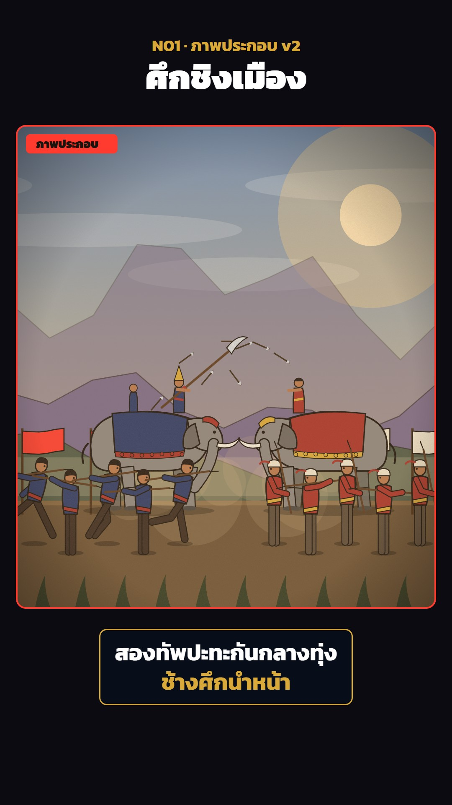

# N01 ภาพประกอบ v2 · House Illustration v2 (Depth, Light, Jointed Figures)

**Fits:** any history scene — marches, sieges, battles, burning cities, court and village life; the default look for
illustrated panels in long-form history videos · **Formats:** 9:16 / 16:9 · **Code:** `Demo.tsx` + `kit/Stage.tsx`,
`kit/scenes.tsx`, `kit/props.tsx` (built on the template's `src/components/Scene.tsx`)

## Look

Each story beat is a framed illustration panel ("ภาพประกอบ" tab, rounded 22 px corners, gold or red frame) on a
near-black screen, with the title above and a two-line caption card below. Inside, a painted-flat world with real
depth: a two-colour sky gradient (dawn, day, dusk or night), a sun, moon or fire glow, slow cloud banks, a pale far
mountain range, two ridges, a mist band, the ground, buildings (city walls with bai sema merlons, prangs, stilted
houses, stockades) and jointed figures — soldiers, villagers, war elephants — each with a soft ground shadow and a
3 px ink outline, then a row of foreground grass. Muted earthy colours, a warm orange wash and paper grain with a
vignette over everything. Fire, smoke, muzzle flashes and dust are the only bright accents.

| Role | Hex |
|---|---|
| Screen background · ink outline | `#0d0b12` · `#1a140f` |
| Earth · chalk (walls) · skin | `#6b5236` · `#efe6d0` · `#b9784e` |
| Costumes: indigo / ochre / gilt | `#2b3a67` / `#a8322a` / `#d9a93a` (template `PAL`) |
| Far ridge / mid ridge / grass | `#7a6a8a` / `#4f5a48` / `#2f3a24` |
| Skies: day / dusk / night / dawn | `#6f8fb8→#f2c98a` / `#3a2a5a→#e0875a` / `#0b1026→#2a2a4a` / `#4a5a8a→#f6b880` |
| Panel frame + tab | gold `#ffc94a` (calm scenes) / red `#ff3b30` (battle, fire) |

**Type:** Kanit 700/900. 9:16: kicker 40 px gilt `#d9a93a`, title 80 px white, caption 54 px 700 (line 1 white,
line 2 gilt) in a `rgba(8,14,26,0.9)` card with a 3 px gilt border, radius 18; panel tab 28 px 900 in `#1a140f`.
16:9: kicker 30, title 58, caption 40 on one line. **Line:** ink `#1a140f`; figures 2–3 px (limbs get a +3 px ink
underlay), buildings 1.5–2 × `g.s`, ridges 1.4 × `g.s` at 50 % opacity.

## Motion signature

- A new panel every ~4 s, sliding up 30 px and fading in over 14 frames on top of the outgoing one (outgoing
  `end` = incoming `start + 14`; no flicker).
- Inside every panel the template's `Depth`: slow push-in (+7 %) and a 40 px pan over the panel's life, applied to
  the layers at different speeds — far × 0.1–0.2, mid × 0.5, near × 0.7, foreground grass × 1.6.
- Figures are always alive: walk / run cycles with bob, spear thrusts, breathing when they stand; elephants walk
  with ear flaps; banners flutter; fire flickers; smoke rises; clouds drift.
- Impacts: a cannon `Shot` (muzzle flash, smoke puffs, ball on an arc, dust burst on landing) or a clash →
  `impactAt` → 6 px × `g.s` shake and a white flash on the panel, with an SFX hit on the same frame.

## Scenes in the kit

| Component | Shows | Props |
|---|---|---|
| `Stage` (`kit/Stage.tsx`) | Map-free panel: sky, clip, frame, tab, `Depth` (push-in, pan, shake on `hits`, warm wash, grain) | `id, start, end, sky, accent, hits, warm, label, fadeOut, children(g, pan, lt)` |
| `stageGeom` | Panel geometry for the video size (9:16: 1000×1150, s 1.8; 16:9: 1800×760, s 1.6) | `width, height, frame` |
| `MarchScene` | Army column with an elephant, banners, dust | `id, start, end, side, dir, light, elephants` |
| `SiegeScene` | City wall + prang, cannon firing `Shot`s at attackers by a stockade | `id, start, end, shots` |
| `BattleScene` | Two armies, two war elephants, arrow volleys, dust, clash flashes | `id, start, end, left, right, volleys, hits, winner, light` |
| `StormScene` | Wall stormed with a ladder at dusk, fire and smoke | `id, start, end, attacker, burn, hits` |
| `BurningCityScene` | Night, houses burning under prangs, villagers fleeing | `id, start, end` |
| `props.tsx` | `Backdrop`, `Clouds`, `Fire`, `Smoke`, `PalaceWall`, `Prang`, `House`, `Palisade`, `Ladder`, `Dust`, `Volley`, `Elephant`, costumes `C`, skies `DAY DUSK NIGHT DAWN` | `g` or `x, y, s` |

Template pieces used directly: `Fighter` (modes walk / run / attack / aim / stand, `COSTUME` presets), `Banner`,
`Grass`, `Glow`, `Ridge`, `Shot`, `impactAt`, `Depth`, `PaperGrain` from `components/Scene.tsx`.

## Build notes

Compose a new scene as `<Stage …>{(g, pan, lt) => …}</Stage>`: `<Clouds>` and `<Backdrop>` first, then buildings
(× 0.3–0.5 pan), figures (× 0.7–0.8), and `<Grass shift={pan * 1.6}>` last. Size everything from `g`: x as
fractions of `g.W`, lengths × `g.s`, figures `scale={g.sc * 0.5–0.8}`, elephants `s={g.s * 0.4–0.5}`, feet at
`g.ground + 0–40 × g.s` (lower = nearer). Pass event frames as props (`shots`, `volleys`, `hits`) so the episode
puts `<Hit>` sounds on the same frames, and give every scene an ambience `<Bed>`. Inside a map episode use the
template's `InsetPanel` instead of `Stage`; the scene bodies are the same. A panel is one SVG group — keep under
~25 figures per panel.

## Don'ts

- No flat cut-outs sliding over one background: at least three layers moving at different speeds.
- No static figures — everyone walks, fights or breathes; no figure without its ground shadow.
- No photos, AI images or portraits; no gradients on figures (flat fills + ink outline only).
- At most two uses of the same scene per episode; change its light, side or props when reused.
- Keep the "ภาพประกอบ" tab on — these are illustrations, not records.

## Credits

None for pictures — everything is drawn in code, no map data. Sound: recorded effects from the house library
(`npm run sfx-lib`; Pixabay Content License and Mixkit Sound Effects Free License — free for commercial video, no
attribution, files not redistributed). Font: Kanit (SIL Open Font License).
