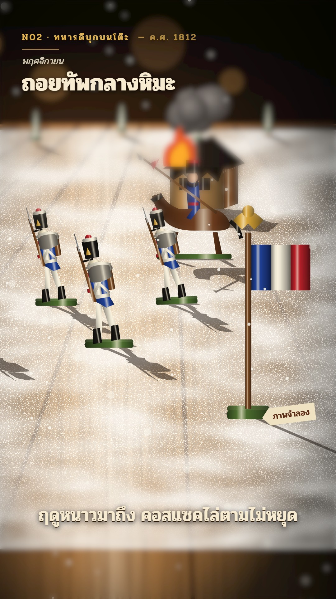

# N02 ทหารดีบุกบนโต๊ะ · Tin Soldiers on the Table

**Fits:** Europe 1700s–1800s — Napoleon's campaigns, the Seven Years' War, revolutions, colonial armies of the
period; any war story told as "a game of toy soldiers" · **Formats:** 9:16 / 16:9 · **Code:** `Demo.tsx` +
`kit/Table.tsx`, `kit/Toys.tsx`

## Look

A history played out with cast-metal toy soldiers on a wooden table at night, photographed with a tilt-shift
lens. A low camera looks along the tabletop: planks run away to the far edge, the grain shows, a warm lamp from
the back left makes a pool of light and throws long hard shadows forward and to the right. Behind the table the
room falls into darkness with a few soft out-of-focus lamp spots (bokeh). Only a band across the middle of the
frame is sharp; the far rank and the near edge melt into blur — that is what makes it read as a miniature.

Every figure is a rigid casting on a little green base, painted in gloss enamel: each part is a small cylinder
with a dark edge, its colour, a bright specular stripe on the lamp side and a dark falloff. Faces are pink with a
dot eye, a painted moustache and a red cheek. Props are toy-shop props: a brass field gun on a wooden carriage
with spoked wheels, bottle-brush trees on wooden discs, a cardboard house (kraft box, painted logs, folded red
card roof, corrugated cut edge), a painted ribbon of river, a pontoon bridge of corks and lolly sticks, flour
dusted on the table for snow, cotton wool for smoke, orange tissue paper for flame. No outlines anywhere.

| Role | Hex |
|---|---|
| Room (background) | `#0c0705` → `#3a2414` |
| Table wood (far → mid → near) | `#5a3418` · `#8a5428` · `#6a3c1c`, seams `#2a1608` |
| Lamp light | `#ffd59a` (pool), vignette to black |
| Enamel: French blue / red / white | `#1f3f94` / `#c4232c` / `#ece5d2` |
| Enamel: Russian green / base green / brass | `#2f5a34` / `#4b6b2e` / `#d8a436` |
| Type: gold / cream | `#e3b452` / `#f6ead0` |

Other paints in `Table.tsx PAINT`: black, skin `#efbf9c`, grey (steel), brown, wood, horse, greycoat, cream,
char. Every paint has a ready gloss gradient `url(#n02-<name>)`.

**Type:** Pridi throughout — kicker 30 px 600 gold, letter-spaced, with the year; a short gold rule; the tag in
Pridi italic 30 px; headline Pridi 700 74 px cream; the stat Pridi 700 118 px gold with its label 36 px. The
spoken line is Pridi 600 58 px cream with a soft dark shadow (no outline box), low over the blurred near edge
(sizes at 1080 wide). No cards, no panels: type sits straight on the dark room. **Line:** none — form comes
from gloss shading and the cast shadow.

## Motion signature

- **Tabletop dolly:** one long table holds every set-up side by side (x 0, 16, 40 world units); the camera slides
  along it between scenes with an ease-in-out and tilts slightly as it goes.
- **Pushed by hand:** figures never bend — they move in little hops, as if nudged along by a finger: a short
  jump with a forward tilt, a landing wobble, a pause (`hop(t, period, step)`). Their shadow stays on the table
  and shrinks while they are in the air.
- Things fall over like toys: the eagle standard tips, lands on the table and bounces once.
- Guns recoil and puff cotton smoke; shell bursts are a tissue flame plus a cotton puff, and the whole table jolts
  (camera bump) on each hit, with an SFX hit on the same frame.
- Flour snow on the table and paper flakes falling through the frame, near flakes large and soft.

## Scenes in the kit

| Component | Shows | Props |
|---|---|---|
| `useCam`, `at` (`Table.tsx`) | Camera on the table; world (x, z) → screen x, y and px per unit | `x, tilt` |
| `TiltShift` | Wraps the scene: draws it sharp + a blurred copy masked top and bottom, vignette | `id` |
| `Tabletop` | Room, bokeh, planks, grain, lamp pool | `c, far` |
| `Place` | Puts a toy at (x, z) with its hard lamp shadow; `lift`, `tilt`, `flip`, `size` | `draw: (p) => SVG` |
| `hop` | Hand-pushed hop motion → `{ d, lift, tilt }` | `t, period, step, phase` |
| `Cotton`, `Titles`, `Tag`, `Line` | Cotton smoke; kicker/headline/stat; "ภาพจำลอง" shop tag; spoken line | — |
| `soldier(u, pose, frost)` (`Toys.tsx`) | Line infantryman: march / stand / trudge (blanket), frosted | `FRENCH`, `RUSSIAN`, `GUARD` |
| `napoleon`, `kutuzov`, `cossack`, `eagle` | Commanders, Cossack lancer on a galloping horse, eagle standard | — |
| `cannon(recoil)`, `tree(snow, h)`, `isba(burnt)`, `bridge(len)` | Field gun, bottle-brush tree, cardboard house, pontoon bridge | — |
| `River`, `Flour`, `PaperSnow`, `Flame` | Ribbon river with glints, flour snow patch, falling paper snow, tissue flame | — |

## Build notes

All SVG. Draw back to front (far z first). A toy is a function `(p: Paint) => SVG` in a 100-unit-tall box,
feet at 0, facing right; use `p("blue")` etc. for every fill so the same drawing doubles as its shadow. Keep the
main action at z 1.4–2.4 (the sharp band); put scenery at z 3–6 (blurred). Figure size 0.6–0.9. A new army =
a new `Uniform` (coat, front, trousers, facing, hat). A new scene = a new x on the same table; let the camera
dolly to it. Text is HTML over the SVG, so it stays sharp.

## Don'ts

- No outlines, no flat cartoon fills — every part is glossy painted metal with the lamp highlight.
- No felt, no clay, no paper diorama look: the table is wood, the props are toys.
- Figures do not walk with moving legs — they hop, tip and recoil like castings.
- No news cards, red bars or framed panels; no photos or AI images.
- Keep blood off-screen; losses are numbers in the headline stat.

## Credits

None for pictures — everything is drawn in code. Sound: template `SFX.swell`; house library `army_marching`,
`cannon`, `explosion_mid`, `wind_storm`, `horse_gallop`, `wood_hit` (`npm run sfx-lib`). Font: Pridi (SIL Open
Font License).
