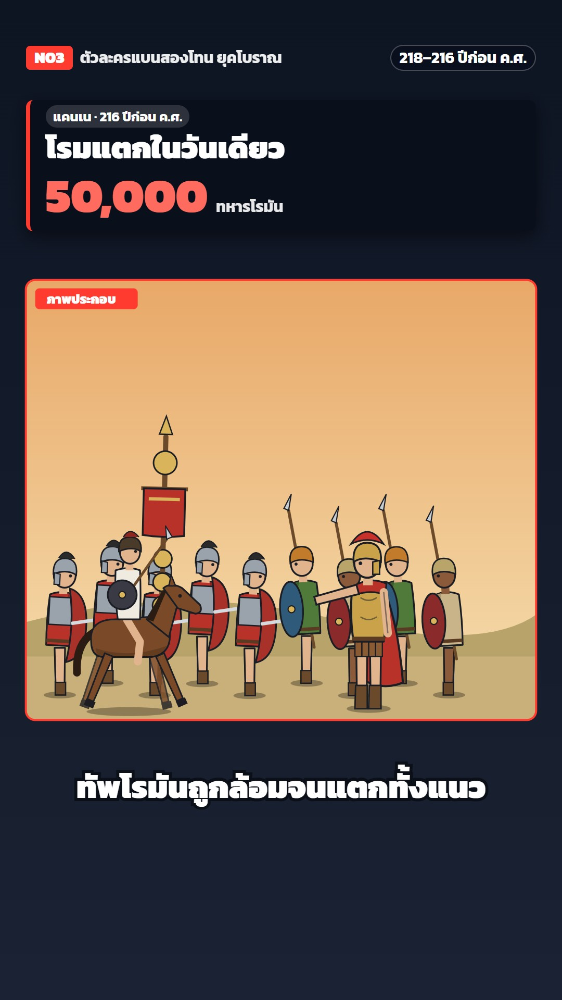

# N03 ตัวละครแบนสองโทน ยุคโบราณ · Flat Two-Tone Ancient

**Fits:** the ancient Mediterranean — Rome and Carthage, Hannibal, Greece and Persia, Alexander, Egypt ·
**Formats:** 9:16 / 16:9 · **Code:** `Demo.tsx` + `kit/Ancient.tsx`, `kit/Pieces.tsx`, `kit/Panel.tsx`

## Look

The same flat news-look as N02, moved to antiquity. Figures are solid two-tone shapes (base + one darker side)
with a thin, even dark navy outline: Romans in grey mail with big curved red shields and crested iron helmets,
Libyans and Iberians with oval shields and spears, Gauls in green with blue shields, a grey war elephant with a
red saddle cloth, generals in a bronze cuirass and long red cloak, citizens and senators in white togas.
Backdrops stay graphic: snow-capped two-ridge mountains, conifers, rolling tan plains, a white temple front.
Each picture lives in a rounded illustration panel with a bright accent border and "ภาพประกอบ" tag, below a dark
head card with a coloured edge and a big number, on a deep navy page.

| Role | Hex |
|---|---|
| Background (page) | `#0d1422` → `#1b2233` |
| Outline | `#1b1d24` |
| Roman tunic / shield / mail | `#b8322a` / `#a8322a` / `#9aa3ab` |
| Carthage side (Libyan tunic / shield) | `#c9b48a` / `#8a2a2a` · Iberian `#f0ebe0` · Gaul `#4f7a3a` / `#2f5a7a` |
| Elephant / saddle | `#8d8a86` / `#7a2230` |
| Accents | `#ff3b30` red · `#ffc94a` gold · `#4fa3ff` blue |
| Text | `#ffffff` on `rgba(8,14,26,0.86)` cards |

Skies: winter `#7a8a94 → #d8dee2`, dawn `#e8a868 → #f6dfb0`, summer `#8ab8de → #e8f0f2`. Skin `#e2b48e`
(Libyan `#8a5a3a`). Toga `#efe9da`. Bronze `#c9a24a`.

**Type:** Kanit 900 headlines (58 px) and stats (90 px), Kanit 700 tags / top bar (30 px), Kanit 900 subtitles
60 px with a 12 px `#0b0f18` outline (at 1080 wide). **Line:** 1.5 units on figures (≈ 3 px at panel scale);
panel border 4 px accent; 18 px corners.

## Motion signature

- Inside a panel: slow push-in (+6 %), 60 px pan, parallax layers (mountains × 0.2, mid rank × 0.6–0.9,
  front figures × 1.6).
- Columns march endlessly across the panel (`Column` wraps); elephants sway with slow leg swings and a
  swinging trunk; charges lean forward and speed up the leg cycle.
- Standards fall (`Signum fall` 0→1), generals raise a pointing arm, senators throw an arm up in alarm.
- Panels spring up 30 px, fade out over 14 frames, overlap 14 frames; the head card swaps per panel.
- Clashes: 8-frame shake + white flash, a sword-clash hit on the same frame.

## Scenes in the kit

| Component | Shows | Props |
|---|---|---|
| `Page`, `TopBar`, `HeadCard`, `Line`, `Panel`, `Layers` (`Panel.tsx`) | The news frame and the illustration panel | as N02 |
| `Warrior` (`Ancient.tsx`) | Foot soldier: walk / stand / trudge / charge, `roman` scutum + sword, `cloak` | `x, y, scale, kit, roman, pose` |
| `Elephant` | War elephant with mahout; `thin` ribs, `snow` | `x, y, scale, walk` |
| `LIBYAN`, `IBERIAN`, `GAUL`, `ROMAN`, `Mountains` | Kit colour sets; snowy mountain backdrop | — |
| `Column` (`Pieces.tsx`) | A marching column: "w" warrior, "e" elephant, "h" horse, "p" pack horse | `order, kits, speed, pose, loop` |
| `HannibalOnElephant`, `General`, `Senator`, `Citizen` | Hannibal riding; commander pointing; senator in alarm; citizen | `point`, `alarm`, `raise` |
| `Cavalry`, `Horse`, `PackLoad`, `Signum` | Light horseman; horse; pack; Roman standard that falls | `gait`, `fall` |
| `Temple`, `CityWall`, `ArmyTent`, `Tree`, `Moon`, `Snow` | Sets and weather | — |

The same pieces work small inside a map's `<InsetPanel>` — that is how the world-history channel uses them.

## Build notes

All SVG. `Panel` gives `x, y, W, H, ground, cx, s, sc`; figures go at `g.sc × 0.5–0.8`, far ranks smaller and
higher (`ground − 20…120 × g.s`). Two armies face each other with `flip` on one side. Draw back to front: sky,
mountains/hills, ground band, back rank, effects, front rank, riders. New peoples = a new `Kit`
(tunic, shade, shield, helmet, crest).

## Don'ts

- No gradients, textures or soft shading on figures — two tones and an outline only.
- No gore; losses are numbers on the head card.
- No photos, museum pictures or AI images.
- Do not mix with the sepia Chinese figures (N04) in one scene.
- Do not let a panel hold one picture longer than ~5 s.

## Credits

None for pictures — everything is drawn in code. Sound: template `SFX.swell`; house library `wind_storm`,
`elephant`, `war_horn`, `sword_battle`, `sword_clash`, `crowd_panic` (`npm run sfx-lib`). Font: Kanit (SIL Open
Font License).
