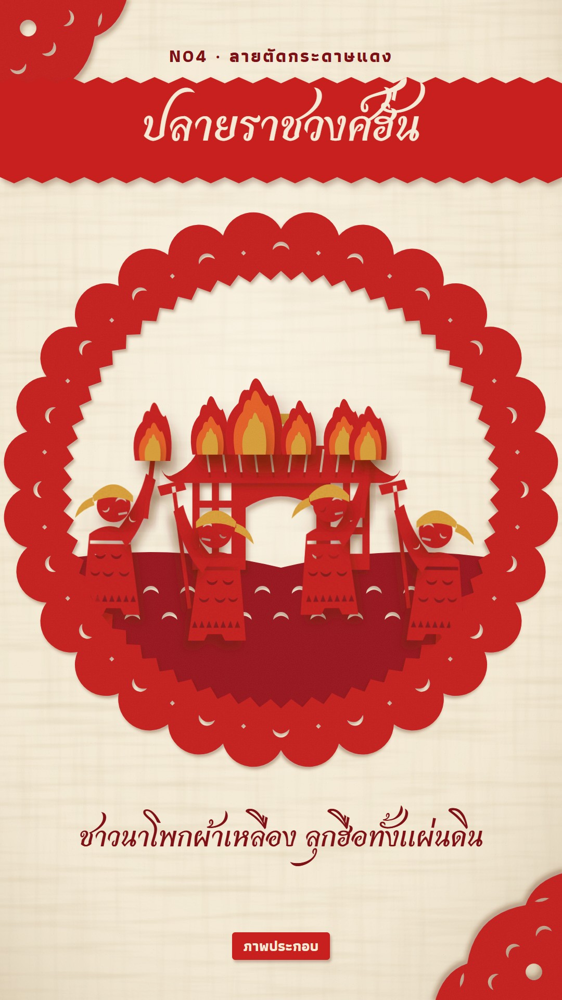

# N04 ลายตัดกระดาษแดง · Red Paper-Cut

**Fits:** Chinese history and epics (Three Kingdoms, Han and Tang court stories, Journey to the West), folk tales,
festival stories, anything that wants a warm hand-cut look · **Formats:** 9:16 / 16:9 · **Code:** `Demo.tsx` +
`kit/Paper.tsx`, `kit/Cuts.tsx`

## Look

Red paper-cuts pinned on a cream rice-paper wall. Every picture is cut from bold vermilion paper: solid
silhouettes whose detail is made of holes — crescent "moon-tooth" cuts on robes, saw-tooth rows along hems and
rims, lattice windows, slit roof tiles, spiral cuts in clouds — so the wall shows through. A second, deeper red
is used for ground bands and roof ridges; small gold and orange sheets are layered on top for the moon, crowns,
yellow turbans, scrolls and flames. Each cut stands a little off the wall and casts a soft brown shadow (two
heights: pinned flat, or raised). The paper has a faint fibre grain.

Each scene sits inside a big round window-cut: a scalloped outer edge, a band of crescents and diamonds, a
saw-tooth inner rim, a ground band with wave cuts. The wall is cream with long fibres, specks and a soft lamp
falloff; corner fans of red cut-work frame the page.

| Role | Hex |
|---|---|
| Wall (rice paper) | `#f3e9d4` (fibres `#8c6b40`) |
| Paper red (main) | `#c8201e` |
| Deep red (ground, ridges) | `#97131a` |
| Gold paper / orange paper | `#dba63c` / `#e8662a` |
| Text red / shadow | `#7e1016` / `#5a2614` |

**Type:** Charmonman 700 for the title, set in cream inside a red paper band with sawn edges (96 px), and for the
spoken line in dark red (62 px); Athiti 700 for the kicker `N04 · ลายตัดกระดาษแดง` (34 px) and the cream-on-red
"ภาพประกอบ" tag (sizes at 1080 wide). 16:9: window-cut on the right, all type in a left column. **Line:**
cut-edge only — no strokes; edges come from the hole shapes and the shadow.

## Motion signature

- **Unfold:** each window-cut arrives folded in half (the right half lying on the left), then opens along the
  fold line in ~26 frames, like opening a folded paper-cut. At the end of the scene it folds shut again.
- Then the figures and sets are pinned on one by one: each rises 40 px with a small tilt and settles with a
  slight overshoot.
- Paper does not bend: walkers bob and rock as whole pieces, willow strands sway, flames are three layered sheets
  flickering in height.
- Impacts (drums): the whole window shivers (±1° rotation, 10 frames) with the SFX hit.

## Scenes in the kit

| Component | Shows | Props |
|---|---|---|
| `Wall`, `PaperDefs` (`Paper.tsx`) | Rice-paper wall; the two lift filters (grain + shadow) | — |
| `Cut` | One evenodd paper piece | `d, color, lift` |
| `circ`, `moon`, `diamond`, `slit`, `saw`, `rect`, `leaf` | Path helpers for outlines and holes | — |
| `Window` | Round window-cut; `sym` = the symmetric part cut on the fold (unfolds), `children` = pinned pieces | `id, cx, cy, R, open, alpha` |
| `Pin` | Pins a piece on with a rise-and-settle | `k, x, y` |
| `Kicker`, `Line`, `Label` | Kicker + title band; spoken line; tag | — |
| `Person` (`Cuts.tsx`) | Figure: hats bun / official / eunuch / crown / turban; holds halberd / spear / torch / hoe / scroll; `raise`, `walk` | — |
| `Flame`, `MoonDisc`, `Cloud`, `CloudPair`, `Willow`, `Farmhouse`, `Hall`, `OfficeGate`, `Chest`, `Ground`, `Corner` | Sets and props | — |

## Build notes

All SVG. A piece is one path: the outline plus its holes, drawn with `fillRule="evenodd"` — holes must lie
inside the outline and must not overlap each other. Build the symmetric part of a scene (ground, hall, gate,
cloud pair) as `sym` so it unfolds; pin everything asymmetric after. Figures are 100 units tall, feet at 0;
scale ≈ 2.9 × R / 470. Keep 3–5 pinned pieces per window. A new character = a `Person` with a new hat/hold or a
new path in the same idiom (round head with crescent eye, wide-sleeved robe with crescent rows and a saw hem).

## Don'ts

- No outlines, gradients or shading on the paper — flat colour, holes and the drop shadow only.
- Red dominates; gold/orange only as small layered accents. No other colours.
- No ink-scroll, watercolour or brush look; no photos or AI images.
- Do not hold one window longer than ~5 s; do not crowd it.

## Credits

None for pictures — everything is drawn in code. Sound: template `SFX.swell`; house library `wind`,
`horse_neigh`, `gong`, `crowd_angry`, `fire_big`, `war_drums` (`npm run sfx-lib`). Fonts: Charmonman, Athiti
(SIL Open Font License).
