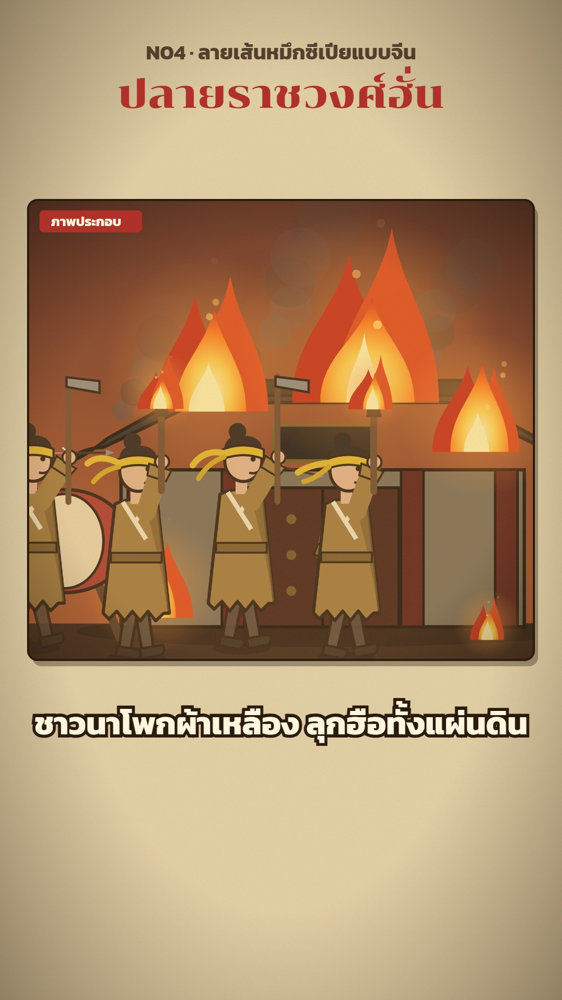

# N04 ลายเส้นหมึกซีเปียแบบจีน · Han Sepia Ink

**Fits:** Chinese history and epics (Three Kingdoms, Han and Tang court stories, Journey to the West), and any
story that wants a warm storybook look · **Formats:** 9:16 / 16:9 · **Code:** `Demo.tsx` + `kit/Scenes.tsx`,
`kit/Stage.tsx`

## Look

Flat, muted storybook illustration of Han-era China, framed as a rounded "ภาพประกอบ" panel on an old paper page.
Every shape is a flat fill in a soft earthy colour — dusty blue, olive green, brick red, ochre, tan — with a thin
dark sepia ink outline; faces are round with a dot eye and a small mouth; robes have a crossed white collar and a
sash. Sets are simple and graphic: red columns and a gold screen for the palace, thatched rammed-earth houses,
a tiled gate tower, a willow with swaying strands. Light comes from a two-stop sky gradient (cream day, ember
dusk, blue-black night) plus a warm orange wash and paper grain over the panel; fire is bright layered flame
with grey smoke. Below the panel, one line of cream text with a thick dark-brown outline.

| Role | Hex |
|---|---|
| Background (paper page) | `#e6d4aa` |
| Ink (outline, text outline) | `#2a1b0e` |
| Robes / sets | `#6f7f96` blue · `#4f6b4a` green · `#a8382a` red · `#c9a03c` gold · `#a07a3a` ochre |
| Accent (tag, title) | `#b0302a` |
| Text | `#fff6dd` line on screen · `#3b2a1a` kicker |

Skies: day `#e9d7a6 → #cdb27a`, dusk `#5a2a1f → #c0602e`, night `#0e1626 → #24324a`, hall `#6e2a1f`.
Skin `#e2b48a`.

**Type:** Chonburi 400 for the title (76 px at 1080 wide), Kanit 700 for the on-screen line (62 px on 9:16, 54 px
on 16:9, 12 px outline) and the "ภาพประกอบ" tag (26 px on red). **Line:** figure outlines 1.2–1.6 units (≈ 4–6 px
at panel scale), panel border 4 px ink, 18 px corner radius.

## Motion signature

- Inside a panel: slow push-in (+7 %) and a 60 px pan over the panel's life, three layers moving at different
  speeds (far × 0.2, mid × 0.6, foreground × 1.6).
- Figures always live: walk cycles with leg swing and a small bob, idle breathing, flags and turban tails wave,
  willow strands sway, fireflies drift.
- Panels spring in from 30 px below and fade out over 14 frames; the next panel overlaps by 14 frames.
- Impacts (drums, a blow, fire catching): 10-frame shake + cream flash on the panel, an SFX hit on the same frame.
- A new picture every 3–5 s.

## Scenes in the kit

| Component | Shows | Props |
|---|---|---|
| `Page`, `Stage` (`Stage.tsx`) | Paper page; one framed panel with sky gradient and tag (children get an `InsetGeom`) | `id, start, end, sky, box` |
| `Layers` | Push-in + parallax `pan`, impact shake/flash, warm light, grain | `g, id, start, end, impact` |
| `Line` | The on-screen line under the panel | `text, start, end` |
| `HanFigure` (`Scenes.tsx`) | Han person: 11 poses, 9 hats (turban, official, eunuch, helmet, lady…), 13 holds, beards | `x, y, scale, pose, hold, head, robe, flip` |
| `Horse`, `Pig` | Horse (gallop / stand, rider drawn first), pig | `x, y, scale, run` |
| `Hall`, `ThroneRoom`, `OfficeGate`, `CityGate`, `EarthWall`, `Farmhouse`, `Grave` | Buildings and sets; `OfficeGate burn` 0–1 sets it alight | `x, y, scale` |
| `DryField`, `Willow`, `Rope`, `River`, `Bushes`, `Fireflies` | Landscape pieces | — |
| `Chest`, `Mirror`, `WineCup`, `FeastTable`, `WarDrum`, `ArrowShot` | Props and effects | — |
| `LOOK` | Ready looks per character (Liu Bei, Guan Yu, Cao Cao, eunuch, rebel, soldier…) | spread into `HanFigure` |

The same pieces work small inside a map's `<InsetPanel>` (that is how the Sam Kok series uses them).

## Build notes

Everything is SVG. `Stage` gives the panel geometry (`x, y, W, H, ground, cx, s, sc`); draw scenery from
`ground` up, figures at `g.sc` (× 0.9–1.1 for main figures), with feet 30–60 × `g.s` below `ground` so they stand
on the floor band. Fire and smoke come from `components/Figures.tsx` (needs `FigureDefs`, already inside
`Stage`). Keep it to ~8 figures per panel. New characters: a `LOOK` entry (robe, shade, head, beard, skin).

## Don'ts

- No gradients or shading on figures beyond the one darker robe side; no thick cartoon outlines.
- No photos, painted portraits or AI images — everything is drawn in code.
- No saturated neon colours; keep the muted earthy palette (fire is the only bright thing).
- Do not hold one panel longer than ~5 s.
- Do not mix with the flat Western figures of N02/N03 in one scene.

## Credits

None for pictures — everything is drawn in code. Sound: template `SFX.swell`; house library `wind`,
`horse_neigh`, `gong`, `crowd_angry`, `fire_big`, `war_drums` (`npm run sfx-lib`). Fonts: Chonburi, Kanit (SIL Open
Font License).
