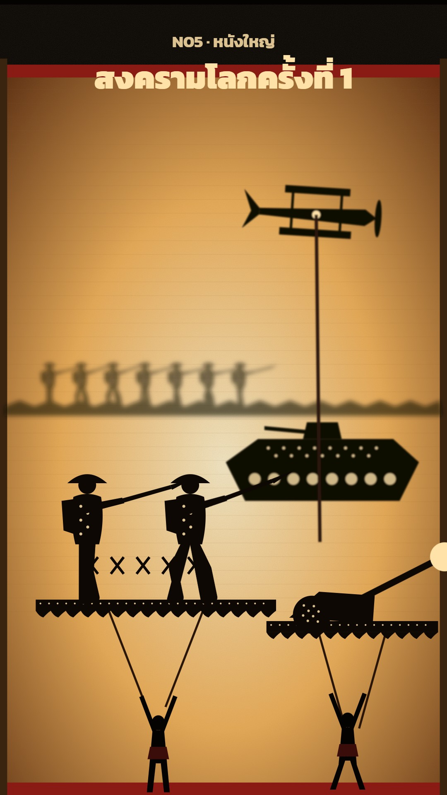

# N05 หนังใหญ่ · Nang Yai Shadow Theatre

**Fits:** battles, legends, Ramakien-style episodes, one or two special scenes inside a long history video ·
**Formats:** 9:16 · **Code:** `Demo.tsx` + `kit/NangYai.tsx`

## Look

A story staged as Thai shadow-puppet theatre. A cloth screen lit from behind by fire fills the frame: warm cream
in the centre falling to burnt orange and brown at the edges, with faint horizontal weave lines and grain, red
cloth borders top and bottom and dark wooden posts at the sides. Every figure is a black carved-leather silhouette
with light showing through dotted perforations, standing on carved ground bands with a kanok flame edge, held
up on two poles. Puppets far from the cloth are blurred and paler; dancing performers in front of the screen are
the sharpest, darkest shapes. Explosions and magic are carved flame bursts that also flash the cloth from behind.

| Role | Hex |
|---|---|
| Background (outside the cloth) | `#050302` |
| Cloth centre → edge | `#fff3cf` → `#f2b25a` → `#5a2a0c` |
| Leather silhouette | `#0e0805` |
| Light through carving | `#ffe2a8` |
| Cloth border | `#8a1a14` |

**Type:** Kanit 700/900, colour `#ffe2a8`, title 76 px, kicker 40 px at 1080 wide. **Line:** no outlines — shapes
are solid silhouettes; detail comes only from perforation dots (step 7–12 px, radius 1.5–2.2 px).

## Motion signature

- Slow push-in over the whole scene (+6 % scale), centred low (on the performers).
- Fire flicker on the cloth: opacity 0.94 ± 0.05 from two slow sines.
- Puppets move the way leather on poles moves: whole-panel slides, legs swing from the hip, a small sway; no
  squash and stretch, no smooth 3D turns.
- Impacts: a carved `Burst` opens and closes over 30 frames, a light bloom behind the cloth, 12-frame white flash,
  8 px camera shake, an SFX hit on the same frame.
- Performers dance a step under the panels all the time — they are what makes it read as theatre.

## Scenes in the kit (`kit/NangYai.tsx`)

| Component | Shows | Props |
|---|---|---|
| `ClothDefs`, `Cloth` | Gradient, blur and grain filters; the lit screen with borders and posts | `light` 0–1 |
| `Far`, `Mid` | Depth wrappers: blurred and dimmed puppets far from the cloth | `opacity` |
| `Panel` | Carved ground band + kanok edge + two poles; put figures inside | `x, y, w` |
| `Performer` | Dancer in front of the screen, arms up on the poles | `x, t` |
| `Burst` | Carved flame burst (explosion, magic, fire) | `x, y, k` 0→1 |
| `Holes`, `Kanok` | Perforation pattern and flame edge for new puppets | box / baseline |
| `Tommy`, `Tank`, `Plane`, `FieldGun` | WW1 puppets used in the demo | `x, y, s, t` |

For a new story, draw new puppets the same way: one solid `SKIN` path per body part, a `Holes` box on the chest
or clothing, a `Kanok` edge on crowns, armour and hems.

## Build notes

Everything is one SVG at 1080×1920. Keep at most ~12 puppets with `Holes` on screen; each `Holes` box is many
circles, so large boxes slow rendering. Blur filters go on whole groups (`Far`, `Mid`), never per puppet.

## Don'ts

- No colour on puppets, no gradients on silhouettes, no outlines.
- No camera cuts or fast pans inside one shadow scene; change the panel instead.
- Do not use it for a whole long video — 1–2 scenes per episode, or a short of 30–60 s.
- Do not copy real carved panels from museum photos; draw new ones.

## Credits

None for pictures — everything is drawn in code. Sound: template UI sounds (`SFX.hit`, `SFX.swell`); for an episode
use recorded effects from the house library (`npm run sfx-lib`). Font: Kanit (SIL Open Font License).
