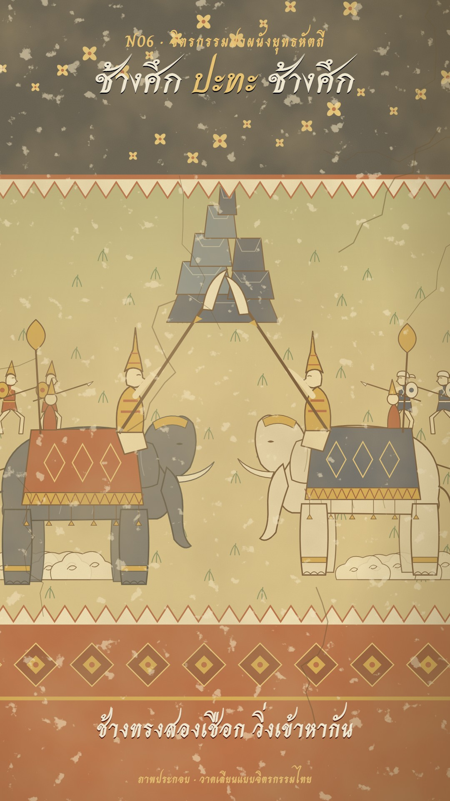

# N06 จิตรกรรมฝาผนังยุทธหัตถี · Temple-Mural Elephant Duel

**Fits:** elephant duels, decisive battles of Thai, Burmese, Khmer and Lanna history, Jataka and chronicle scenes,
any "two leaders meet" climax · **Formats:** 9:16 · **Code:** `Demo.tsx` + `kit/Mural.tsx`

## Look

The battle is a painting on an old temple wall, and the camera moves along it. The wall has three registers:
a dark indigo heaven band at the top scattered with small gold four-petal flowers (where the title sits), the
battle register on pale ochre earth washed with green toward the top, and a red-ochre dado at the bottom with a
row of gold-edged lozenges (where the spoken line sits). Registers are split by white zig-zag *sinthao* bands
edged in red.

Everything is flat mineral colour with fine red-brown outlines and no perspective: rows higher on the wall are
further away and are not smaller. Stepped rock formations (*khao mo*) in malachite green and indigo, lollipop
trees made of leaf scallops, grass tufts as little green strokes. Soldiers stand in the mural stance — knees
bent wide, spear thrust forward, a round shield behind — Siam in red with gold pointed helmets, the other side in
indigo with white turbans; swallow-tail banners on tall poles. The two war elephants are slate and pale, with a
twin-domed head, a gold head-net, gold anklets, a caparison with a gold zig-zag border and tassels, a rear rider
with a gold fan and a crowned king (*chada* spire) on the neck swinging the ngao. Over it all, aged plaster:
brown mottling, flaked patches showing bare plaster, hairline cracks, a lamp falloff at the corners.

| Role | Hex |
|---|---|
| Plaster / bare plaster | `#dccaa2` / `#efe5cc` |
| Earth (battle register) | `#cdb98a` + malachite wash |
| Red ochre / deep red (dado, Siam) | `#9c3b25` / `#6e2318` |
| Indigo / heaven | `#2d3a5c` / `#1a1f33` |
| Malachite / dark malachite | `#4f7d5c` / `#2f5a44` |
| Gold / light gold | `#c9973a` / `#e6c272` |
| Outline ink | `#3a1a10` |
| Elephant hides | slate `#4a4f62`, pale `#e2d6bc` |

**Type:** Srisakdi 700 for the headline in the heaven band (92 px cream, the verb in light gold) and the end
cartouche (126 px); Charm 700 for the kicker `N06 · จิตรกรรมฝาผนังยุทธหัตถี` (38 px gold), the spoken lines on the dado
(60 px cream with a deep-red drop) and the label. The end title sits in a red-ochre cartouche with an arched
top and a double gold border. **Line:** fine brush outline `#3a1a10`, 2–3 px at zoom 1; light-gold highlights on
rocks and leaves.

## Motion signature

- **Dolly along the wall:** one long wall (x −300…3500), one camera: along the Siam line → following the charge
  → in on the duel (zoom 1.2) → along the fallen banners → back to the centre for the title. Slow sine ease.
- The painting comes alive only a little: soldiers step in place and advance, banners flutter, elephants walk,
  raise their trunks to trumpet, recoil on each blow; the ngao sweeps down on every strike.
- Blows: a burst of gold flame-tongues (kanok-like) between the tusks, a small camera shake (6 px, 12 on the
  decisive blow), a gilt flash; the enemy banners topple one by one.
- One event schedule at the top of `Demo.tsx` drives both picture and sound.

## Scenes in the kit (`kit/Mural.tsx`)

| Component | Shows | Props |
|---|---|---|
| `WallPaint` | Registers, flowers, earth, dado frieze, sinthao bands; children go in the battle register | — |
| `Age` | Mottling, flakes, grain, cracks (draw last, in world space) | — |
| `Rock`, `Tree` | Stepped rock, mural tree | `x, y, s, color, dark` |
| `Soldier` | Foot soldier in the mural stance; `run`, `fallen` | `x, y, s, side, flip, t` |
| `Banner` | Swallow-tail banner; `fall` degrees | `x, y, s, color, t` |
| `Elephant` | War elephant with king and rear rider | `x, y, s, flip, hide, cloth, walk, trumpet, swing, rider` |
| `Arrows`, `Flare`, `Dust` | Arrow volley lines; gold flame burst; painted dust puffs | — |
| `SIAM`, `BURMA`, `M`, `G`, `SKY`, `FLOOR` | Sides, colours, ground line, register lines | — |

## Build notes

The world is one `<svg>` 1080×1920 with `translate(W/2, 960) scale(zoom) translate(−cx, −cy)`; keep zoom
0.94–1.2 so the heaven band stays under the title and the dado under the line. Main figures stand on `G` = 1400;
further rows at y 1000–1300. Text is HTML over the SVG. For narration, mix the beds 0.15–0.35 and duck them under
the voice. Sound in the demo: beds `war_drums`, `wind`, `army_marching`; hits `war_horn_drums`, `arrows_volley`,
`arrow_hit`, `battle_cry`, `elephant`, `sword_swish`, `sword_clash`, `sword_battle`, `explosion_far`,
`crowd_cheer`, `gong`.

## Don'ts

- No perspective, no shading, no soft gradients on figures — flat pigment and fine outline.
- No cuts inside the duel — move along the wall instead.
- Do not show blood or a rider being cut; the decisive blow is the gold burst and the falling banners.
- Do not dress both sides alike — red/gold against indigo/white carries the story.
- No copy of a real temple mural, no photos, no AI images.

## Credits

None for pictures — everything is drawn in code, no map data. Sound: recorded effects from the house library
(`npm run sfx-lib`; Pixabay Content License and Mixkit Sound Effects Free License — free for commercial video, no
attribution, files not redistributed). Fonts: Srisakdi, Charm (SIL Open Font License).
