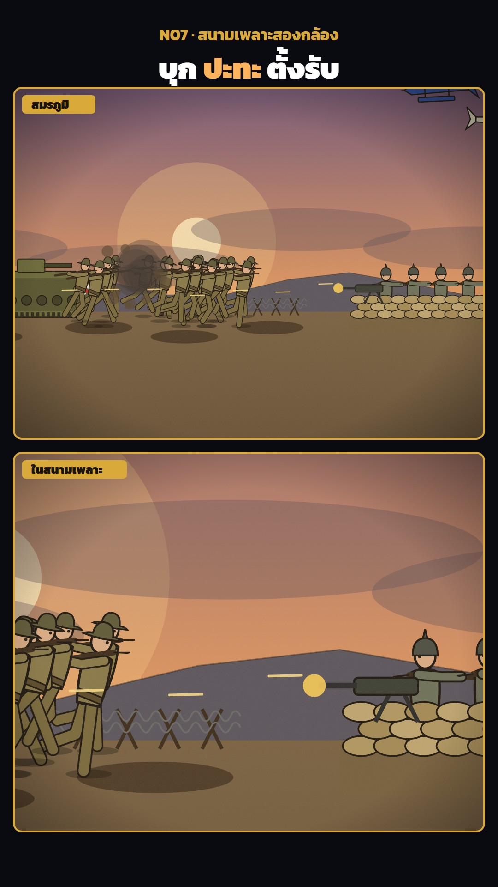

# N07 สนามเพลาะสองกล้อง · Trench Battle, Two Cameras

**Fits:** modern war (1860s–1940s), assaults on a fixed line, any "attack vs defence" moment where the viewer must
see the whole field and the man in the trench at once · **Formats:** 9:16 · **Code:** `Demo.tsx` + `kit/Trench.tsx`

## Look

One live side-view battlefield shown through two framed windows stacked on a near-black screen: a wide shot of the
whole field on top (label "สมรภูมิ") and a tight trench camera below (label "ในสนามเพลาะ"). Both windows render the
same world at the same frame, so a shell that lands in the wide shot also shakes the close-up. Dusk sky from navy
through mauve to orange with a low sun, drifting smoke banks, a grey far ridge, brown mud with craters, shattered
trees, barbed wire, a sandbagged trench with riflemen and a machine gun on the right, khaki attackers running from
the left behind a rhomboid tank, biplanes overhead. Ink outlines, paper grain, a gilt frame and tab on each window.

| Role | Hex |
|---|---|
| Screen background | `#0a0b10` |
| Sky top → mid → horizon | `#24305a` → `#7a5a7a` → `#f0a060` |
| Mud (top → bottom) · sandbags | `#7a6244` → `#3e2f1f` · `#b49a64` `#a68c58` `#c2a874` |
| Attackers khaki / defenders field grey | `#8a7a4a` / `#6d725c` (template `COSTUME.ww1khaki`, `ww1grey`) |
| Fire and tracers · window frame | `#ff7a1a` `#ffd25a` `#fff6d8`, tracer `#ffe08a` · gilt `#d9a93a` |

**Type:** Kanit 700/900, white; kicker 34 px gilt, headline 64 px with the verb in `#ffb35c`; window tabs 26 px 900
in `#1a140f` on a gilt tab; end card 92 px. **Line:** bold ink `#1a140f`, 3–4 px on vehicles, 2–2.4 px on
sandbags and wire (world px at zoom 1); window frames 4 px gilt, radius 18.

## Motion signature

- Two cameras, one world: the wide shot drifts slowly across the field (zoom 0.62 → 0.68, x 900 → 1700); the
  trench camera holds on the parapet, swings to the wire as the attack arrives, and snaps back for the big hit
  (zoom 1.45 → 1.7). Neither window ever cuts.
- Shell bursts: fireball 0–22 frames, dirt column on a parabola, dark smoke rising for 70 frames, a shock ring on
  the ground. Each burst shakes the wide window 4 px × size and the trench window 9 px × size; the last, biggest
  shell adds an 18 px shake and a 14-frame white flash over the whole screen.
- The machine gun's muzzle flash and tracers are drawn only while its recorded sound is loud
  (`levelAt("mg_ww1", …) > 0.6`), a round every 2 frames — picture follows sound.
- Riflemen flash on their own firing frames; attackers climb out, run, and stop at the wire to fight.

## Scenes in the kit (`kit/Trench.tsx`)

| Component | Shows | Props |
|---|---|---|
| `View` | A camera window: clip, world transform, shake, grain, gilt frame, label tab | `x, y, w, h, cx, cy, zoom, shake, label, id, font, children` |
| `Battlefield` | Sky, sun, smoke banks, far ridge, mud and craters (ground `GROUND` = 1000) | `frame` |
| `Explosion` | Shell burst (fireball, dirt, smoke, shock ring) | `x, size, age` |
| `Wire` | Barbed-wire entanglement | `x0, x1` |
| `Sandbags` | Trench parapet, 3 staggered rows | `x, n, rows` |
| `Tank` | Rhomboid tank with running tracks, exhaust, gun flash | `x, frame, gunAt` |
| `Plane` | Biplane with prop blur, cross or roundel | `x, y, flip, frame, color, mark` |
| `Tree` | Shattered stump | `x, h, lean` |
| `rnd`, `since` | Deterministic random; frames since last event | — |

Soldiers are the template's `Fighter` with `weapon="rifle"` and `flash` for the muzzle flash.

## Build notes

Put the world in one component (`World`) and render it inside every `View`; give each `View` its own `id` (clip and
grain ids). Keep the event lists at the top — `BLASTS` as `[frame, x, size]`, rifle frames per man, MG plays, tank
gun, plane crossings — and build the sound from the same lists. This demo is the house **reference sound mix**:

| Layer | Ids | Level |
|---|---|---|
| Beds under everything | `explosions_distant`, `wind` | 0.30, 0.16 |
| Shells | `shell_incoming` whistle ending on the impact, then `explosion_far` (x < 1000) / `explosion_mid` / `explosion_big` (size > 2) + `explosion_debris` | 0.35 · 0.5 / 0.7 / 0.95 |
| Small arms | `rifle_ww1`, every 3rd `rifle_echo`; `mg_ww1` started at play + its `hit` offset | 0.18–0.26 · 0.42 |
| Vehicles | `tank_move` bed while it moves, `cannon` on its gun frames; `plane_vintage` / `plane_prop_loop` beds started with `bedFrom(id, crossFrame)` so the loudest moment lands as the plane crosses | 0.4 · 0.6 · 0.45 / 0.3 |
| Story cues | `whistle_officer` (over the top), `battle_cry`, `war_horn_drums` under the end card | 0.5–0.6 |

With narration, drop every one-shot 6–10 dB under the voice and duck the beds (see `references/sound.md`).
Rendering two windows doubles the cost of the world — keep particles modest (≤ 20 men, ≤ 11 bursts).

## Don'ts

- Do not cut between the cameras; both run all the time.
- No gore — bursts, smoke, falling men out of frame; the war is shown, not wallowed in.
- No real unit insignia or national flags beyond simple roundels and crosses; no photos or real footage.
- Do not let the two windows show unrelated worlds — the point is one moment, two distances.

## Credits

None for pictures — everything is drawn in code, no map data. Sound: recorded effects from the house library
(`npm run sfx-lib`; Pixabay Content License and Mixkit Sound Effects Free License — free for commercial video, no
attribution, files not redistributed). Font: Kanit (SIL Open Font License).
