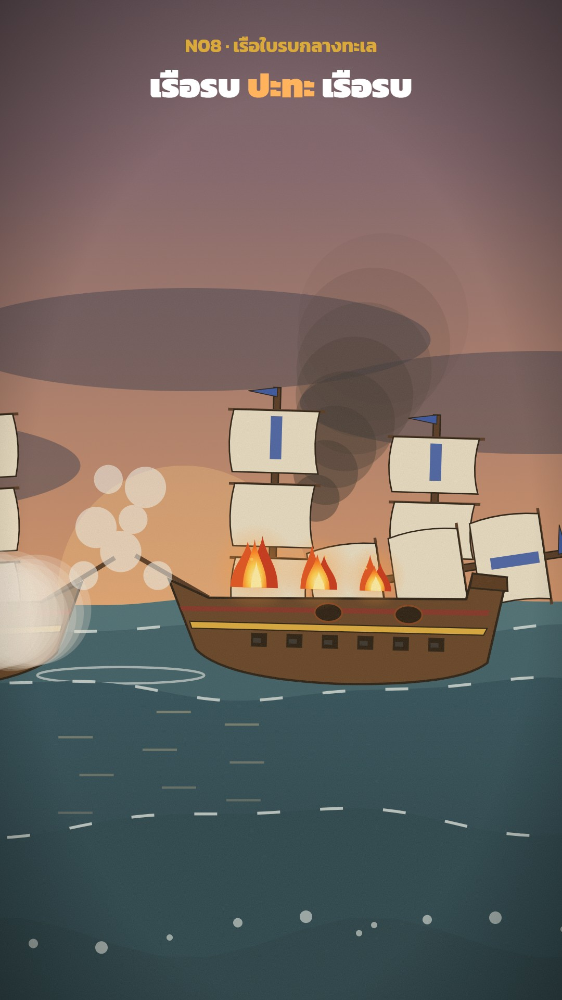

# N08 เรือใบรบกลางทะเล · Sailing Warships in Battle

**Fits:** sea battles of the age of sail (1500s–1860s), naval duels, a ship lost or a fleet broken ·
**Formats:** 9:16 · **Code:** `Demo.tsx` + `kit/Naval.tsx`

## Look

Two three-masted warships broadside to broadside on a rolling dusk sea, seen side-on through one moving camera.
A slate-blue sky warming to apricot at the horizon, a low sun glow, dark cloud banks drifting across. The sea is
four layers of wave bands from pale teal far away to deep blue-green near the camera, each with a travelling
dashed white foam crest, sun streaks on the water and a darkening gradient below. The ships have brown ink-outlined
hulls with a gilt wale, a red stripe and six gun ports a side, cream billowing sails and coloured pennants (red for
our side, blue for the enemy). Broadsides throw yellow muzzle flashes and big white powder smoke that drifts and
lingers; shots fall as white splashes or leave scorched holes; the enemy mainmast is shot away and the deck burns
under a dark smoke column. A foreground swell with spray crosses the bottom of the screen.

| Role | Hex |
|---|---|
| Sky top → mid → horizon | `#262f48` → `#7a6070` → `#e09a6a` |
| Sea far → near (+ foreground swell) | `#3f6a78` `#2f5868` `#21485a` `#1a3d4c` (+ `#173847`) |
| Foam, splashes · powder smoke | `#e8f2f2` · `#efeae0` |
| Hull · wale · sails | `#5a3a22` · gilt `#d9a93a` · `#f0e8d2` / `#e6dfcb` |
| Our flag / enemy flag | `#c0302a` / `#2a4fa8` |

**Type:** Kanit 700/900, white; kicker 36 px gilt `#d9a93a`, headline 66 px with the verb in `#ffb35c`; end card
110 px on `rgba(8,14,26,0.88)` with a 5 px gilt border. **Line:** bold ink `#1a140f`, 4 px on hulls, 2.5 px on
masts and sails (world px at zoom 1).

## Motion signature

- Everything floats: both ships roll ±3° and heave ±10 px on offset sines; a hit jolts the ship 3°; the crippled
  ship lists 7° over 5 s. Sails billow, pennants flutter, foam crests travel.
- Broadsides ripple gun by gun 6 frames apart (never all at once): flash, the gun recoils, a ball flies on a low
  arc (22 frames), powder smoke swells and drifts downwind for ~3.5 s.
- Camera: wide on both ships (zoom 0.7) → push in on the enemy as its mainmast is hit (1.1) → hold on the fire →
  pull back for the title (0.72). The waterline stays at ~2/3 of the screen (`cy = SEA − 330 / zoom`).
- Impacts: 9 px shake on hull hits, 16 px from the mast hit on, a 6-frame warm flash on the mast hit, the mast
  topples over 40 frames (eased) and lands with a big splash; fire grows on deck. An SFX hit on every event frame.

## Scenes in the kit (`kit/Naval.tsx`)

| Component | Shows | Props |
|---|---|---|
| `Sky` | Gradient, sun glow, drifting cloud banks (world x −800…3200, sea level `SEA` = 1000) | `frame` |
| `Waves` | One wave layer with optional travelling foam crest | `frame, base, amp, k, w, color, foam, ph` |
| `Deep` | Darkening under the near waves + sun streaks | `frame` |
| `Ship` | Three-masted warship: masts, sails, hull, 6 gun ports, damage, deck fire | `x, frame, flip, flag, sail, fires, roll, heave, mastFall, fire, hits` |
| `Ball`, `PowderSmoke`, `Splash` | Cannonball arc, lingering gun smoke, water column | `frame, t, x0, x1` · `x, y, age, dir` · `x, age, big` |
| `ShipSmoke` | Dark smoke column over a burning ship | `frame, from, x, k` |
| `Fire`, `FireDefs` | Animated flames (copied from the template's `Figures` fire, own gradients) | `x, y, size, seed` |
| `PORT`, `portX`, `GUNS`, `since` | Gun-port positions, frames since last event | — |

## Build notes

Write the schedule first: per-gun firing frames (`A_FIRES[i]`, `B_FIRES[i]`), misses, hits, the mast hit and the
mast landing. Balls, smoke, recoil and sound all read the same lists, so a gun is never heard without being seen.
Layer order inside the world: sky → two far wave layers → smoke behind the far ship → far ship → near ship → balls
→ powder smoke → splashes → near wave → `Deep` → nearest wave; then outside the camera transform the foreground
swell and spray, a `#ffb060` wash at 6 % and `PaperGrain`. Sound in the demo: beds `sea_rough`, `wind_storm`,
`ship_creak`, `fire_big` once the deck burns; hits `ship_bell` (open and close), alternating `cannon_heavy` /
`cannon_old` per gun (our side louder), `splash_big` on misses, `wood_hit` + `wood_break` on hull hits,
`mast_fall`, `crowd_cheer` from the winning crew.

## Don'ts

- Do not fire a whole broadside on one frame — ripple it.
- No still water: every ship and wave must keep moving, even in a held shot.
- No real national ensigns unless the story needs them; plain coloured pennants read better at phone size.
- No photos, paintings or real ship plans; everything is drawn in code.

## Credits

None for pictures — everything is drawn in code, no map data. Sound: recorded effects from the house library
(`npm run sfx-lib`; Pixabay Content License and Mixkit Sound Effects Free License — free for commercial video, no
attribution, files not redistributed). Font: Kanit (SIL Open Font License).
