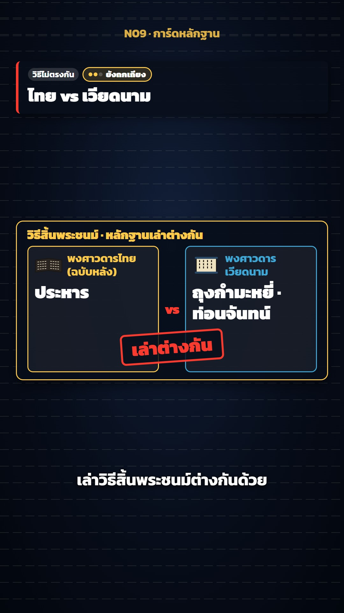

# N09 การ์ดหลักฐาน · Evidence Cards

**Fits:** disputed facts, "who is right", deaths and dates that the sources tell differently, myth-busting,
source criticism segments inside a long history video · **Formats:** 9:16 / 16:9 · **Code:** `Demo.tsx` +
`kit/Cards.tsx`, `kit/Head.tsx`

## Look

News-style dark cards that put the sources side by side. Every card is a navy box with a 3 px coloured border,
18 px corners and a short coloured title; inside, the evidence is drawn as a small graphic: a month calendar with
hand-drawn red rings on the disputed days, two columns "source A vs source B" with a manuscript glyph and the
claim in big type plus a rotated rubber stamp, a page whose middle lines fade to a dashed "not mentioned" note, a
timeline with a shaded "written later" zone, a staircase of how the wording grows heavier over time, a row of
sides whose "?" flips to a green ✓ (or to what that side says), a flickering table for legends that keep
changing. A head card on top (blue-black with a coloured left bar) carries the tag, the headline, an optional big
number with "โดยประมาณ" and a confidence chip (three dots: หลักฐานตรงกัน / ยังถกเถียง / หลักฐานฝ่ายเดียว). Colour
always means a side: gold = Thai sources, cyan = Vietnamese, magenta = Chinese, blue = European, red = conflict,
green = agreement.

| Role | Hex |
|---|---|
| Background | `#02060d` (centre `#12203a`) |
| Card | `rgba(8,14,26,0.92)` (`#080e1a`) |
| Thai side / title | `#ffc94a` |
| Conflict | `#ff3b30` (numbers `#ff6b5f`) |
| Agreement | `#3fbf6a` |
| Other sides | Vietnam `#3fa7d6`, China `#c0186a`, Europe `#4fa3ff` |
| Text | `#ffffff` |

**Type:** Kanit 400/700/900. Head 54 px 900, big stat 92 px 900, card title 30 px 900, claim 44 px 900, source tag
28 px 700, calendar 28 px, stamp 44 px 900, subtitle 50 px 700 — at 1080 on the short side (cards can be scaled
×1.25 with `CardLayout scale` when they are the whole picture). **Line:** card borders 3 px, column borders 3 px,
calendar rings 5 px hand-drawn ellipses, stamp 5 px.

## Motion signature

- Cards rise 24 px and scale 0.96 → 1 on a spring (damping 14), fade out over 8 frames; the next card starts
  8 frames before the last ends.
- Inside a card every mark appears on the spoken word (`wf(beat, "คำ")`), never all at once: calendar rings draw
  in 12 frames, columns pop with springs, the stamp slams from ×2, timeline marks overshoot to ×1.15, ✓ spin in
  from −90°.
- Keep cue frames in order with `mono(frames, gap)` so marks never bunch up.
- Each mark has a UI sound on the same frame (`SFX.pop` for columns and rings, `SFX.tick` for timeline/✓, `SFX.hit`
  for the stamp and the agreement line).
- Head card text swaps with a 14 px spring rise; the confidence chip pops 8 frames after the headline.

## Scenes in the kit

| Component | Shows | Props |
|---|---|---|
| `Slot`, `CardLayout` | The card box in the "panel" or "head" slot; layout of the slots (top, height, max width, scale) | `start, end, slot, color, title` / `panel, head, maxW, scale` |
| `Calendar` | One month with red rings on the disputed days | `title, first, days, marks: [day, frame][]` |
| `Compare` | Source A vs source B with glyphs (thai / viet / china / book) and an optional stamp | `left, right: Side, title, vs, stamp` |
| `NotePage` | A page whose middle goes blank → dashed note ("ไม่กล่าวถึง") | `title, gapAt, note` |
| `Timeline` | Years with marks, a "written later" zone, a blinking gap | `from, to, marks, zone, blink, dotted` |
| `Staircase` | How a claim grows heavier in later texts | `title, steps, axis` |
| `FourSources` | N sides: "?" → ✓, or → what each says (`say`), then the agreed line | `sources: Source[], checks, bottom, agree` |
| `FlickerTable` | Legend versions whose answers keep changing | `rows, cols, values, rowF` |
| `ThreeQuestions`, `Poll`, `BigQuestion` | "who wrote it / when / for whom", closing poll + follow, the big question | — |
| `HeadCard`, `Confidence` | Top card with tag, headline, stat + label, chips, confidence chip | `heads: Head[]` (`sure: high/mid/low`) |
| `Subtitle` | Simple caption line (use the template `Caption` with word timing in a real video) | `lines` |
| `mono`, `usePop` | Cue ordering and pop-in helpers | — |

## Build notes

Cards are HTML over the picture, so they work on a map (default layout: panel at 56 % height, 350 px — the same box
as an illustration panel — head at 10 %) or on their own (`<CardLayout panel={{ top: 0.36, h: 400 }} scale={1.25}>`).
One card per idea, 3–5 s each; one head card per beat. Every claim names its source on the card ("พงศาวดารไทย
(ฉบับหลัง)", "บันทึกราชวงศ์ชิง (ถอดความ)"); quotes are paraphrases marked "ถอดความ". Keep the confidence chip
honest: high only when independent sides agree.

## Don'ts

- Never show one side's claim as fact without its source tag.
- Do not mix colours between sides inside one video — a side keeps its colour everywhere.
- No real document scans or photos of manuscripts; the glyphs are drawn in code.
- Do not crowd a card: one claim per column, ≤ 6 words in big type.
- Do not put cards over the caption band (76.5 %).

## Credits

None for pictures — everything is drawn in code. Sound: template UI sounds (`SFX.pop`, `SFX.tick`, `SFX.hit`,
`SFX.whoosh`, `SFX.swell`) and the house-library bed `fire_crackle` (`npm run sfx-lib`). Font: Kanit (SIL Open
Font License). The facts in the demo follow the episode's checked source list (Thai chronicles, Qing records,
Vietnamese chronicles, French missionary letters).
