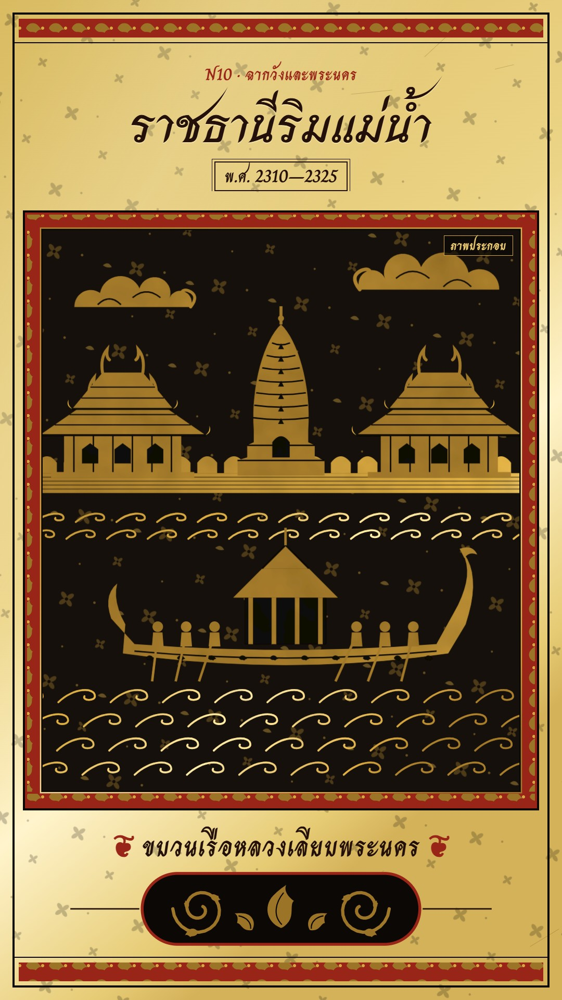

# N10 ฉากวังและพระนคร · Gilt Lacquer Cabinet

**Look name:** ลายรดน้ำ · Gilt Lacquer
**Fits:** court history, capitals and coronations, palace coups, royal ceremonies, temple life, old riverside cities
(Ayutthaya, Thonburi, early Bangkok) · **Formats:** 9:16 / 16:9 · **Code:** `Demo.tsx` + `kit/Lacquer.tsx`

## Look

A Thai lacquer cabinet in the ลายรดน้ำ technique. The page is the cabinet's **gilt body**: pale gold leaf with a slow
sheen, faint incised flower sprigs and fine scratches, black rules and **red lacquer friezes** carrying small gold
kanok. In the middle sits the door: a **black lacquer panel** framed by a red lacquer band with kanok friezes on all
four sides. Inside the panel every scene is **gold line-and-fill**: gold-leaf shapes (mottled, with a moving sheen)
whose details are **incised black lines** (the resist lines of the craft) — Khmer corn-cob prang with tier lines,
halls with two steep roof tiers, chofa and hang-hong, bai-sema walls with a gate, tiered parasols, the royal barge
with its curling prow and pavilion, figures (king seated with a tall crown, nobles kneeling in wai, monks with
bowls, scribes, warriors with spears) as gold silhouettes with incised costume lines, water as rows of gold wave
scrolls, the moon and sun ringed with kanok rays, Thai clouds, and **fire drawn as kanok flame-leaves**. Falling-
flower sprigs fill the black ground. Type is dark lacquer-brown on the gilt (title in Srisakdi, captions in Charm,
red ❦ sprigs); under the caption a black plaque holds a pair of gold scrolls. The honest label "ภาพประกอบ" sits in a
small gold-ruled box in the panel's top-right corner.

| Role | Hex |
|---|---|
| Black lacquer (panel) · lacquer ground | `#0c0806` · `#15100c` |
| Gold leaf (scenes) · pale gold (sparks, rays) | `#d6a840` (gradient `#9c7428 → #fbe7a6 → #a47a2a`) · `#f4d98a` |
| Gilt page | `#e6cb74` (gradient `#d9bb62 → #fff4cc → #d4b25a`) |
| Red lacquer (bands, friezes, kicker) | `#982517` |
| Lacquer-brown ink (title, caption, incised lines) | `#24100a` (incised `#0c0806`) |

**Type:** Srisakdi 700 for the title (104 px; 64 px in two lines on 16:9), Charm 700 for everything else: kicker
32 px red, year 34 px in a double-ruled cartouche, caption 54 px (44 px on 16:9), label 24 px. **Line:** incised
lines 2.4 scene units (1.6 for faces and details), water scrolls 3.2, panel band 34 px, page rules 2–4 px.

## Motion signature

- **Wipe-reveal, water-washed:** each scene's gold is washed in from the top over 26 frames — a mask whose edge is
  displaced by turbulence (wavy, wet), with a faint light band riding the edge. The next scene washes down over the
  last (scenes overlap 26 frames), so the panel is never empty.
- One scene every ~2.7 s (80 frames). Inside, a very slow push (+0.06 %/frame); the gold sheen drifts across all gold
  (gradient stop moving with the frame); water scrolls drift sideways; flames flicker by scale and turn; boats bob.
- Impacts (gate blows) shake the panel 10 px for 8 frames and burst a star of pale kanok.
- Title and caption arrive with clean wipes (title top-down, caption from the centre out).

## Scenes in the kit (`kit/Lacquer.tsx`)

| Component | Shows | Props |
|---|---|---|
| `LacquerPage` | Gilt page, incised sprigs, sheen, scratches, red friezes | `children` |
| `PanelFrame` | Red lacquer band with kanok friezes and black rules around the panel | — |
| `Scene` | One washed-in scene in the panel (scene units: H 1000, W by aspect, ground 800) | `id, start, end, hits, wash, children(lt, W)` |
| `useLq`, `LqDefs` | Page geometry (panel, `SW`); gradients, leaf filter, patterns | — |
| `Prang`, `Hall`, `Wall`, `Parasol` | Architecture | `x, y, h` / `x, y, w, glow` / `x, y, w, h, gateAt, gateOpen` / `x, y, h` |
| `Figure` | Gold figure: `kneel`, `prostrate`, `stand`, `walk`, `run`, `attack`, `seated`, `row`, `write` | `x, y, s, pose, flip, crown, monk, spear, phase, frame` |
| `Barge` | Royal barge with prow, pavilion, rowers | `x, y, w, frame, rowers, pavilion` |
| `Water`, `Cloud`, `Moon`, `Stars` | Wave-scroll rows; Thai cloud; ringed moon; four-point stars | — |
| `KanokFire`, `Candle`, `Book` | Kanok flames with sparks; candle with rays; samut khoi that fills with lines | — |
| `Kanok`, `Flower`, `Scroll`, `KANOK` | Motifs: flame-leaf, four-petal sprig, ก้านขด spiral | — |

## Build notes

Scenes are drawn in scene units inside `Scene` (it supplies the gold `url(#sgold)` and the leaf filter); use only
gold fills, black (`L.line`) incised strokes and black cut-outs — never another colour inside the panel. Keep ≤ 12
figures per scene. Captions: one line, ≤ 28 characters. Sound: beds `wind`, `city_crowd`, `fire_crackle`,
`crowd_angry` at 0.1–0.2; `gong` on the throne hall and the closing chimes; `war_drums` on the barge; `wood_hit` on
gate blows — all under the voice.

## Don'ts

- No colour inside the panel besides gold and black; no gradients other than the gold leaf and its sheen.
- No flat-cartoon outlines, rounded UI cards or sans-serif type; no "ภาพประกอบ" chip in red.
- Do not copy a specific cabinet or manuscript; compose your own scenes from the motifs.
- Royal figures stay respectful: seated, crowned, never caricatured or in violence.

## Credits

None for pictures: everything is drawn in code, no map data. Sound: template UI sound `swell` and the house library
(Pixabay / Mixkit licences, no attribution). Fonts: Charm, Srisakdi (SIL Open Font License).
