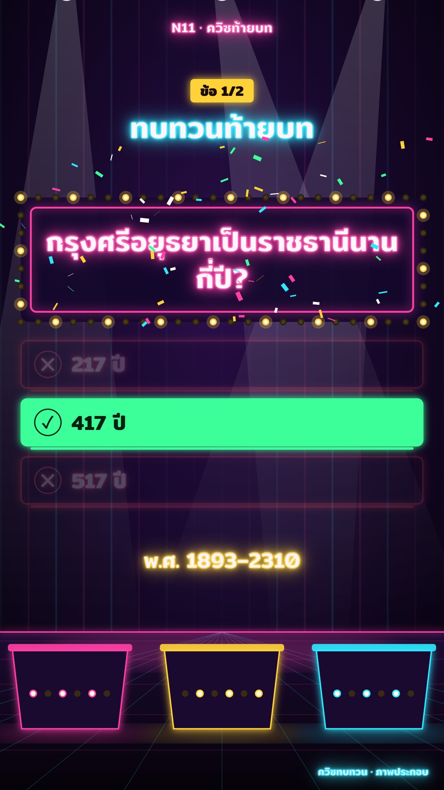

# N11 ควิซท้ายบท · Neon Game Show

**Look name:** เกมโชว์นีออน · Neon Game Show
**Fits:** end-of-chapter recap, "guess before I tell you" moments, retention breaks in long videos, quiz shorts ·
**Formats:** 9:16 / 16:9 · **Code:** `Demo.tsx` + `kit/Neon.tsx`

## Look

A TV game-show set at night. A **dark stage**: deep violet back wall with faint pink/cyan LED slats, three
spotlights hanging from the rig sweeping slowly, a glossy floor with a pink edge line, perspective grid lines and a
pink reflection glow, and **contestant podiums** on the floor (three on 9:16: pink, yellow, cyan; two on 16:9) with lit fronts, light caps
and blinking bulb rows. Centre stage: the **question board**, dark glass with a pink **neon tube** inset and a ring of
**marquee bulbs** that chase around it. The question is neon-tube lettering (white-hot core, pink glow); a yellow
bulb plate says "ข้อ 1/2" and the round title glows cyan. Options are **lit podium panels** with a neon outline, a
lettered circle (ก ข ค ง) and a light strip under each. The countdown is a big yellow neon digit inside a **ring of
bulbs** that switch off one by one. On the answer: a **buzzer flash**, the right panel blazes solid green with a
dark ✓, the wrong ones short out to red and dim, the board's bulbs blink all at once, **confetti** bursts, and the
explanation lights up in yellow. The label "ควิซทบทวน · ภาพประกอบ" glows small in the corner.

| Role | Hex |
|---|---|
| Stage black · violet depth | `#07030f` · `#140726` (wall centre `#2a0f4a`) |
| Neon pink (board tube, question, floor line) | `#ff3fa6` |
| Neon cyan (title, options, grid) | `#2ee8ff` |
| Bulb yellow (marquee, countdown, explanation) | `#ffd23a` (lit core `#fffbe0`) |
| Right · wrong | `#3dff9a` · `#ff4d5e` |
| Text (tube core) | `#fff2fa` |

**Type:** Mitr 600 (700 for the countdown and plates). Kicker 30 px pink neon, round plate 30 px on yellow, title
66 px cyan neon, question 60–62 px pink neon, options 44 px, countdown 96 px, explanation 46 px — at 1080 on the
short side (×1.12 on 9:16). Neon = white core + `text-shadow` 3/9/20/42 px in the tube colour + a 1.2 px stroke.
**Line:** neon tubes 3–4 px with drop-shadow glow; bulbs 6–7 px with a halo.

## Motion signature

- **Flicker:** every tube strikes on with a 16-frame on/off pattern (staggered per element: board, question, each
  option 6 frames apart, the digit), then holds with rare 3-frame dips. Wrong options short out (flicker 10 frames,
  then 22 %).
- Marquee bulbs chase: every 3rd bulb lit, stepping every 3 frames (every 2 after the answer); at the buzzer all
  bulbs blink together for 20 frames. Podium bulbs alternate every 4 frames; spotlights sweep ± 14°.
- Countdown: the bulb ring drains with time, the digit changes each second (`SFX.tick`), `SFX.riser` 2 s before.
- Answer (`SFX.hit` + `SFX.pop`): 8-frame white-pink flash, right panel pops (spring, damping 9), confetti for 90 frames.

## Scenes in the kit (`kit/Neon.tsx`)

| Component | Shows | Props |
|---|---|---|
| `StageBackdrop` | Stage wall, LED slats, sweeping spotlights, glossy floor + grid, three podiums | — |
| `ShowHeader` | "ข้อ n/of" bulb plate + neon round title | `n, of, title, start, top` |
| `QuizShow` | Board with chasing bulbs, neon question, podium options, bulb-ring countdown, flash, confetti, explanation | `question, options, answer, start, reveal, end, explain, top` |
| `NeonText` | Neon-tube lettering that flickers on | `color, on, size, seed` |
| `Bulbs`, `Confetti` | Marquee bulb rectangle; deterministic confetti burst | `x, y, w, h, gap, r, frame, fast, all` / `at, n` |
| `flick`, `glow`, `useU`, `NE` | Flicker curve; neon shadow; size unit; palette | — |

## Build notes

One question per beat, 2–4 options (≤ 14 characters each), the question ≤ 2 lines. Countdown at least 3 s; the
answer explanation ≤ 24 characters. Keep the board centred above the floor line; on 16:9 options go in two columns.
Inside a long episode, use the stage only for the quiz break (cut to it and back), not over a map.

## Don'ts

- No paper textures, flat cartoon panels, rounded news cards or navy dashboard glass.
- Do not use real show names, logos or a real host's catchphrase; the set is generic.
- Do not let neon colours code sides of a story; colour here only means state (pink question, cyan option, green
  right, red wrong, yellow timer).
- Keep flicker short and rare after the strike-on: no constant strobing.

## Credits

None for pictures: everything is drawn in code. Sound: template UI sounds (`npm run sfx`). Font: Mitr (SIL Open
Font License).
